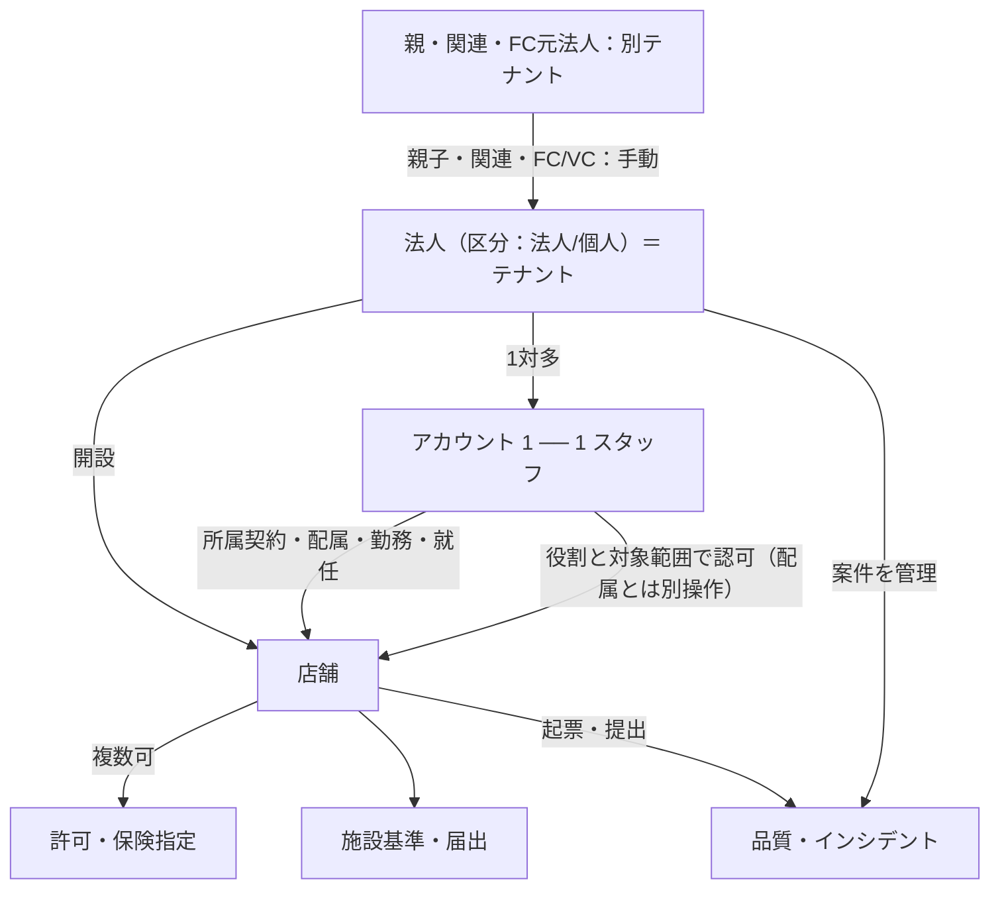

# 組織・基盤

対象ドメインの一覧は [ドメイン一覧](../domain-candidates.md) を参照。用語および履歴管理の原則は [用語・履歴と領域間の受け渡し](organization-contracts.md#用語) で定義する。

## 全体の関係

個人開設者もモデル上は「法人」（区分：個人）として統一的に扱い、1法人＝1テナントとする。アカウントとスタッフはテナント内で必ず1対1とし、人事・シフト上の配属とシステム上の閲覧・操作権限（RBAC）は完全に別操作として管理する。

## 文書と責務

- [組織と薬局の全体構造](organization.md): 法人・店舗・許認可・保険指定・スタッフの全体関係と組織変更シナリオ
- [法人と法人間の関係](corporate.md): 法人（法人/個人区分）の識別、法人間関係（親子・関連会社・FC/VC契約）と履歴
- [店舗](store.md): 店舗の識別、物理拠点（緯度経度・設備含）、屋号、営業日時・休日輪番、開設者関係、営業状態、開設許可・麻薬小売業免許・保険薬局指定
- [スタッフ](staff.md): スタッフとアカウントの1対1対応、雇用等の契約区分、店舗配属、勤務予定・実績、保険薬剤師資格、管理薬剤師の就任・専任要件
- [施設基準・届出](facility-compliance.md): 要件の版、根拠実績、報酬上のグループ判定（`GroupAssessment`）、R8基本料連動制約、地域支援加算維持要件、届出・適用期間
- [テナント・アクセス管理](tenant-access.md): 法人単位のテナント分離、RBAC認可、M&Aデータ承継・移行、開設者別設定
- [用語・履歴と領域間の受け渡し](organization-contracts.md): 用語定義、正本の所有領域、半開区間とバイテンポラル履歴ルール
- [共通の詳細論点](cross-cutting-issues.md): 店舗同一性、報酬上の同一グループ判定アルゴリズム、データ承継と閲覧境界、法定保存ポリシー
- [インタラクティブ図解 (HTML)](diagram.html): 組織・基盤のモデル構成図、店舗状態遷移、M&A・異動ケース別影響ビュー

なお、[品質・インシデント](../05-pharmaceutical-care/quality.md) は発生源となる臨床記録に直結するため `05-pharmaceutical-care` に配置し、管理主体（発生店舗の開設法人）およびテナント境界のみ本領域と連携する。
