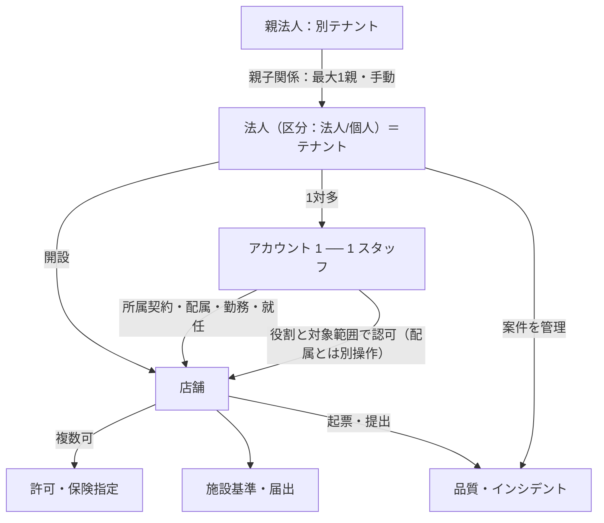

# 組織・基盤

状態: 相談用のモデル案。対象候補は [ドメイン候補一覧](../domain-candidates.md) を参照。まず基本の関係を読み、その後に各領域の操作・履歴・具体例を確認する。用語は [用語・履歴と領域間の受け渡し](organization-contracts.md#用語) で定義する。

## 全体の関係

線は業務上の関係を表す。個人開設者もモデル上は「法人」（区分：個人）として統一的に扱い、1法人＝1テナントとする。アカウントとスタッフはテナント内で必ず1対1とし、配属・雇用と店舗の閲覧・操作権限は完全に別操作として管理する。

## 文書と責務

- [企業・企業グループ](corporate.md): 企業の識別、企業グループへの所属、企業間関係と履歴
- [店舗](store.md): 店舗の識別、拠点、屋号、開設者関係、営業状態、許可・指定
- [スタッフ](staff.md): 人の識別、雇用等の所属、配属、勤務、資格、役割
- [施設基準・届出](facility-compliance.md): 要件の版、根拠実績、判定、届出、適用期間
- [品質・インシデント](quality.md): 報告、調査、対応、改善と確認
- [テナント・アクセス管理](tenant-access.md): 法人単位の分離、利用範囲、アカウント、認可、承継・移行
- [用語・履歴と領域間の受け渡し](organization-contracts.md): 用語の定義、情報の所有先、共通の履歴ルール
- [共通の詳細論点](cross-cutting-issues.md): 承継、期間、報酬上のグループ判定、データ承継等
- [組織と薬局](organization.md): 初期の検討資料（更新しない）

## 最初にたどる例

法人Aが薬局X・Yを開設し、スタッフPがXに配属されYへ応援する。Xの施設基準に使う勤務実績と、Pが閲覧できる患者情報は別々に判断する。その後Xを法人Bへ譲渡するとき、開設者・雇用等・配属・権限・届出をそれぞれ確認する。

## 検討の順序

1. 企業・店舗の基本情報と関係を確認する。
2. スタッフの所属・配属・勤務を確認する。
3. 施設基準と品質管理が必要とする実績・記録を確認する。
4. 利用者がどの対象に何をできるかを確認する。
5. M&A等の変更例で、履歴と領域間の引継ぎを確かめる。

制度上の要件・保存期間・例外条件は未確定。各文書の具体例はモデルの確認用であり、制度適合の判定ではない。関連作業: [文書整備 Issue #2](https://github.com/SatohaCC/pharmacy-domain/issues/2)。
