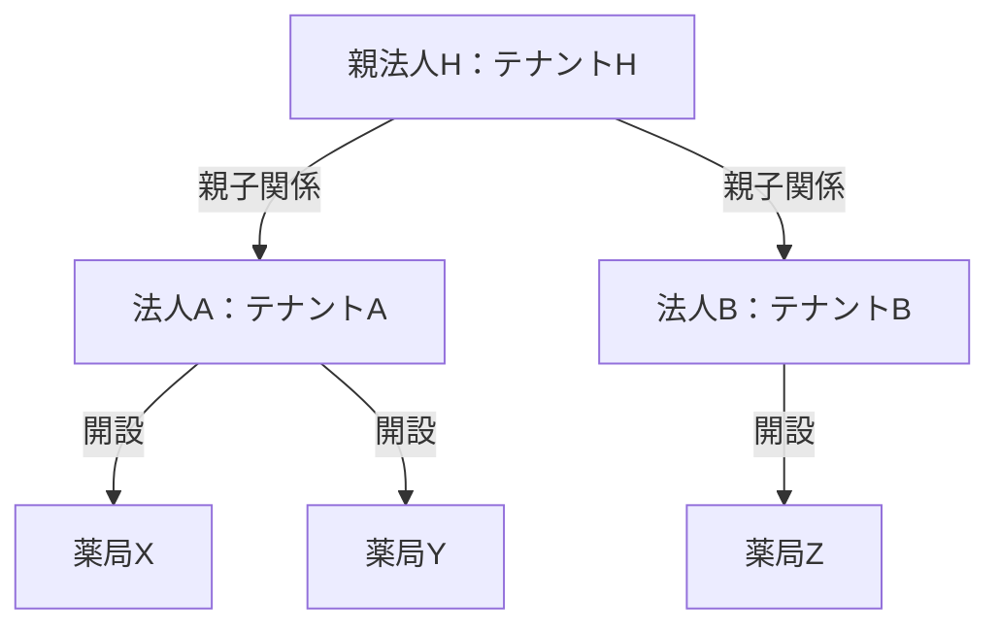

# 法人と法人間の関係

## 確認済みの方針

- 管理の基本単位は「法人」（区分：`法人` / `個人`）とし、1法人＝1テナントとする。個人開設者もモデル上は「法人」（区分：個人）として統一的に扱う。
- 法人同士の親子関係を管理する。親法人と子法人は別テナントとする。
- 親子関係は**最大1つの親（単一親）**とし、管理者が確認して手動で登録・終了する（実質的に法人グループを表現するため）。個人区分では法人番号や親子関係を持たない。
- 法人間の関係は現段階では親子関係のみ。業務提携・FC・関連会社の関係管理は対象外とする。
- 「アイン全体の中にさくら薬局グループ」のような独立した企業グループの階層は設けない。

以下の情報項目・操作の詳細は相談用のモデル案。用語は [用語・履歴](organization-contracts.md#用語) を参照する。

## 基本の関係

親法人も一つの法人として識別する。店舗を開設しない持株会社等も登録できる。親子関係を登録しても、子法人の薬歴閲覧権限や店舗の開設者は変更しない。関係図への法人登録とシステム利用の開始を区別する。

個人開設者も「法人」（区分：個人）として同じ正本で管理し、1個人＝1テナントとする。品質の報告もその法人（個人区分）が管理する。個人開設から法人開設へ切り替える（法人成り）場合は、新設法人への店舗譲渡（データ承継）として扱う。

## 管理する情報の案

| 対象 | 情報の候補 |
| --- | --- |
| 法人 | 法人ID、区分（法人/個人）、法人名（個人の場合は氏名等）、法人番号（法人のみ）、所在地、存続状態 |
| 親子関係 | 親法人（最大1つ）、子法人、適用期間、根拠メモ、確認状態 |

旧案の独立した企業グループID・グループ所属は、現在の基本モデルに含めない。報酬上の同一グループは、法人間関係等を材料とする制度上の判定として別途整理する。

## 買収と合併

BがAを買収し、Aが存続する場合は、Aの識別とテナントを維持して親子関係の変更を記録する。Aの店舗X・Yの開設者はAのまま。単なる株式取得を必ず親子関係に分類するとは決めず、関係の根拠を確認する。

AがBへ吸収合併される場合は、消滅法人Aと存続法人Bを区別し、店舗・データ・記録の承継を確認する。過去の業務記録が参照する法人Aを削除しない。

組織変更をまとめる独立した案件は設けず、各情報の変更履歴で追跡する。

## 操作と履歴の案

| 操作 | 記録すること |
| --- | --- |
| 法人登録 | 法人の識別情報、確認根拠。同名だけで統合しない |
| 名称・所在地変更 | 有効期間と訂正履歴。法人IDは維持 |
| 親子関係の登録・変更・終了 | 相手、効力日、根拠、確認状態。過去の関係を保持 |
| 合併 | 消滅・存続法人、効力日、変更根拠を法人の履歴として記録 |

企業は設立からの完全な履歴がなくても登録できる案とする。確認できない期間を推測で埋めない。法人の存続状態とシステム利用状態を区別する。

## 確認する例

Hの子法人Aが薬局X・Yを開設している。別法人BがAを買収した場合、HとAの旧関係を終了し、確認したBとAの新関係を開始する。AとX・Yの識別は維持する。Bの担当者がAの薬歴を自動閲覧することはない。

## 未決事項

- 法人の重複登録の確認方法。

店舗の属性と開設者の切替は [店舗](store.md)、許可・承継・報酬上の判定は [共通の詳細論点](cross-cutting-issues.md)、認可は [テナント・アクセス管理](tenant-access.md) を参照する。
