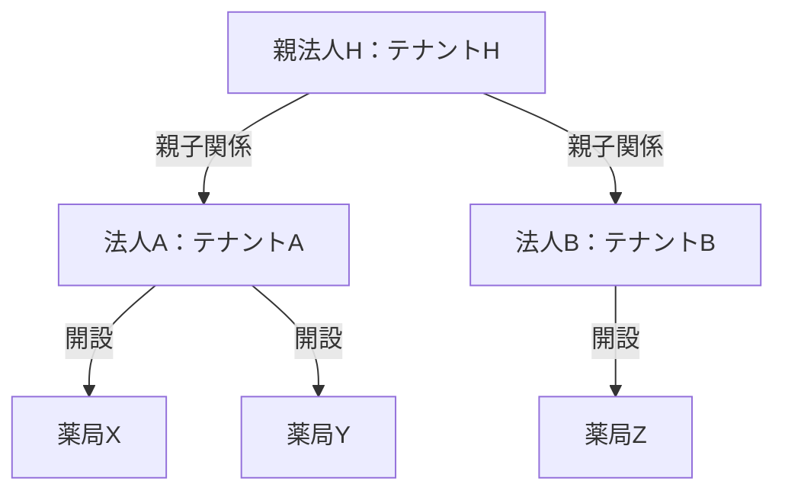

# 法人と法人間の関係

## 基本方針

- 管理の基本単位は「法人」（区分：`法人` / `個人`）とし、1法人＝1テナントとする。個人開設者もモデル上は「法人」（区分：個人）として統一的に扱う。
- 法人同士の関係（`CorporateRelation`）として、**`親子（支配）` / `関連会社` / `FC・VC契約`** の3種別を管理する（実質的な法人グループの表現および報酬算定上の同一グループ判定に用いる）。関係がある法人同士もそれぞれ別テナントとする。
- `親子（支配）` は**最大1つの親（単一親）**とし、多段（親→子→孫）を許容する。`関連会社` と `FC・VC契約` は複数相手を許容する。いずれも管理者が確認して手動で登録・終了し、個人区分であっても同一開設者や役員兼任・実質支配等がある場合は関係登録を許容する（個人区分は法人番号のみ持たない）。
- 業務提携など、報酬上の同一グループ判定に関わらない契約関係は対象外とする。
- 「親グループの中に子グループを置く」ような独立した企業グループ階層や固定グループIDは設けない。

用語の定義は [用語・履歴と領域間の受け渡し](organization-contracts.md#用語) を参照。

## 基本の関係

親法人も一つの法人として識別し、店舗を開設しない持株会社等も登録できる。親子関係を登録しても、子法人の薬歴閲覧権限や店舗の開設者は変更しない。関係図への法人登録とシステム利用の開始を区別する。

個人開設者も「法人」（区分：個人）として同じ正本で管理し、1個人＝1テナントとする。品質・インシデントの報告もその法人（個人区分）が管理する。個人開設から法人開設へ切り替える（法人成り）場合は、新設法人への店舗譲渡（データ承継）として扱う。

## 管理する情報

| 対象 | 保持する情報 |
| --- | --- |
| 法人 (`Corporation`) | 法人ID、区分（`法人` / `個人`）、法人名（個人の場合は氏名・屋号等）、代表者名（個人の場合は開設者氏名）、法人番号（13桁：法人区分のみ）、所在地、存続状態（存続 / 解散 / 合併消滅） |
| 法人間関係 (`CorporateRelation`) | 関係元法人ID、関係先法人ID、関係種別（`親子（支配）` / `関連会社` / `FC・VC契約`）、適用期間 `[valid_from, valid_to)`、根拠メモ（議決権比率・役員兼任・実質支配・契約等） |

報酬上の同一グループは、法人間関係を材料として [施設基準・届出](facility-compliance.md) の `GroupAssessment` で基準日ごとに判定する。

## 買収と合併

- **株式買収（法人存続）**: BがAを買収しAが存続する場合は、Aの法人IDとテナントを維持して親子関係の変更履歴を記録する。Aの店舗X・Yの開設者はAのままとする。
- **吸収合併（法人消滅）**: AがBへ吸収合併される場合は、消滅法人A（存続状態：`合併消滅`）と存続法人Bを区別し、店舗・データ・記録の承継を行う。過去の業務記録が参照する法人Aは削除しない。
- **履歴による追跡**: 組織変更をまとめる独立した案件オブジェクトは設けず、各情報の有効期間付き変更履歴で追跡する。

## 操作と履歴

| 操作 | 記録する内容 |
| --- | --- |
| 法人登録 | 法人の識別情報、区分、確認根拠。同名だけで自動統合しない |
| 名称・所在地変更 | 有効期間と訂正履歴。法人IDは維持する |
| 法人間関係の登録・変更・終了 | 相手法人、関係種別、効力日、根拠メモ。過去の関係履歴を保持する |
| 合併 | 消滅・存続法人、効力日、変更根拠を法人の履歴として記録する |

設立時からの完全な過去履歴が存在しない場合でも確認できた時点から登録でき、未確認の過去期間を推測で埋めない。法人の存続状態とシステムの利用状態を区別する。

## 重複登録ルール

13桁の法人番号を持つ法人区分は番号による重複を確認する。一方、法人番号を持たない「個人区分」や番号確認前の外部法人は重複登録チェックを行わない（一人の個人開設者が複数店舗・複数開設を行うケースを許容するため）。

関連: [店舗](store.md)、[共通の詳細論点](cross-cutting-issues.md)、[テナント・アクセス管理](tenant-access.md)。
