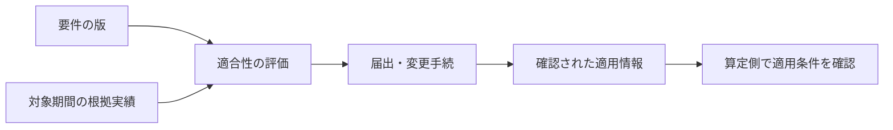

# 施設基準・届出

状態: 相談用のモデル案。具体的な施設基準や算定要件は、一次資料と適用日を確認して追加する。

## 責務

店舗のどの基準について、何を根拠に判定し、何を届け出て、いつから適用するかを追跡する。基準を満たすという内部評価、届出の提出・確認状態、実際の算定可否を分ける。また、法人間関係をもとに評価する**報酬算定上の同一グループ判定（`GroupAssessment`）**の正本を本領域で保持し、算定領域へ渡す。

## 管理する概念

| 概念 | 主な情報 |
| --- | --- |
| 基準・報告の定義 | 識別子、名称、根拠資料、制度版、適用期間（調剤基本料・主要加算・年次の妥結率等報告を同じ枠組みで扱う） |
| 根拠実績 | 元領域、参照先、対象店舗・期間、集計方法の版、確認日時 |
| 外部実績サマリー | 導入直後・譲受時等の過去期間に使う外部集計値の手入力、対象期間、出典メモ |
| 評価・グループ判定 | 基準の版、対象店舗、条件ごとの充足・不足・未確認、判断者、報酬上の同一グループ判定（`GroupAssessment`） |
| 届出・報告 | 種別、提出先、提出日、対象、添付資料、補正・取下げ等の履歴（妥結率等の報告は算出元を他領域に任せ提出内容・状態のみ管理） |
| 適用情報 | 適用開始・終了、確認根拠、確認者、確認状態（行政上の受理通知や公表情報を担当者が手動で確認登録） |

## 操作と履歴

基準の版を登録し、勤務・調剤等の実績を参照して評価する。資料を確定して提出し、補正・変更・終了の経緯を残す。内部で管理する状態の案は「準備中 → 提出済み → 確認済み」。補正中・取下げも表す。これらは行政上の正式な状態名を定義したものではない。

## モデル上のルール案

- 提出時の根拠と資料を固定して参照し、後日の実績訂正で提出内容を黙って変更しない。
- 要件の版、実績の対象期間、適用期間を区別する。
- 未確認の評価を充足として扱わない。提出済みだけでは算定可能としない。
- 元の勤務・処方箋・調剤実績は各領域が管理し、本領域は参照先と使用した集計結果を持つ。
- M&Aや店舗移転時は再確認対象を示す。開設者等の変更履歴だけを理由に、旧店舗の届出を無条件にコピーしない。

## 確認する例

Xが基準Fの届出を準備する。スタッフ領域の勤務実績と調剤側の実績を、期間と版をそろえて集計する。提出後に勤務訂正があったら差異を確認し、必要な再評価・補正を記録する。

## 他領域へ渡す情報と未決事項

算定領域（`04-business`）へは、指定日（調剤日）時点で対象店舗において「確認済み・適用期間内」の施設基準一覧（調剤基本料区分・各種加算の届出状態・`GroupAssessment` 結果）を渡す。`GroupAssessment` は調剤基本料の判定だけでなく、地域支援体制加算（同一グループ以外の薬局・医療機関との連携実績判定）や後発医薬品調剤体制加算等の参照にも用いる。算定側で実績の再集計は行わない。

現時点で施設基準・届出に関する主要な未決事項は解消済み。

関連: [店舗](store.md)、[スタッフ](staff.md)、[共通の詳細論点](cross-cutting-issues.md)。
