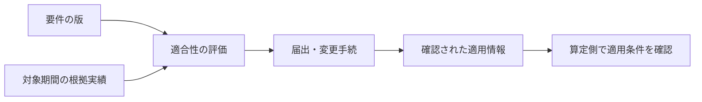

# 施設基準・届出

## 責務

店舗のどの施設基準について、何を根拠に判定し、何を届け出て、いつから適用するかを追跡する。基準を満たすという内部評価、届出の提出・確認状態、実際の算定可否を明確に分離する。また、法人間関係をもとに評価する**報酬算定上の同一グループ判定（`GroupAssessment`）**の正本を本領域で保持し、算定領域（`07-reimbursement-billing`）へ渡す。

## 管理する概念

| 概念 | 主な情報 |
| --- | --- |
| 基準・報告の定義 | 識別子、名称、根拠資料、制度版、適用期間（調剤基本料・主要加算・年次の妥結率等報告を統一フレームワークで扱う） |
| 根拠実績 | 元領域、参照先、対象店舗・期間、集計方法の版、確認日時 |
| 外部実績サマリー | 導入直後・譲受時等の過去期間に用いる外部集計値の手入力、対象期間、出典メモ |
| 評価・グループ判定 | 基準の版、対象店舗、条件ごとの充足・不足・未確認、判断者、報酬上の同一グループ判定（`GroupAssessment`） |
| 届出・報告 (`FacilityStandardNotification`) | 種別、提出先（地方厚生局等）、提出日、対象、添付資料、補正・取下げ等の履歴（妥結率等の報告は算出元を他領域に委ね提出内容・状態のみ管理） |
| 適用情報 | 適用開始・終了、確認根拠（受理通知等）、確認者、確認状態（準備中 → 提出済み → 確認済み、および補正中・取下げ） |

## モデル上のルール

- **提出時点の根拠固定**: 提出時の根拠実績と資料を固定して参照し、後日の実績訂正で提出済み内容を暗黙に変更しない（差異が生じた場合は再評価・補正履歴を記録する）。
- **期間と確認状態の分離・速やかな変更届**: 要件の版、実績の集計対象期間、届出の適用期間を区別する。未確認の評価や「提出済み」段階だけでは算定可能とせず、「確認済み・適用期間内」のもののみを有効とする。管理薬剤師交代や実績変動等により要件に変更が生じた場合は速やかに変更届・辞退届の手続状態を反映する。
- **M&A・移転時の再評価**: 開設者変更や店舗移転時は再確認対象として検出し、旧店舗の届出を無条件にコピーしない。
- **調剤基本料区分と加算・減算の連動制約（令和8年度改定）**:
  - **特別調剤基本料B**（地方厚生局長への調剤基本料届出なし等）：地域支援・医薬品供給対応体制加算、連携強化加算、バイオ後続品調剤体制加算、在宅薬学総合体制加算を算定不可とする。
  - **特別調剤基本料A**：地域支援・医薬品供給対応体制加算（4/5）、バイオ後続品調剤体制加算、在宅薬学総合体制加算1/2は所定点数の `10/100` とする。また、特定の関係医療機関が外来感染対策向上加算または感染対策向上加算を届出している場合、連携強化加算は算定不可とする。
  - **注4（50/100減算）判定**：妥結率5割以下、妥結率・流通改善取組状況の未報告、または保険薬剤師のかかりつけ機能に係る基本的業務を1年間実施していない場合に適用する。
  - **注8（後発品5点減算）判定**：後発医薬品調剤数量割合が5割以下かつ月間処方箋受付回数が600回超の場合に適用する。
  - **調剤ベースアップ評価料（区分40）**：得られた収入は対象職員の基本給・決まって毎月支払われる手当の引上げおよび関連増加分以外に流用不可とする。
- **地域貢献・医療安全・独立性・掲示義務要件（指導指摘 II）**:
  - 地域支援・医薬品供給対応体制加算の維持要件として、PMDAメディナビ登録、プレアボイド事例報告（直近1年以内）、副作用報告手順書整備、研修実施計画・外部学術研修受講、プライバシー配慮設備（独立カウンター等）、敷地内禁煙、要指導/一般用医薬品・48薬効群・緊急避妊薬備蓄、健康相談・健康教室実施等の体制チェック状態を保持する。
  - 保険医療機関との経済的・構造的・機能的独立性（リベート・職員派遣・粗品等による患者誘引禁止）の遵守確認状態を管理する。
  - 薬局内外への掲示および**自局ウェブサイトへの掲載義務項目**（開局時間・夜間休日加算対象時間帯、調剤報酬点数表、届出事項、0円患者を含む明細書無償発行状況と不要申出方法、オンライン資格確認体制、選定療養・保険外併用療養費等）の掲載確認フラグを管理する。

## 他領域へ渡す情報

算定領域（`07-reimbursement-billing`）へは、指定日（調剤日）時点で対象店舗において「確認済み・適用期間内」の施設基準スナップショット（調剤基本料区分・各種加算の届出状態・減算該当有無・`GroupAssessment` 結果）を渡す。`GroupAssessment` は調剤基本料の判定に加え、地域支援・医薬品供給対応体制加算（同一グループ以外の薬局・医療機関との連携実績判定）等の参照にも用いる。算定側で実績の再集計は行わない。

関連: [店舗](store.md)、[スタッフ](staff.md)、[共通の詳細論点](cross-cutting-issues.md)。
