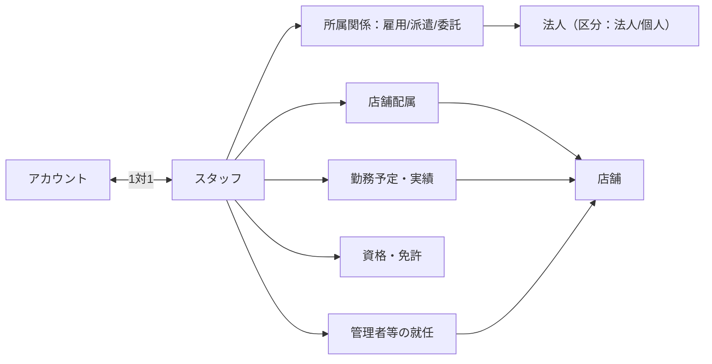

# スタッフ

状態: 相談用のモデル案。給与計算や人事評価の詳細は対象外。

## 責務と関係

スタッフが誰で、どの主体に所属し、どの店舗でどの役割・勤務を担うかを表す。

## 管理する概念

| 概念 | 主な情報 | 区別すること |
| --- | --- | --- |
| スタッフ | スタッフID、所属テナント（法人）、氏名、連絡先、利用状態 | アカウントと1対1だが人物情報と認証主体を区別 |
| 所属関係 | 所属法人（自テナント）、契約区分（雇用・派遣・業務委託等）、期間 | 派遣元・委託元法人はマスタ管理しない |
| 店舗配属 | 店舗、担当役割、主配属・応援等、期間 | 配属と実際に勤務した事実、アクセス権限 |
| 勤務 | 店舗、予定・実績、開始終了、訂正経緯 | 予定をそのまま算定用の実績としない |
| 資格・免許 | 種別、識別情報、確認資料、確認状態、必要な有効期間 | 資格の保有と店舗での就任 |
| 就任 | 対象店舗・施設、役割、就任期間、確認根拠 | 法的・業務上の役割とアプリの操作権限 |

## 主な操作

人物を登録し、資格を確認して所属・配属を設定する。応援は対象店舗と期間を明示する。異動・退職時は該当関係を終了し、勤務や調剤等の過去記録から実施者を参照できるようにする。

スタッフはテナント（法人）内の存在とし、法人をまたぐ共通スタッフIDは設けない。別法人でも働く場合は、それぞれのテナントで別のスタッフ・別アカウントとして登録する。個人開設者（法人区分：個人）自身が薬剤師として店舗で働く場合は、開設主体としての法人情報とは別に、スタッフ＋アカウントとして登録し必要に応じ紐づける。

セキュリティ・監査ログ上の整合性のため、**アカウントとスタッフは必ず1対1**とする。ログイン不要のスタッフ（配送員等）はアカウントのログイン状態を無効にして登録し、店舗に配属されない本部管理者等は店舗配属なしで登録する。

## モデル上のルール案

- 配属期間、勤務時間、就任期間はそれぞれ保持し、期間の意味を混同しない。
- 派遣・業務委託等は自法人との契約区分として記録し、派遣会社等の外部法人は法人マスタに登録しない。
- 同時刻の複数店舗勤務や就任の重複を検出する。訂正・例外の確認結果も記録する。
- 管理薬剤師等の兼務の可否は適用規定と例外を確認して判断する。同じ施設で許可が切り替わっただけの重複は兼務と扱わない。
- 常勤換算は、施設基準等の目的・制度版・対象期間に応じて必要な勤務実績から求める。人物の固定属性にしない。
- **配属とアクセス権限は完全に別操作として管理する**。配属登録だけでは薬歴等を閲覧できず、異動・配属終了時も権限管理側で別途見直す（自動付与・自動剥奪しない）。

## 確認する例

PはA社所属でXが主配属。翌週のみYへ応援する。主配属を上書きせずYの予定・実績を記録する。施設基準へは対象期間の確認済み実績を渡し、Yの閲覧権限は権限管理で別途付与・失効させる。

## 未決事項と確認方法

- **勤務管理システムとの分担**: シフト・勤務実績は本システム内で直接入力・管理できる前提としつつ、必要に応じて外部勤怠システムからの実績取込も許容する。
- **本人照合・資格の確認方法**: 公的API等での自動照合は行わず、管理者が免許証・確認資料を目視確認してシステム上で「確認済み（確認日・確認者）」を手動登録する。

現時点でスタッフ領域に関する主要な未決事項は解消済み。

関連: [店舗](store.md)、[施設基準](facility-compliance.md)、[アクセス管理](tenant-access.md)。
