# スタッフ

給与計算や人事評価は外部システムの責務とし、本ドメインではスタッフが誰で、どの法人テナントに所属し、どの店舗でどの資格・役割・勤務を担うかを管理する。

## 責務と関係

```mermaid
flowchart LR
    U[アカウント] <-->|1対1| P[スタッフ]
    P --> E[所属関係：雇用/派遣/委託]
    E --> C[法人（区分：法人/個人）]
    P --> A[店舗配属]
    A --> S[店舗]
    P --> W[勤務予定・実績]
    W --> S
    P --> L[資格・免許]
    P --> R[管理者等の就任]
    R --> S
```

## 管理する概念

| 概念 | 主な情報 | 区別・制約 |
| --- | --- | --- |
| スタッフ (`Staff`) | スタッフID、所属テナント（法人）、氏名、連絡先、利用状態 | アカウントと必ず1対1対応としつつ、人物情報と認証主体を区別する |
| 所属関係 | 所属法人（自テナント）、契約区分（雇用・派遣・業務委託等）、期間 | 派遣元・委託元の外部法人は法人マスタに登録しない |
| 店舗配属 | 店舗、担当役割、区分（主配属・兼務/副配属・応援等）、期間 | 常時複数店舗への配属や主配属なしの複数店舗勤務を許容。配属と勤務実績・アクセス権限は区別する |
| 勤務予定・実績 | 店舗、シフト（予定）・実績、開始終了日時、訂正経緯 | 1人が日ごと・時間帯ごとに異なる店舗で登録可。予定をそのまま算定・届出用の実績としない |
| 資格・免許 | 種別（薬剤師・保険薬剤師・登録販売者等）、識別情報（保険薬剤師登録番号等）、薬局勤務経験年数、確認資料、確認状態（管理者目視確認日・確認者）、有効期間 | 資格の保有と、特定店舗での管理薬剤師等の就任を区別する |
| 就任 | 対象店舗・施設、役割（管理薬剤師等）、週勤務時間、当該店舗在籍期間、就任期間、確認根拠 | 法的・業務上の役割とアプリケーションの操作権限（RBAC）を区別する |

## 主な操作とテナント境界

- **テナント内エンティティ**: スタッフはテナント（法人）内の存在とし、法人をまたぐ共通スタッフIDは設けない。別法人でも働く場合は、それぞれのテナントで別スタッフ・別アカウントとして登録する。個人開設者（法人区分：個人）自身が薬剤師として働く場合も、開設主体としての法人情報とは別にスタッフ＋アカウントとして登録する。
- **アカウントとスタッフの1対1厳守**: セキュリティおよび監査ログの整合性のため、**アカウントとスタッフは必ず1対1**とする。ログイン不要のスタッフ（配送員等）はアカウントのログイン有効状態を無効にして登録し、店舗に配属されない本部管理者や外部委託者も店舗配属なしのスタッフ＋アカウントとして登録する。
- **勤務管理と資格確認**: シフト・勤務実績はシステム内で直接入力・管理でき、外部勤怠システムからの実績取込にも対応する。資格・免許は管理者が免許証・登録票等を目視確認し、確認済み（確認日・確認者）を登録する。

## モデル上のルール

- **期間と時間の分離**: 配属期間、実際の勤務時間、管理薬剤師等の就任期間はそれぞれ独立して保持し、混同しない。
- **複数店舗兼務・ラウンダー勤務**: 常時2店舗以上で兼務する場合や毎日異なる店舗で勤務する場合でも、期間が重複する複数の店舗配属、および時間帯が重複しない日別・時間帯別の店舗ごとのシフト・勤務実績を登録できる。同時刻の複数店舗勤務実績は重複エラーとして検出する。
- **管理薬剤師の専任・要件ルール（薬機法第7条・28条、指導指摘 II）**:
  - 管理薬剤師は他の薬局で管理薬剤師を兼務できない（同一時点において1店舗のみ。同一施設で許可世代が切り替わっただけの見かけ上の重複は兼務と扱わない）。
  - 地域支援・医薬品供給対応体制加算等の届出店舗における管理薬剤師は、保険薬剤師として**5年以上の薬局勤務経験**、**週32時間以上勤務**、**当該薬局への1年以上継続在籍**を満たさなければならない。
- **店舗別・目的別の常勤換算**: 常勤換算は人物の固定属性とせず、**保健所の届出・登録（薬機法）および施設基準（診療報酬）**等の目的・制度版・対象期間に応じて、**各店舗で期間別の確認済み勤務実績時間から集計・算出**する。
- **配属とアクセス権限の完全分離**: 配属登録だけでは薬歴等を閲覧できず、異動・配属終了時も [テナント・アクセス管理](tenant-access.md) 側で権限を別途付与・失効させる（自動付与・自動剥奪しない）。

関連: [店舗](store.md)、[施設基準・届出](facility-compliance.md)、[テナント・アクセス管理](tenant-access.md)。
