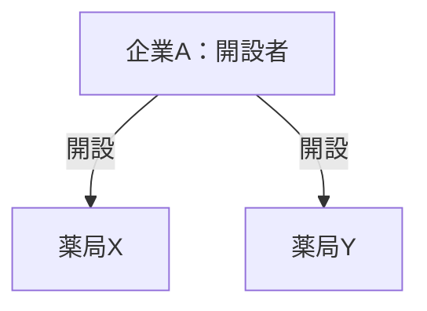
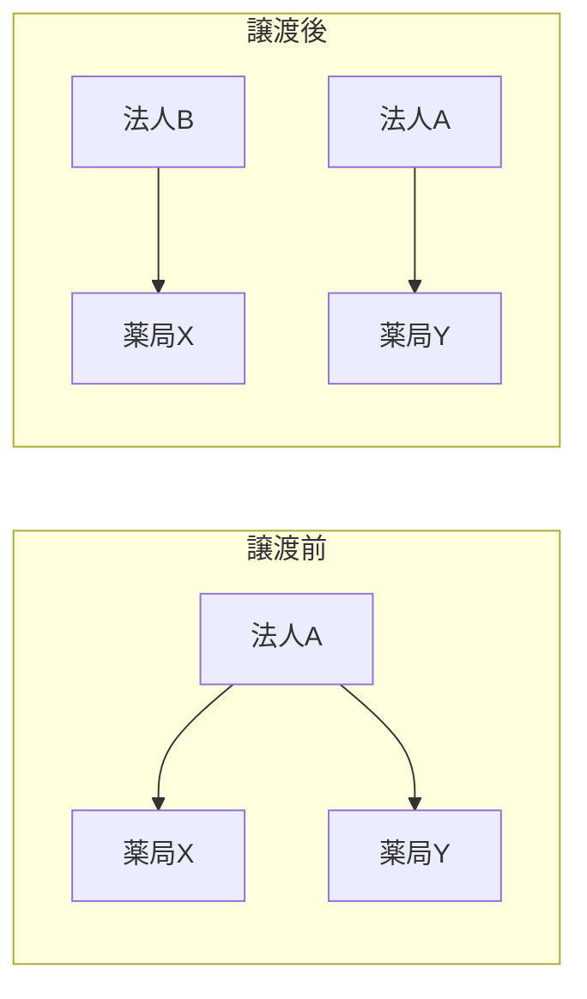
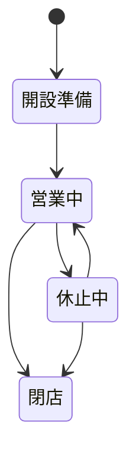

# 店舗

状態: 相談用のモデル案。用語は [用語・履歴と領域間の受け渡し](organization-contracts.md#用語) に合わせる。

## 基本の関係

店舗は、薬局業務を行う単位として識別する。一つの開設者が複数店舗を開設できる。ある時点の店舗の開設者を明確にし、開設者は「法人」（区分：法人／個人。個人開設者もモデル上は法人として扱う）とする。いずれも開設主体ごとにテナントを分ける。開設者と運営担当が異なるケースは想定しない。

## 管理する情報の案

| 対象 | 情報の候補 |
| --- | --- |
| 店舗 | 店舗ID、店舗名、営業状態 |
| 屋号・ブランド | 屋号・ブランド名、店舗への適用期間 |
| 所在地・拠点 | 住所、区画、利用期間 |
| 開設者との関係 | 店舗、開設者（法人：法人/個人区分）、開始日、終了日 |
| 許可・保険指定 | 対象、名義人、番号・コード、適用期間 |

屋号・ブランドは法人と1対1にせず、店舗への適用期間で管理する。店舗IDと許可番号・保険薬局コードを区別する。薬局と併設する販売店舗（店舗販売業など）がある場合は、1つの店舗に複数の許可（薬局開設許可と店舗販売業許可）を紐づけて管理する。移転時は所在地の履歴を持ち、同じ店舗IDを維持するかは運用上の判断（担当者が継続か新規かを選ぶ）に委ねる。

## 店舗の譲渡

薬局Xの事業を法人Aから法人Bへ譲渡する場合、Xの開設者が変わる。薬局YはAのままとする例。

店舗IDを維持するかは運用上の判断（継続か新規か）に委ねる。開設者の変更日と、許可・指定の適用日、システム移行日は分けて扱う。過去の調剤等の記録は当時の開設者・店舗・指定を参照できるようにする。

## その他の変更

- 開設: 店舗と開設者を登録する。
- 名称変更: 店舗IDを維持し、名称の履歴を残す。
- 移転: 拠点を変更し、店舗の継続性と許可・指定の手続を確認する。
- 休止・再開・閉店: 状態と適用日を管理し、過去記録を参照できるようにする。

## 営業状態の案

実世界の営業状態とシステムの入力可否は別にする。閉店後も返戻処理・訂正・保存目的の参照が必要な場合がある。開設準備の中止、過去店舗の取込、閉店後に同じ店舗として再開するかの扱いは追加で検討する。

## モデル上のルール案

- 日付Dで開設者を切り替える場合、旧関係をDで終了し、新関係をDから開始する半開区間で表す。
- 許可は開設者ごとに受ける前提で、同じ店舗の開設者関係を同じ期間に重複させない案とする。重複を検出したら要確認とする。根拠規定は確認して追加する。
- 1つの店舗に薬局開設許可・店舗販売業許可等の複数の許可を紐づけられる。
- 許可・指定の確認状態と、店舗が営業中であるという事実を区別する。登録しただけで制度上の営業可否を判定しない。
- 移転、譲渡、合併で必要な届出・勤務・アクセスの見直しを示し、関係する領域で確認する。

## 他領域に渡す情報

店舗ID、名称・所在地、基準日時点の開設者と営業状態、許可・指定の参照先を提供する。処方箋受付や調剤では実施時点の情報を特定し、後日の変更で当時の表示・主体を失わないようにする。

## 未決事項

営業日・営業時間・連絡先を扱う範囲を決める。

企業グループや買収は [企業・企業グループ](corporate.md) を参照する。患者情報の承継範囲、閲覧権限、保存責任は、開設者を変更するだけで自動決定しない。詳細は [共通の詳細論点](cross-cutting-issues.md) を参照する。
