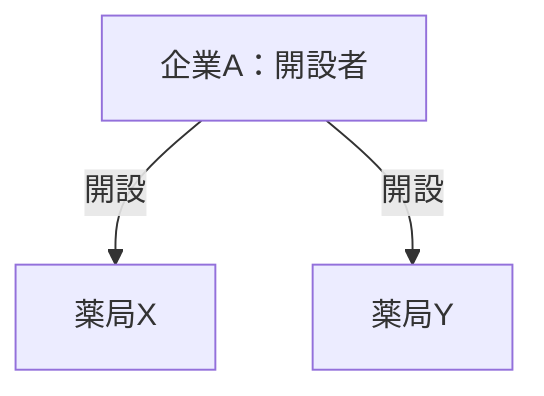
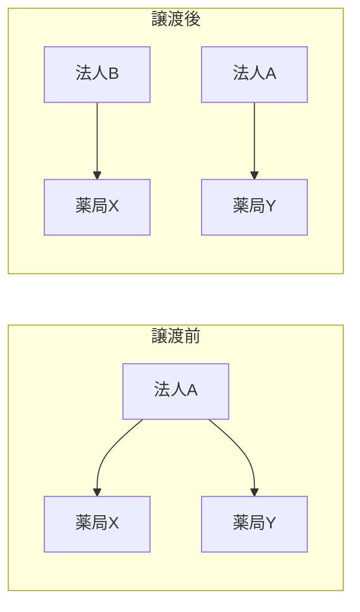
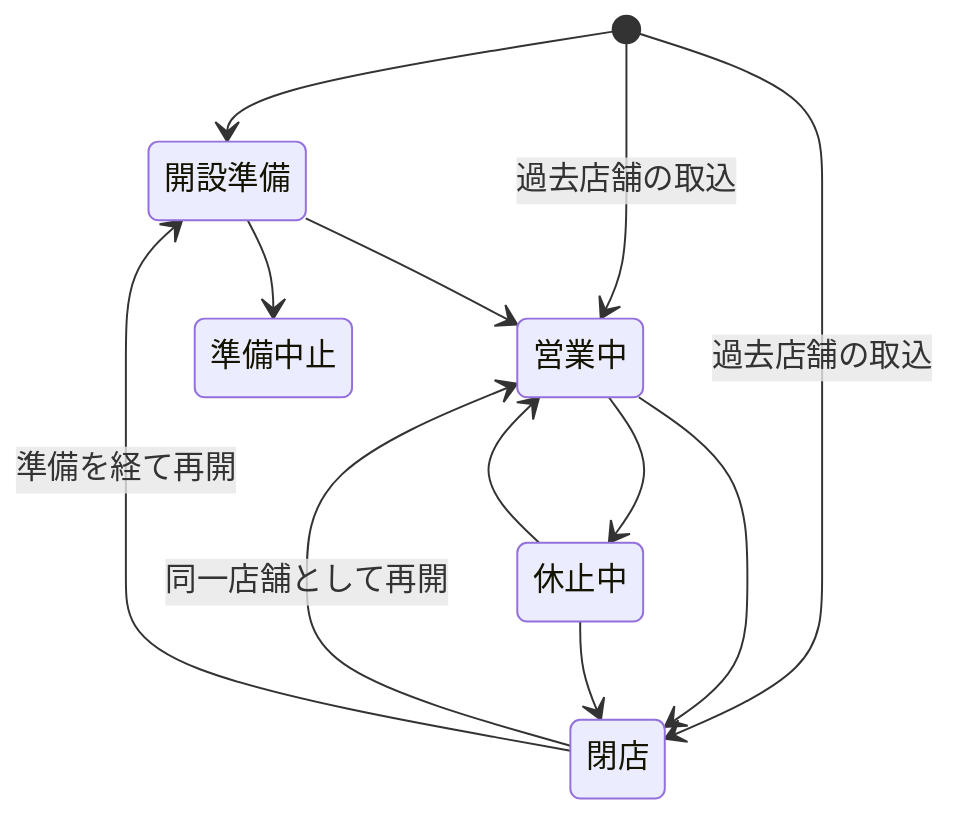

# 店舗

用語の定義は [用語・履歴と領域間の受け渡し](organization-contracts.md#用語) を参照。

## 基本の関係

店舗は、薬局業務を行う単位として識別する。一つの開設者が複数店舗を開設できる。ある時点の店舗の開設者を明確にし、開設者は「法人」（区分：`法人` / `個人`）とする。いずれも開設主体ごとにテナントを分ける。開設者と運営担当が異なるケースは想定しない。

## 管理する情報

| 対象 | 保持する情報 |
| --- | --- |
| 店舗 (`PharmacyStore`) | 店舗ID、店舗名、営業状態 |
| 屋号・ブランド (`Brand`) | 屋号・ブランド名、店舗への適用期間 |
| 所在地・物理拠点 (`StoreLocation`) | 住所、区画、緯度経度、利用期間、プライバシー配慮設備（パーテーション等の独立カウンター）、敷地内禁煙体制、医療機関からの構造的・機能的・経済的独立性確認 |
| 連絡先・営業日時・掲示 | 電話・FAX・メール、曜日別の通常営業時間、日別の特別営業日・臨時休業・祝日例外、休日輪番スケジュール、薬局内外掲示および**自局ウェブサイト掲載確認フラグ**（開局時間・夜間休日加算対象時間帯・調剤報酬点数表・届出施設基準・明細書無償発行状況［0円患者含む・不要申出方法］・オンライン資格確認体制・保険外併用療養費） |
| 開設者との関係 (`StoreOperatorAssignment`) | 店舗ID、開設者ID（法人：法人/個人区分）、開始日、終了日 |
| 許可・保険指定 (`FacilityLicense` / `InsuranceDesignation`) | 許可（種別［薬局開設許可・麻薬小売業免許・店舗販売業許可等］、名義人、発行者［都道府県知事等］、番号、有効期間・有効期限）、保険指定（都道府県コード2桁・点数表区分1桁・機関コード7桁、指定日、適用期間、`predecessor_id`［承継元指定ID］） |

屋号・ブランドは法人と1対1にせず、店舗への適用期間で管理する。店舗IDと許可番号・保険薬局コードを分離する。薬局と併設する販売店舗（店舗販売業など）がある場合は、1つの店舗に複数の許可（薬局開設許可・麻薬小売業免許・店舗販売業許可）を紐づけて管理する。移転時は物理拠点の履歴を持ち、同じ店舗IDを維持するか新規作成するかは運用上の判断で選択できる。

## 店舗の譲渡

薬局Xの事業を法人Aから法人Bへ譲渡する場合、Xの開設者が切り替わる（薬局YはAのまま維持される）。

店舗IDの継続有無は運用判断で選択し、開設者の変更日、許可・保険指定の適用日、システム移行日はそれぞれ独立して記録する。過去の調剤等の記録は当時の開設者・店舗・保険指定を不変に参照できるようにする。

## ライフサイクルと営業状態

- **開設**: 店舗と開設者、物理拠点、許可・保険指定を登録する。
- **名称変更**: 店舗IDを維持し、名称の有効期間履歴を残す。
- **移転**: 物理拠点を変更し、店舗の継続性と許可・保険指定の切替を記録する。
- **休止・再開・閉店**: 営業状態と適用日を管理し、過去記録を参照可能に保つ。

実世界の営業状態とシステムの入力可否は分離する。閉店後も返戻処理・訂正・法定保存目的の参照を可能とする。「開設準備の中止（`準備中止`）」「過去店舗の取込（初期状態を `営業中` または `閉店` として登録）」「閉店後の同一店舗としての再開（`閉店 → 営業中` または `閉店 → 開設準備 → 営業中`）」をすべて扱う。営業日・営業時間（曜日別通常営業時間＋日別例外・祝日・臨時休業）はシフト管理および時間外・休日・深夜加算（「常態として開局している時間帯でないこと」）の判定根拠として保持する。

## モデル上のルール

- **半開区間による開設者切替**: 日付 `D` で開設者を切り替える場合、旧関係を `D` で終了し、新関係を `D` から開始する半開区間 `[valid_from, valid_to)` で表し、同一店舗の開設者期間を重複させない。
- **複数許可の保持と麻薬小売業免許ガード（指導指摘 VI-1）**: 1つの店舗に薬局開設許可・麻薬小売業免許・店舗販売業許可等の複数許可を紐づけられる。店舗に紐づく麻薬小売業免許が有効期限切れ、または未登録の状態では、麻薬の調剤およびレセプト摘要欄（`TK`）への免許番号記載をブロックする。
- **保険薬局指定の承継系譜**: M&Aや移転時の遡及指定・債権分離のため、保険薬局指定に承継元指定ID（`predecessor_id`）を保持する。
- **営業状態と許認可確認状態の分離**: 許可・指定の確認状態と、店舗が営業中である事実を区別する。

## 他領域へ渡す情報

店舗ID、名称・所在地（緯度経度含む）、基準日時点の開設者と営業状態・営業時間、有効な薬局開設許可・麻薬小売業免許番号・保険薬局コードのスナップショットを提供する。処方箋受付・調剤・在宅・算定・請求では実施日時点の情報を特定し、後日の変更で当時の主体や指定コードを失わないようにする。

関連: [法人と法人間の関係](corporate.md)、[共通の詳細論点](cross-cutting-issues.md)。
