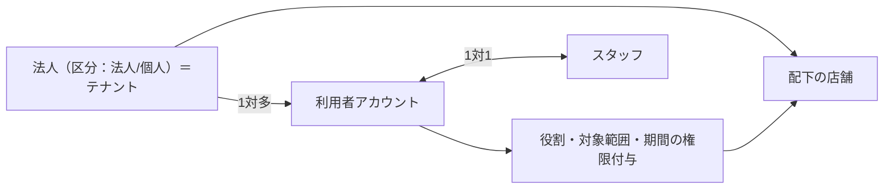

# テナント・アクセス管理

## 基本方針

- **法人＝テナント**: 一法人（区分：`法人` / `個人`）を一つのデータ分離単位とする。独立した契約テナントは設けない。個人開設者も「法人」（区分：個人）として一法人一テナントで管理する。
- **1アカウント＝1スタッフ**: アカウント自体もテナントごとに別とし、1つのアカウントが複数テナントに参加する形は採らない。ログイン主体（アカウント）と人物情報（スタッフ）を分離しつつ、テナント内で常に1対1で対応させる。
- **配属と認可の完全分離**: 企業グループの別法人は別テナントとし、同一法人内でも店舗配属とは完全に独立した RBAC（ロール・対象範囲・有効期間）によって認可する。

## 管理する概念

| 概念 | 主な情報 |
| --- | --- |
| 法人の利用設定 | 対象の法人（法人/個人区分）、システム利用状態（1法人＝1テナント） |
| アカウント (`Account`) | 利用者ID、所属テナント（法人）、認証先の識別、ログイン有効状態、スタッフとの1対1対応 |
| 権限付与 (`RoleAssignment`) | 対象アカウント、ロール（`Permission` の束）、対象範囲（法人全体 / 指定店舗）、有効期間、承認者・根拠（店舗配属とは別操作） |
| 承継・移行 (`DataSuccession`) | 元テナントと先テナント、対象記録集合、利用目的、承認、切替日時、結果・ID対応 |
| 監査記録 (`AuditLog`) | 誰が・いつ・どの店舗/データを・どう閲覧/変更/承認したか、結果（原則物理削除不可） |

## 認可モデル（RBAC）と店舗境界

- **ロールと権限**: 認可モデルは「`Permission` の束である `Role` ＋ 対象範囲（法人全体 / 指定店舗）＋ 有効期間」をアカウントへ付与する形に統一する。本部担当や外部委託者（請求代行・システム保守等）も、1アカウント＝1スタッフ（外部委託者は契約区分：業務委託）の原則に沿って登録し、必要なロール・範囲を付与する。
- **医療情報システムの安全管理ガイドライン（第6.0版）準拠**:
  - **共有IDの禁止と認証強度**: 複数職員でのアカウント共有を禁止し（1アカウント＝1スタッフ）、二要素認証またはガイドライン準拠のパスワードポリシー（英数字記号混在13文字以上、または8文字以上＋2ヶ月以内定期変更等）を強制する。
  - **職種別アクセス制限と代行入力の承認仕組み**: 保険薬剤師と非薬剤師（事務員等）の職種・資格に応じて操作権限を分離し、事務員等による代行入力・下書き操作は保険薬剤師による承認（確定）なしに完了・請求へ進めない仕組みを強制する。
  - **退職者IDの即時失効と監査証跡**: 退職・契約終了時のアカウント無効化や権限剥奪は即時反映とし、アクセスログ・操作業務日誌・バックアップ証跡を物理削除不可で保持する。
  - **年次システム監査・個人情報保護教育訓練の記録管理**: ガイドラインおよび特定共同指導で現物・記録確認が求められる**年次のシステム監査実施記録**および**全職員向け個人情報保護・情報セキュリティ教育訓練の実施記録**（実施日・対象者・保管参照・次回期限アラート）を保持する。
- **緊急時アクセス**: 設けず、通常の権限付与フローで統制する。
- **同一テナント内の薬歴閲覧と追記制限**: 薬歴閲覧権限を持つ利用者は、同じ法人・個人開設者のテナント内で別店舗の同一患者の薬歴も閲覧できる。一方、確定後の追記・訂正は**記録元店舗に限定**し、当該店舗の操作権限を持つ薬剤師のみに許可する。別テナントへの自動共有は一切行わない。
- **フォローアップの店舗間引継ぎ**: フォローアップは同じテナント内の別店舗へ引き継げる。引継ぎ先は自店舗の新しい実施記録として作成し、元店舗の薬歴への追記・訂正権限は付与しない。

## M&A・データ移行

本領域をテナント移行と認可の正本とする。承継の判断基準は [共通の詳細論点](cross-cutting-issues.md#データ承継と閲覧権限) を参照。

- **株式買収（法人存続）**: 法人Aが存続する買収ではAのテナントを維持する。法人が存続したまま契約上の都合だけでテナントを統合する操作は設けない。
- **事業譲渡・吸収合併**: AからBへの店舗譲渡や吸収合併は法人間のデータ承継として扱い、記録作成時のテナント・業務実施主体と現在の保管・アクセス先を区別する（単純な `TenantId` 上書きで原記録の所属・監査履歴を消去しない）。
- **譲渡前実績の遡及修正禁止**: 事業譲渡前のレセプト・調剤実績に対する新法人側からの遡及変更・修正請求は禁止（スナップショット参照のみ）とし、薬歴を承継する場合も患者同意および当時の記載者・責任法人の履歴を保持する。
- **別テナント間の報酬集計**: 同一グループ判定に伴う別テナント間の実績集計では、承認された集計値・出典・対象期間・重複排除情報のみを受け渡し、患者情報の閲覧権限は伴わせない。

## 開設者ごとの薬歴・イベント設定と認可

- **薬歴記載のチェック項目設定**: 開設者（法人：区分 `法人` / `個人`）とイベント種別の組み合わせごとに記載チェック事項を設定する（不足事項がある場合は薬歴確定時に注意を促す）。設定変更権限は本領域の `Permission` で制御する。設定変更は新規イベントから適用し、既存イベントは作成時の設定を維持する。詳細は [薬歴記載](../05-pharmaceutical-care/medication-history.md) を参照。
- **完了後のNSIPS変更時の設定**: 完了後に外部NSIPSの処方・調剤内容が変更された場合、「未完了へ戻す（初期値）」か「完了を維持して変更を表示」かを法人（個人区分含む）ごとに設定できる。未完了へ戻したイベントは、記載修正が不要であれば対象イベントの記録元店舗の操作権限を持つ薬剤師が差分確認を行うことで再完了できる（記載修正を行う場合は確定済み薬歴へ追記・訂正を確定する）。詳細は [受付・相談・フォローアップのイベント](../05-pharmaceutical-care/care-event.md#完了後のnsips変更時の設定と再完了) を参照。
- **イベント間の関連登録・独自イベント種別**: 同じテナント・同じ患者のイベント同士は別店舗でも関連づけられる（関連先への追記権限は増やさない）。また、開設者は自テナントの独自イベント種別を追加・利用停止でき（削除は不可）、これらの管理権限も本領域の `Permission` で制御する。

関連: [スタッフ](staff.md)、[共通の詳細論点](cross-cutting-issues.md)。
