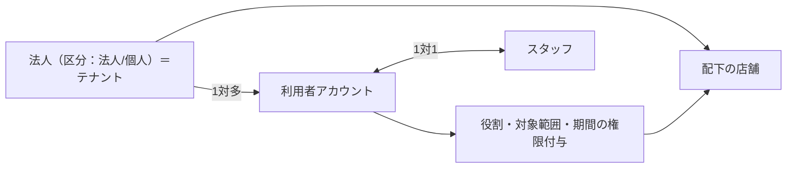

# テナント・アクセス管理

状態: 相談用のモデル案。認証製品やDB構造は未選定。

合意済みの方針: **法人＝テナント**。一法人を一つのデータ分離単位とする。独立した契約テナントは設けない。個人開設者もモデル上は「法人」（区分：個人）として統一的に扱い、一法人一テナントで管理する。

## 区別する対象

法人がテナント境界を持つ。アカウント自体もテナントごとに別とし、1つのアカウントが複数テナントに参加する形は採らない。**アカウントとスタッフは必ず1対1**とし、ログイン主体（アカウント）と人物情報（スタッフ）を分離しつつ常に1対1で対応させる。企業グループの別法人は別テナントとし、法人内でも店舗・職務・目的に応じて認可する。契約・課金情報は必要に応じて検討し、データ分離境界を変えるものとはしない。

## 管理する概念

| 概念 | 主な情報 |
| --- | --- |
| 法人の利用設定 | 対象の法人（法人/個人区分）、システム利用状態。法人とテナントを一対一にする。技術上のID形式は未定 |
| アカウント | 利用者ID、所属テナント（法人）、認証先の識別、ログイン有効状態、スタッフとの1対1対応 |
| 権限付与 | 対象アカウント、ロール（Permissionの束）、対象範囲（法人全体/指定店舗）、期間、承認者・根拠（店舗配属とは完全に別操作） |
| 承継・移行 | 元と先、対象記録、利用目的、承認、切替、結果・ID対応 |
| 監査記録 | 誰がいつ何を閲覧・変更・承認したか、結果 |

## 認可の判断案

フォローアップは同じテナント内の別店舗へ引き継げる。引継ぎ先は自店舗の新しい実施記録として作成する。元店舗の薬歴を追記・訂正する権限が付与されるわけではない。

確認済み: 薬歴を閲覧する権限を持つ利用者は、同じ法人・個人開設者のテナント内で、別店舗の同一患者の薬歴も閲覧できる。店舗の違いだけでは当該閲覧を遮断しない。追記・訂正は記録元店舗に限定し、当該店舗の操作権限を持つ薬剤師が行う。他店舗からは閲覧のみとし、別テナントへの自動共有は行わない。

アカウントの有効性、所属テナント、対象データとの分離境界、操作権限、店舗・職務・目的等の条件を確認する。承継済み記録は承認されたデータ範囲も確認する。必要な条件が不足・未確認なら許可しない。通常の閲覧、集計、権限管理、移行操作を分ける。

## 主な操作

法人（法人/個人区分）と配下店舗を登録し、利用者をスタッフ兼アカウント（1対1）として登録する。本人・役割を確認して権限を付与する。異動・退職・契約終了時には、店舗配属とは別にアクセス権限やアカウント有効状態を見直す。長期の主配属と短期の応援では付与期間を分ける。

## M&A・移行

本書をテナント移行と認可の正本とする。承継の判断（対象記録・利用目的・根拠）は [共通の詳細論点](cross-cutting-issues.md#データ承継と閲覧権限) で扱う。

法人Aが存続する買収ではAのテナントを維持する。AからBへの店舗譲渡は法人間のデータ承継となる。AがBへ吸収合併される場合はBへの承継を確認し、Aの過去の主体情報を保持する。法人が存続したまま契約の都合だけでテナントを統合する操作は設けない。

- 記録作成時のテナント・業務実施主体と、現在の保管・アクセス先を区別する。単純な `TenantId` 上書きで原記録の所属・監査履歴を失わないようにする。
- 移行では、ID対応、参照整合性、対象件数、権限、複製の扱い、切替結果を記録する。
- 移行検証、切替、移行元アクセスの終了、失敗時の復旧を移行履歴として記録する。独立したM&A・組織変更案件やその進捗管理は設けない。
- 移行完了は閲覧許可を自動的に意味しない。

別テナントにまたがる報酬集計は、集計目的と対象期間を承認し、承認された集計値・出典・対象期間・重複排除情報を受け渡す。患者情報の共有権限を伴うとはしない。

## 確認する例

A社のX担当者がYへ応援する。期間限定でYの必要な操作を許可する。応援終了後は権限を失効させるが、その担当者が行った調剤等の記録は残る。後日XがB社へ譲渡された後は、A社の担当者がXの薬歴を閲覧できるのは、保存・請求等の必要性に基づき別途承認された範囲に限る。

## 認可モデルと未決事項の整理

- **ロールと権限**: 認可モデルは「`Permission` の束である `Role` ＋ 対象範囲（法人全体 / 指定店舗）＋ 有効期間」をアカウントへ付与する形に統一する。本部担当や外部委託者（請求代行・システム保守等）も、1アカウント＝1スタッフ（外部委託者は契約区分：業務委託）の原則に沿って登録し、必要なロール・範囲を付与する。
- **緊急時アクセス**: 不要（通常の権限付与のみで対応）。
- **失効反映**: アカウント無効化や権限剥奪は即時反映とし、以降の操作・参照を拒否する。
- **監査ログ**: 原則物理削除不可とし、具体的な保存年数は法人・制度方針に従う。

関連: [スタッフ](staff.md)、[共通の詳細論点](cross-cutting-issues.md)。

## 開設者ごとの薬歴設定

薬歴記載の必須条件は、開設者（法人：区分 `法人` / `個人`）とイベント種別の組み合わせごとに設定する。設定の内容と検証は薬歴領域で扱い、設定を変更できる利用者の認可は本領域の `Permission`（例：薬歴設定変更権限）で制御する。設定変更は新規イベントから適用し、既存イベントは作成時の設定を維持する。詳細は [薬歴記載](../03-clinical/medication-history.md) を参照。

## NSIPS変更時の法人設定

完了後にNSIPSの処方・調剤内容が変更された場合、未完了へ戻すか、完了を維持して変更を表示するかを法人（個人区分含む）ごとに設定できる。薬歴必須事項の設定とは別に扱う。初期値は「未完了へ戻す」（安全側）とし、設定変更後のNSIPS変更受信分から適用する。設定変更権限は本領域の `Permission` で制御する。詳細は [イベント](../03-clinical/care-event.md#完了後のnsips変更時の設定) を参照。

NSIPS変更で未完了に戻したイベントは、記載修正が不要なら差分確認だけで再完了できる。ただし必須事項不足は解消が必要。確認・再完了は、対象イベントの記録元店舗の操作権限を持つ薬剤師なら誰でも行える。元の記載者・確定者に限定しない。他店舗の閲覧権限のみでは操作できない。

## イベント間の関連範囲

同じテナント・同じ患者のイベント同士は別店舗でも関連づけられる。関連先への追記・訂正権限は増やさず、記録元店舗の操作権限を確認する。関連登録・解除の権限は本領域の `Permission` で制御する。

## 独自イベント種別

開設者は自テナントの独自イベント種別を追加でき、その種別の薬歴必須事項も設定できる。他テナントへは自動共有しない。追加・変更・停止の権限は本領域の `Permission` で制御する。

独自イベント種別は利用停止で新規選択を止め、既存イベントと記載を保持する。
