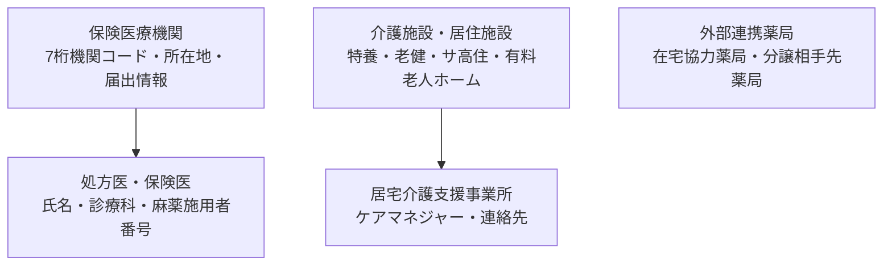

# 医療機関・外部関係者マスタ (`external_parties`)

## 責務と基本方針

処方箋の発行元、疑義照会・トレーシングレポート（服薬情報等提供文書）の送付先、在宅医療の多職種連携先、および医薬品供給不安時の分譲・案内先となる**外部機関・外部専門職の参照マスタ**を管理する。

- **処方箋原記載との分離**: マスタ上の現在値（医療機関名称・所在地・電話番号等の最新情報）と、過去の処方箋や情報提供文書に印字された「当時の記載スナップショット」を区別して保持する。
- **同一グループ・特別関係医療機関の識別**: [施設基準・届出](../01-organization/facility-compliance.md) における特別調剤基本料Aや門前薬局等立地依存減算、連携強化加算の算定可否判定（対象医療機関の外来感染対策向上加算・感染対策向上加算の届出有無等）に必要な属性を保持する。

## 管理する概念

| 概念 | 主な情報 | 設計上のポイント |
| --- | --- | --- |
| 保険医療機関 (`MedicalInstitution`) | 都道府県番号（2桁）、点数表区分（1桁：医科 `1` / 歯科 `3`）、医療機関コード（7桁）、名称、所在地、電話番号・FAX番号、診療科一覧、感染対策向上加算等の届出状態、有効期間 | レセ電 `SH`（処方基本レコード）出力および特別調剤基本料・門前集中率判定の参照元 |
| 処方医・保険医 (`PrescribingPhysician`) | 医師ID、所属医療機関、診療科、氏名、**保険医該当確認フラグ**、**麻薬施用者免許番号**、在宅主治医・連携医区分 | 非保険医から交付された処方箋による保険調剤をブロック（[レセコン入力・連携](../04-prescription-dispensing/reception-entry.md)）。麻薬処方箋監査の参照元 |
| 介護施設・居住系施設 (`CareFacility`) | 施設ID、名称、所在地（緯度経度・直線距離16km判定用）、**施設種別（特別養護老人ホーム［介護老人福祉施設］ / 介護老人保健施設 / 介護医療院 / 有料老人ホーム / サービス付き高齢者向け住宅 / グループホーム等）** | 施設種別により、外来服薬管理指導料3・施設連携加算の対象か、在宅患者訪問薬剤管理指導料／居宅療養管理指導費の対象かが分岐する |
| 居宅介護支援事業所・ケアマネジャー (`CareManagerContact`) | 事業所名、事業所番号、担当介護支援専門員（ケアマネジャー）氏名、連絡先（電話・FAX等） | 居宅療養管理指導におけるケアプラン連携および情報提供文書の送付先 |
| 外部連携薬局 (`PartnerPharmacy`) | 薬局名称、開設者名、所在地、電話番号・FAX、保険薬局コード、薬局開設許可番号、連携区分（在宅協力薬局 / 医薬品分譲・在庫案内先薬局）、同一グループ外フラグ | 在宅協力薬局連携（`調管`/`調時`/`支B`）および供給不安時の他薬局在庫案内（別紙様式4-2）・医薬品分譲（別紙様式4-1）の相手先 |

## モデル上のルール

- **保険医確認と麻薬施用者番号の検証**: 処方箋受付・形式監査において、処方医が保険医であること（保険調剤の場合）、および麻薬処方時に麻薬施用者免許番号が記載されていることを検証する。
- **施設種別による算定区分の厳格分離**: 特別養護老人ホーム（介護老人福祉施設）入所者に対する訪問と、自宅・有料老人ホーム・サ高住等の居住者に対する在宅訪問では算定可能な点数区分が異なるため、`CareFacility` の施設種別を必須属性として管理する。
- **地域支援加算におけるグループ外連携判定**: [施設基準・届出](../01-organization/facility-compliance.md) の `GroupAssessment` と照合し、同一グループ以外の保険医療機関・保険薬局との連携実績（情報提供・分譲等）であるかを識別できるようにする。

関連: [医薬品情報マスタ](medicine-catalog.md)、[施設基準・届出](../01-organization/facility-compliance.md)、[処方箋と処方内容](../04-prescription-dispensing/prescription.md)、[在宅医療・訪問薬剤管理](../06-home-care/home-care.md)。
