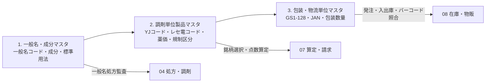

# 医薬品情報マスタ (`medicine_catalog`)

## 責務と基本方針

処方・調剤・服薬指導・報酬算定・在庫・物販の各コンテキストから参照される**医薬品および特定保険医療材料のマスタ情報と有効期間（世代）**を管理する。

- **3層構造の分離**: 処方箋上の指示単位である「一般名／処方銘柄」、調剤・算定上の「調剤単位製品（1錠・1g・1mL等）」、および調達・在庫上の「包装単位（100錠PTP箱・500g瓶・GS1-128）」を明確に分離して対応づける。
- **時点（`as_of`）による版管理**: 薬価改定、経過措置満了、後発医薬品・長期収載品（選定療養対象）区分の変更を有効期間 `[valid_from, valid_to)` で保持し、調剤日時点のマスタ状態を正確に復元できるようにする。

## 管理する概念

| 概念 | 主な情報 | 設計上のポイント |
| --- | --- | --- |
| 一般名・成分 (`GenericDrugConcept`) | 一般名コード、成分名、薬効分類（48薬効群該当有無）、標準用法・標準用量範囲、同効薬グループ | 一般名処方加算・後発品変更調剤・同効薬重複投薬チェックの基準 |
| 調剤単位製品 (`DispensingProduct`) | YJコード、レセプト電算処理システム用コード（9桁：`IY` 出力用）、製品名、規格・単位、剤形区分（内服・湯薬・滴剤・屯服・浸煎・外用・貼付剤・注射等）、製造販売業者、有効期間 | レセ電 `IY` の剤形別用量ルールおよび服用時点同一1剤判定の基礎データ |
| 薬価・選定療養・経過措置 (`DrugPricingVersion`) | 薬価（調剤単位あたり）、適用開始日・終了日、経過措置満了日、先発/後発/バイオ後続品区分、長期収載品選定療養対象区分（後発品最高価格帯との価格差計算用） | 調剤日時点で経過措置切れの医薬品による調剤・請求をブロック |
| 規制・安全管理プロファイル (`DrugSafetyProfile`) | 麻薬・向精神薬（第1〜3種）・覚醒剤原料・毒薬・劇薬・習慣性医薬品・生物由来製品区分、ハイリスク薬（特定薬剤管理指導加算1対象の薬効群）、RMP（医薬品リスク管理計画）患者向け資材有無、投与日数制限（14日・30日・90日上限）、禁忌（疾病・妊婦・授乳婦・年齢・併用）・相互作用データ、温度/遮光等の保存条件（長期保存困難注9の根拠） | 処方監査の自動チェックおよび調剤管理料・服薬管理指導料各加算の適格性判定に直結 |
| 包装・販売単位 (`PackageUnit`) | GS1-128コード（調剤包装単位・販売包装単位）、JANコード（OTC・一般商品）、包装形態（PTP/バラ/瓶等）、入数・単位 | ピッキング時のバーコード鑑査および在庫受払・発注の単位 |
| 特定保険医療材料 (`SpecificMedicalMaterial`) | 特定器材コード（9桁：`TO` 出力用）、名称、規格、所定価格、算定可能要件、適用期間 | インスリン注射針等の保険請求可能な特定器材と、請求不可の衛生材料を厳格に区別 |

## モデル上のルール

- **経過措置満了品の調剤ブロック**: 調剤実施日時点で薬価基準の経過措置期間が満了している医薬品は、保険調剤明細として選択・確定できない。
- **含量規格変更・類似別剤形変更の同等性判定**: 変更調剤時に「同一成分・同一効能効果」「変更後薬剤料が変更前を超えないこと」を判定できるよう、同一一般名配下の規格違い・類似剤形グループと薬価を紐づけて保持する。
- **特定保険医療材料（`TO`）と衛生材料の分離**: 調剤報酬として請求できない衛生材料や容器は `SpecificMedicalMaterial` に含めず、[窓口会計](../07-reimbursement-billing/payment.md) または [商品・物販](../08-inventory-retail/retail.md) 側の品目として分離する。

関連: [医療機関・外部関係者](external-parties.md)、[処方監査・疑義照会](../04-prescription-dispensing/prescription-review.md)、[調剤・鑑査](../04-prescription-dispensing/dispensing.md)、[調剤報酬算定](../07-reimbursement-billing/reimbursement.md)、[調達・在庫](../08-inventory-retail/inventory.md)。
