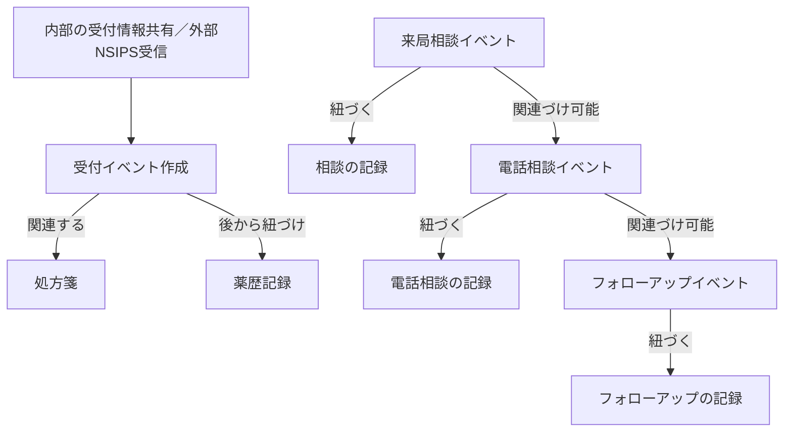
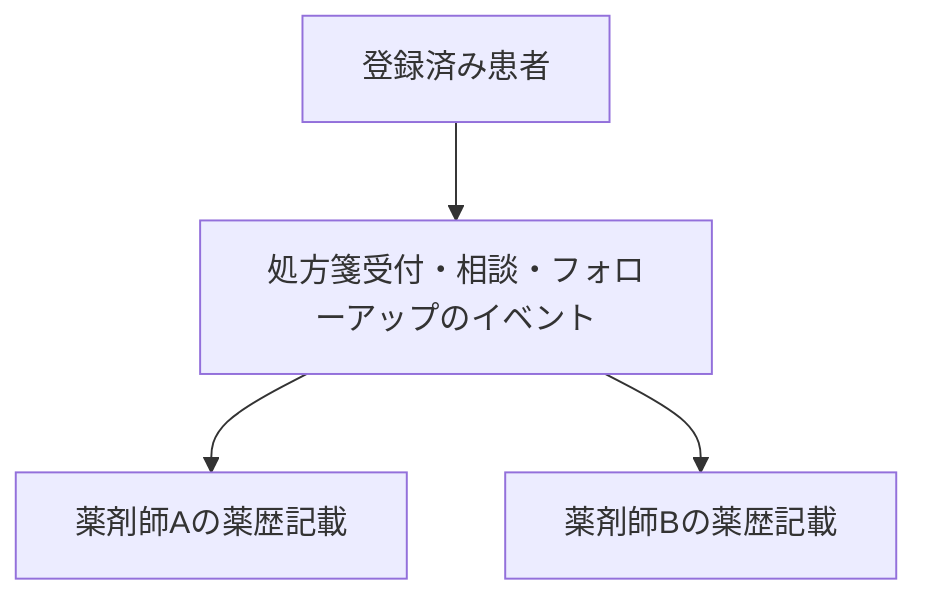
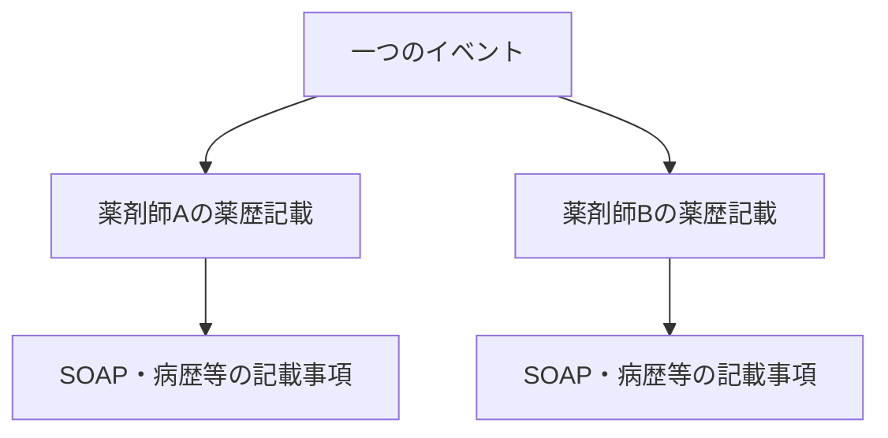
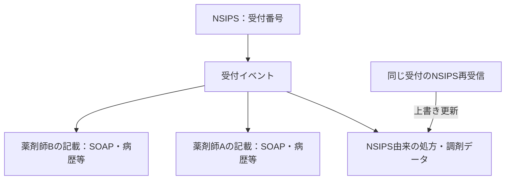
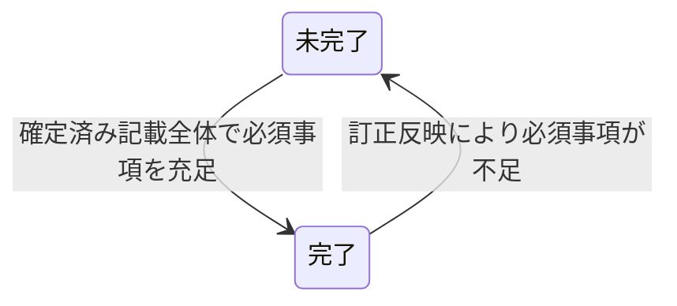

# 受付・相談・フォローアップのイベント

状態: 記録の紐づけ方は確認済み。項目・多重度・操作の詳細は相談用のモデル案。

## 一体型内部と外部連携

一体型内部ではレセコンの受付・処方入力機能から情報を直接共有し、患者配下の受付イベントへ関連づける。イベント作成と後からの薬歴記載という構造は共通とする。NSIPSは外部連携用であり、内部でのイベント作成にNSIPS受信を必須としない。

以下のNSIPS受信・再受信・差分確認の記述は外部連携の場合に適用する。詳細は [内部と外部連携の境界](../external-integration.md) を参照。

## 確認済みの方針

- **患者が入口となり、登録済み患者に紐づけてイベントを作成する。** 処方箋受付・来局相談・電話相談・OTC相談・フォローアップのすべてで患者を必須とする。患者未登録・匿名のイベントは作成しない。

- 処方箋がある場合もイベントを作成し、処方箋との関連を持つ。
- 内部の受付情報共有、または外部NSIPS受信により受付イベントを作成し、記録は後から紐づける。
- 来局相談等もイベントだけを先に作成でき、内容の記載は後から行える。
- イベントの対象は処方箋受付・来局相談・電話相談・OTC相談・フォローアップ等。
- イベント同士を紐づけられる。

処方箋とイベントを二者択一にはしない。処方箋に関する記録も、受付イベントを介して処方箋と対応づける。イベントは受付・相談・支援という業務上の出来事であり、システム内部の通知イベントとは区別する。

線は関連の存在を示す。必須・任意、件数、前後関係の方向を確定する図ではない。

## 患者を入口とする構造

患者を登録・特定してから、その患者についてイベントを作成する。イベント同士の関連も、同じテナント・同じ患者の範囲で設定する。

## 薬歴記載の単位（確認済み）

SOAP・病歴等の記載事項をまとめた一つの薬歴記載を単位とする。SOAPや病歴の各項目を、それぞれ独立した薬歴記載として数えるわけではない。全記載事項が常に必須とはしない。

一つのイベントには複数の薬歴記載を紐づけられる。複数の薬剤師がそれぞれ記載する場合もある。イベント作成直後は薬歴記載がなくてもよい。必須条件は開設者ごとに設定する。イベント種別ごとに必須条件を設定する。

複数の薬歴記載の新規作成と、既存の確定記載への追記・訂正を区別する。記載者・確定者の識別と訂正履歴のルールは薬歴記載ごとに適用する。

## イベント種別の追加

確認済み: **開設者（法人・個人）ごとに独自のイベント種別を追加できる。** 追加した種別にも、その開設者の必須記載事項を設定できる。

処方箋受付・来局相談・電話相談・OTC相談・フォローアップ等の共通種別と、開設者が作る独自種別を区別する案とする。独自種別は作成した開設者のテナント内で使用し、他テナントの種別として自動共有しない。

種別には識別子、名称、所有する開設者、有効状態を持たせる案。独自種別は削除せず、利用停止により新しいイベントを作成するときに選択できなくする。既存イベント・薬歴記載は保持する。名称変更、追加・停止できる担当者、共通種別の変更可否は未決定。種別の追加だけでNSIPSから自動作成する受付イベントの意味を変更するものではない。

### 独自種別の利用停止

確認済み: 使わなくなった独自種別は利用停止にし、新規イベントからの選択を止める。過去に作成したイベント、その種別との対応、薬歴記載を削除しない。停止前に作成した未完了イベントの記載・確定や、停止済み種別の再有効化の扱いは未決定。

### 管理する情報の案

| 概念 | 主な情報 |
| --- | --- |
| イベント | イベントID、種別、対象患者、店舗、発生日時、担当者、登録日時。受付イベントは処方箋・NSIPS受信情報との対応を持つ |
| 記録 | 対応するイベントの参照、記載内容、記載者、下書き・確定・訂正情報 |
| イベント間の関連 | 関連元・関連先、関係の意味、登録者、登録日時 |

イベントは「何が行われたか」、記録は「何を記載したか」を表す案。実施日時と登録・記載日時を区別する。患者は全イベントで必須。日時不明の扱いは未決定。種別の追加は開設者ごとに可能とする。

## NSIPS受付番号とイベント

NSIPS受信による受付イベントも患者配下に作成する。受信データを登録済み患者へ対応づけたうえで、その患者のイベントを作成・更新する。未登録のレセコン患者番号は担当者が候補を確認してから既存患者へ紐づけるかレセコンに登録済みの患者情報を薬歴側へ取り込む。確認前は受信を保留する案とし、患者なしのイベントを作って回避しない。詳細は [患者](patient.md) を参照。

確認済み: NSIPSの受付番号を基に受付イベントを作成する。SOAP・病歴等の薬歴記載はそのイベントに紐づける。同じ受付の再受信では同じイベントを更新する。

再受信では取込データを最新内容へ上書きする。イベントの識別と薬歴記載との関連を維持し、薬剤師が入力した内容・確定情報・追記訂正履歴はそのまま残す。

受付番号が一意となる範囲（店舗、レセコン、日付等）は未決定。受付番号だけを全体で一意なイベントIDとはせず、外部受付の識別と内部イベントの識別を対応づける案とする。

## イベント作成と記録作成

必須事項はイベント種別に応じた開設者設定を使い、イベント内の複数の薬歴記載を合わせて充足を判定する。各記載の確定と、イベント全体の充足状態は区別する。下書きは充足判定に含めず、確定済みのみを使う。必須事項が不足している間はイベントを完了にできない。

NSIPSの受信・受付イベント作成と、薬剤師による記録作成を別の段階とする。イベントに記録がまだなくても登録できる。受信日時を指導等の実施日時として自動採用しない。

確認済み: 同じ受付のNSIPSを再受信した場合は、既存イベントに紐づく取込内容を上書き更新し、受信ごとの新イベントは作らない。イベントの識別は維持し、既存の薬歴記載との関連も維持する。

取込内容は最新NSIPSで自動更新し、差分承認は求めない。薬剤師の薬歴記載・確定情報は上書きせず保持する。受付番号の一意範囲と対応づけの詳細、受信履歴の保存形式・保存期間、取消情報の扱いは別途確認する。

## NSIPS受信履歴と差分確認

確認済み: **上書き前のNSIPSデータも履歴として残し、受信内容の差分を確認できるようにする。** 最新の受信内容で取込データを自動更新する方針は維持する。差分確認は更新前の採用・承認操作を必須にするものではない。

同じ受付イベントについて、各回の受信内容、受信元、受信日時、受信順序と最新として反映した履歴を対応づける案とする。比較対象の内容を再現できる形で保持する。保存形式は未定。

差分表示では、追加・変更・削除された情報を確認できる案とする。比較する履歴の選び方、表示する項目、差分の確認済み管理や通知の要否は未決定。薬剤師のSOAP等は受信履歴とは別に保持する。

## 完了後のNSIPS変更時の設定

確認済み: **完了後にNSIPSの処方・調剤内容が変更された場合の扱いは、法人ごとに設定できる。** 次の二方式を選択する。

| 設定 | 挙動 |
| --- | --- |
| 未完了へ戻す | 最新NSIPSを反映して既存の薬歴記載を保持し、変更確認が必要な未完了状態へ戻す |
| 完了を維持 | 最新NSIPSを反映して既存の薬歴記載を保持し、完了は維持して変更があったことを示す |

必須事項が不足したときに自動で未完了へ戻すルールとは区別する。本設定は、必須事項が満たされていても処方・調剤データの変更確認を求めるかという判断を扱う。「完了を維持」を選んでも、薬歴の訂正で必須事項が不足した場合は未完了へ戻す。

未完了へ戻す設定では、充足しているだけで直ちに自動完了させると変更確認を求められない。記載の修正が不要であれば、差分確認だけで再完了できる。追記・訂正を必須とはしない。必須事項が不足している場合は、確認だけでは完了できない。設定変更の適用時点、差分なしの再送の扱い、初期値、個人開設者にも同じ設定を提供するかは別途確認する。

## NSIPS変更の確認と再完了

確認済み: NSIPS変更により未完了へ戻したイベントは、変更内容を確認し、記載の修正が不要であれば確認だけで再完了できる。追記・訂正の確定を必須とはしない。

完了には、イベント作成時の必須設定を確定済み記載全体で満たしていることも必要。記載不足とNSIPS変更の未確認を別の理由として扱い、差分確認によって不足状態を解消したことにはしない。

確認者・確認日時・確認対象の受信版を保持する案とする。確認は、その受付イベントの記録元店舗の操作権限を持つ薬剤師なら誰でも行える。元の薬歴の記載者・確定者に限定しない。他店舗の閲覧権限だけでは確認・再完了できない。確認対象の後に新しい変更が届いた場合の扱いは未決定。

## 必須設定の適用時点

確認済み: **既存イベントは元の設定を維持する。新設定は変更後に新規作成するイベントから適用する。** 未完了・完了済みのいずれも遡及適用しない。

イベント作成時に開設者・イベント種別に対応する必須設定の版または内容を特定して保持する案とする。後から薬歴記載を作成・確定・訂正する場合も、そのイベントに固定した設定で充足を判定する。設定変更だけで過去の完了状態を変更しない。設定の保存形式は未定。

## イベントの完了

確認済み: **必須事項が不足しているイベントは完了にできない。** 開設者・イベント種別ごとの必須条件について、イベント内の確定済み薬歴記載を合わせて充足を判定する。下書きの内容は含めない。

各薬歴記載はイベント全体の必須事項が不足していても確定できるが、イベントは未完了として残す。記載の確定時にイベント全体の充足を判定し、必須事項を満たせばその時点でイベントも自動完了する。通常の記載完了については別の手動完了操作を設けない。NSIPS変更後の差分確認による再完了は別に扱う。不足が残れば、その記載だけを確定しイベントは未完了のままとする。

確認済み: 訂正の反映で必須事項が不足した場合、イベントを自動で未完了に戻す。再び確定済みの記載全体で満たせば自動完了する。元の記載の確定履歴と過去の完了履歴は保持する。記載の確定情報を取り消すことと、イベントを未完了へ戻すことを混同しない。

訂正の下書き中は未反映の内容を充足判定に使わず、確定した訂正を反映して再判定する案とする。取消操作自体の権限・履歴は未決定。必須設定の変更は既存イベントへ適用しない。

## 権限との関係

### イベント間の関連範囲（確認済み）

同じテナント・同じ患者のイベント同士を関連づけられる。店舗は異なっていてもよい。例えばX店の処方箋受付イベントと、Y店のフォローアップイベントを関連づける。別テナントや別患者のイベントを、この関連として結ばない。

一つのイベントを複数のイベントと関連づけられる。例えば、一回の電話フォローアップで複数回の処方箋受付について確認した場合、そのフォローアップイベントから各受付イベントを参照できる。関連先を一つに制限しない。

関連づけは、相手記録の所属店舗や記載者を変更する操作ではない。関連先の記録の追記・訂正は、その記録元店舗の権限に従う。関連の登録・解除の権限と履歴、関係の意味・方向は未決定。

イベントを関連づけるだけで、相手記録への閲覧・訂正権限を追加しない。同一テナント内の別店舗でフォローアップした場合、その実施店舗に新イベントと別記録を作り、元の情報と関連づける。元の記録の追記・訂正は記録元店舗に限定する。

## 未決事項

- 一つの受付イベントと処方箋・調剤実績との対応件数。
- 薬歴記載の項目構成、イベント種別自体を変更する場合の扱い。
- イベント間の関連の意味・方向・訂正方法。
- 受付イベントからフォローアップイベントへの関連の意味・方向。
- イベントそのものの訂正・取消と、記載内容の訂正の区別。

関連: [処方箋](prescription.md)、[薬歴記載](medication-history.md)、[フォローアップ](follow-up.md)。

### 充足状態の変化

同じテナント内の患者は店舗ごとに複製せず共通で管理する。テナント内で全店舗共通のレセコン患者番号をその患者へ対応づけ、患者の配下に各店舗のイベントを作成する。詳細は [患者](patient.md) を参照。

患者の重複統合に対応する。統合元の患者IDと過去のイベント・薬歴を保持し、統合先から双方を参照できる。統合時に親患者・子患者を選び、新規イベントは親患者へ紐づける。イベント間関連の同一患者判定は別途詳細化する。詳細は [患者](patient.md#重複患者の統合) を参照。

誤った患者統合は取消・分離し、統合前のイベント・薬歴の所属を復元可能にする。統合後に追加したイベントは分離後も親患者に残す。分離で別患者となるイベント間の関連の扱いは未決定。詳細は [患者](patient.md#誤統合の取消と分離) を参照。

患者統合中は親・子を業務上の別患者として使い分けず、一人の患者を入口にイベントを扱う。元のどのレセコン患者番号から受信しても、その統合患者に対して基本情報を更新し、新イベントを作成する。内部の統合元・統合先と過去所属は分離のために保持する。
