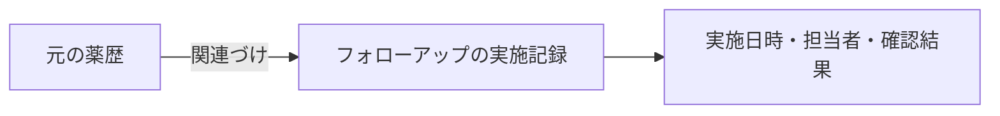
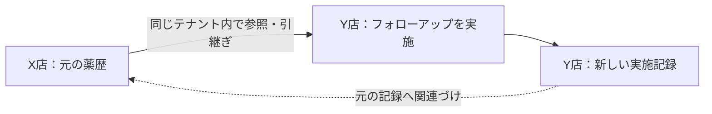

# フォローアップ

状態: 確認済みの記録方針と、相談用の詳細案を記載する。

## 確認済みの方針

**フォローアップの実施結果は、元の薬歴とは別の記録として作成し、元の薬歴と関連づける。** 実施日時・担当者を持つ。元の薬歴への追記だけで経過を表す形にはしない。

**同じテナント内の別店舗でも引き継いで実施できる。** 元の薬歴を参照し、実施した店舗の新しい記録として残す。

## 管理する概念の案

フォローアップは [イベント](care-event.md) として作成し、その実施記録を紐づける。元の薬歴や処方箋がない相談から開始する場合もイベントとして扱える。イベント同士を関連づけられる。処方箋の受付イベントからフォローアップイベントへの関連の具体的な意味・方向は今後確認する。

| 概念 | 情報の候補 |
| --- | --- |
| フォローアップ計画 | 対象患者、目的、確認事項、予定、担当店舗・担当者、元の薬歴の参照 |
| 実施記録 | 記録ID、患者、店舗、担当者、実施日時、連絡方法、確認内容、評価、対応、次回方針 |
| 関連 | 元の薬歴、計画、必要に応じて前回の実施記録 |

計画と実際に行ったことは区別する。予定日時、実施日時、記載日時は別の情報とする。これらの項目と関連の多重度はモデル案であり、個別に確認する。

## 薬歴との関係

元の薬歴は変更せず、新しい実施記録から参照する。元の薬歴の訂正と、新しく確認した事実の記録を区別する。患者の時系列では、元の指導と後日のフォローアップを別の出来事として追跡する案とする。

同一テナント内の他店舗の薬歴は閲覧できるが、その記録への追記・訂正は記録元店舗に限る。別店舗によるフォローアップは元の記録の編集ではなく、実施店舗の新しい記録として扱う。別法人・別個人開設者のテナントへの引継ぎは、この決定に含めない。

## 店舗間の引継ぎ例

Y店の記録にはY店と実施者・実施日時を残し、元のX店の記録は変更しない。引継ぎ先の操作権限は別途確認する。担当変更の承認や、連絡の重複防止の詳細は未決定。

同じテナント・同じ患者であることを条件に、X店の受付イベントとY店のフォローアップイベントを関連づけられる。店舗が異なることだけでは関連を禁止しない。

一回のフォローアップイベントを、複数の受付・相談等のイベントと関連づけられる。確認対象を一つの元イベントに限定しない。

## 記録の確定・訂正

薬歴と同じルールを適用することを確認済み。

- 下書き中は編集できる。記載者と確定者を別々に保持し、記録元店舗の確定権限を持つ別の薬剤師も確認・確定できる。
- 確定後は原記載・元の記載者・確定者を保持する。
- 記録した実施店舗の操作権限を持つ別の薬剤師も追記・訂正できる。
- 追記・訂正した薬剤師本人が確定し、元の記載者の承認は不要。
- 追記・訂正の内容、理由、実施者、記録・確定日時を残す。
- 他店舗からは閲覧のみ。ただし、同一テナント内なら新たなフォローアップを実施して自店舗の別記録を作成できる。

詳細な履歴の考え方は [薬歴記載](medication-history.md) と揃える。

必須事項の設定と充足判定も薬歴と揃え、開設者・イベント種別ごとの設定を使い、フォローアップイベント内の薬歴記載全体で満たす。

## 残る未決事項

- 店舗間の担当変更・引継ぎを誰が設定・承認し、連絡の重複をどう防ぐか。
- 計画を誰がいつ作成し、担当・期限をどう設定するか。
- 連絡不能、再連絡の扱い。
- 元の薬歴がない場合の関連の任意性と、受付イベントとフォローアップイベントの関連の詳細。

関連: [薬歴記載](medication-history.md)、[業務フロー](workflow.md)、[相談記録](../discussion-log.md)。

必須事項の充足判定には、確定済みの薬歴記載だけを使い、下書きは含めない。

フォローアップイベントも、確定済み記載全体で必須事項を満たさない間は完了にできない。各記載の確定と、フォローアップの完了を区別する。

記載確定によってイベント全体の必須事項が満たされれば、フォローアップイベントも自動完了する。別の手動完了操作は設けない。

訂正反映で必須事項が不足した場合はイベントを自動で未完了へ戻し、確定済み記載全体で再び満たせば自動完了する。過去の完了・確定履歴は保持する。

必須設定の変更は新規イベントから適用し、既存のフォローアップイベントは作成時の設定を維持する。引継ぎや後日の記載・訂正でも、そのイベントの設定を使う。

フォローアップも登録済み患者を入口にイベントを作成する。元の薬歴がない場合でも患者への紐づけは必須とし、患者なしのイベントは作成しない。
