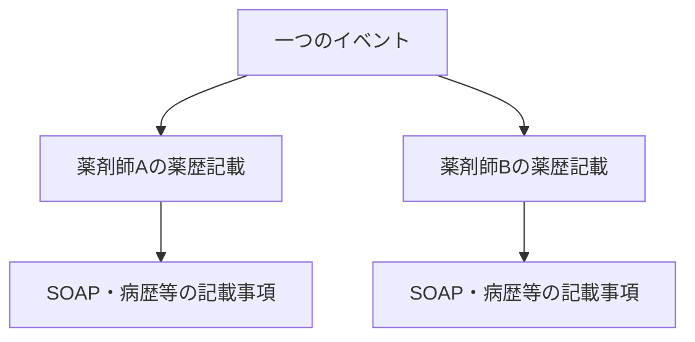
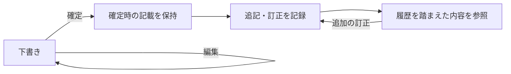

# 薬歴記載

状態: 確認済みの記録方針と、相談用の詳細案を記載する。

## 確認済みの方針

- 下書き中は編集できる。
- 確定後は元の記載を残し、追記・訂正履歴で管理する。
- 誰が、いつ、何を、なぜ訂正したかを残す。
- 薬歴の記載者と確定者を別々に保持する。記録元店舗の確定権限を持つ別の薬剤師も、内容を確認して確定できる。
- 確定後は、別の薬剤師も追記・訂正できる。原記載・元の記載者と確定者は保持し、追記・訂正した薬剤師、日時、内容、理由を別に記録する。
- 同じテナント（同一法人または同一個人開設者）の店舗間では、同じ患者の薬歴を閲覧できる。
- 確定後の追記・訂正は、記録した店舗でのみ行える。他店舗からは閲覧のみとする。記録元店舗の操作権限を持つ別の薬剤師も追記・訂正できる。

- 追記・訂正は、それを行った薬剤師本人が確定する。元の記載者の承認は不要とする。

## 店舗をまたぐ閲覧

薬歴を閲覧できる利用者は、同じテナント内の別店舗が記載した同一患者の薬歴も参照できる。記録した店舗と薬剤師は識別できるように保持する。同一患者の対応づけは、名前の一致だけでは判断しない。

これは別法人・別個人開設者の薬歴を共有する決定ではない。薬歴閲覧の権限を持たない職員への自動付与も行わない。他店舗の記録は閲覧のみとし、追記・訂正は記録元店舗に限定する。

## 薬歴記載の単位（確認済み）

SOAP・病歴等の記載事項をまとめた一つの薬歴記載を単位とする。SOAPや病歴の各項目を、それぞれ独立した薬歴記載として数えるわけではない。全記載事項が常に必須とはしない。

一つのイベントには複数の薬歴記載を紐づけられる。複数の薬剤師がそれぞれ記載する場合もある。イベント作成直後は薬歴記載がなくてもよい。必須条件は開設者ごとに設定する。イベント種別ごとに必須条件を分ける。

複数の薬歴記載の新規作成と、既存の確定記載への追記・訂正を区別する。記載者・確定者の識別と訂正履歴のルールは薬歴記載ごとに適用する。

## 記載事項の必須条件

確認済み: **必須事項の充足はイベント全体で判定する。** 同じイベントに紐づく複数の薬歴記載を合わせて確認し、各薬歴記載にすべての必須事項を要求しない。

例えば、A薬剤師がSOAPの一部、B薬剤師が病歴等を記載した場合、イベント全体で必要な事項を満たせる。各記載の記載者と確定者をそれぞれ保持し、他者の記載を自分の記載へ取り込んで確定する意味ではない。

個々の記載が確定済みかどうかと、イベント全体が必須事項を満たしているかは別の状態として扱う。充足判定には確定済みの記載だけを使い、下書きは含めない。必須事項が不足しているイベントは完了にできない。個々の薬歴記載の確定は可能とし、イベントの完了と区別する。記載の確定によりイベント全体の必須事項を満たせば、その時点で自動完了し、別の完了操作は行わない。訂正反映で不足した場合はイベントを自動で未完了へ戻し、再充足すれば自動完了する。過去の確定・完了履歴は保持する。取消操作と複数記載の内容が矛盾する場合の扱いは未決定。

確認済み: **薬歴の記載事項の必須条件は、開設者（法人または個人）ごとに設定する。** テナント単位の設定とし、モデル共通の一律な必須項目一覧を採用する決定ではない。

SOAP・病歴等のうち、何を必須とするかを開設者が設定する。必須条件は開設者とイベント種別の組み合わせごとに設定する。処方箋受付・来局相談・電話相談・OTC相談・フォローアップ等で、それぞれ必要な記載事項を定められる。開設者が追加した独自イベント種別にも必須条件を設定できる。イベント作成時の設定を維持し、設定変更は新規イベントから適用する。既存イベントの未完了・完了にかかわらず、後日の記載・訂正も元の設定で判定する。設定変更権限と店舗別の追加設定の要否は未決定。

記録ID、記載者、確定日時等のモデルの整合性・監査に必要な情報と、開設者が設定する臨床の記載事項を区別する。開設者設定への適合だけで制度上の記載要件を満たすとは判定しない。

### 情報項目の案

処方箋がある場合も受付イベントを作成し、記録をイベントに紐づけ、処方箋との対応を保持する。来局相談・電話相談・OTC相談・フォローアップ等もイベントに記録を紐づける。NSIPS受信時は先に受付イベントを作り、記録は後から作成できる。イベント同士も関連づけられる。詳細は [イベント](care-event.md) を参照。処方箋のない記録のために架空の処方箋を作らない。一イベントに複数の薬歴記載を作成できる。

| 対象 | 情報の候補 |
| --- | --- |
| 薬歴 | 記録ID、患者、店舗、指導等の実施内容・実施者・実施日時、記載内容、作成者 |
| 確定 | 確定した記載、確定者、確定日時 |
| 追記・訂正 | 対象記録・項目、変更前後の内容、理由、追記・訂正者、記録日時、本人による確定日時 |

実施日時と記載・確定・訂正日時を区別する。履歴の技術的な保存形式は未定。

## 確定の権限

記載者と確定者を別々に識別する。記録元店舗の確定権限を持つ薬剤師が内容を確認し、自分以外の薬剤師の下書きも確定できる。記載者を確定者へ付け替えない。記載者、確定者、確定日時を保持する。

従来の「初回確定は記載者本人のみ」というルールを変更する。確定時の確認内容・理由の必須条件は別途整理する。管理者という役割だけで薬剤師の確定権限を代替せず、他店舗の薬歴を閲覧できることから確定権限を導かない。

## 確定後の追記・訂正の権限

記載者本人に限らず、別の薬剤師も追記・訂正できる。追記・訂正と、下書きの確定を別の操作として扱う。訂正によって元の記載者・確定者を付け替えず、各追記・訂正の実施者が分かるようにする。

薬剤師であることだけで全患者・全店舗の記録への変更操作を許可しない。追記・訂正時は、対象記録の店舗と操作対象の店舗が一致し、当該店舗の操作権限を持つことを確認する。店舗を切り替えただけで権限を得ることはない。追記・訂正はそれを行った薬剤師本人が確定し、元の記載者の承認は求めない。元の記載者の退職後でも、この操作は行える。元の確定情報と追記・訂正の確定情報を分けて保持する。配属・応援・異動時の具体的な権限付与条件は未決定。

## 操作の考え方

確定後に下書きへ戻して原記載を上書きする操作は設けない。現在参照する内容と、確定時の記載・その後の履歴を対応づける案とする。

## フォローアップとの関係

フォローアップの実施結果は元の薬歴への追記ではなく、実施日時・担当者を持つ別記録として作成し、元の薬歴に関連づける。詳細は [フォローアップ](follow-up.md) を参照。実施記録も本書と同じ確定・訂正ルールを適用する。

同じテナント内の別店舗でもフォローアップを引き継げる。新しい記録は実施店舗に帰属し、元の記録の追記・訂正権限を広げるものではない。

## 処方内容との境界

処方内容の登録・訂正は基本レセコン側で行う。薬歴の追記・訂正で、処方や調剤の正本を変更しない。処方の再取込によって確定済み薬歴を自動上書きしない。影響があれば確認し、必要な薬歴訂正を履歴として記録する。

## 未決事項

配属・応援・異動時の操作権限、必須設定の変更権限、取り消し・誤患者への記載の扱い、下書きの変更履歴、記載者不在時の対応手順、フォローアップの計画・進行管理の詳細を確認する。保存期間・監査運用は根拠を確認して別途定める。

関連: [処方箋](prescription.md)、[業務フロー](workflow.md)、[相談記録](../discussion-log.md)。

## NSIPS更新時の記載の保持

NSIPSの受付番号を基に作成した受付イベントに、SOAP・病歴等の薬歴記載を紐づける。NSIPS再受信では取込データを更新し、薬剤師の記載・確定・追記訂正の履歴はそのまま残す。記載の更新が必要な場合は、薬歴側の追記・訂正操作で扱う。
