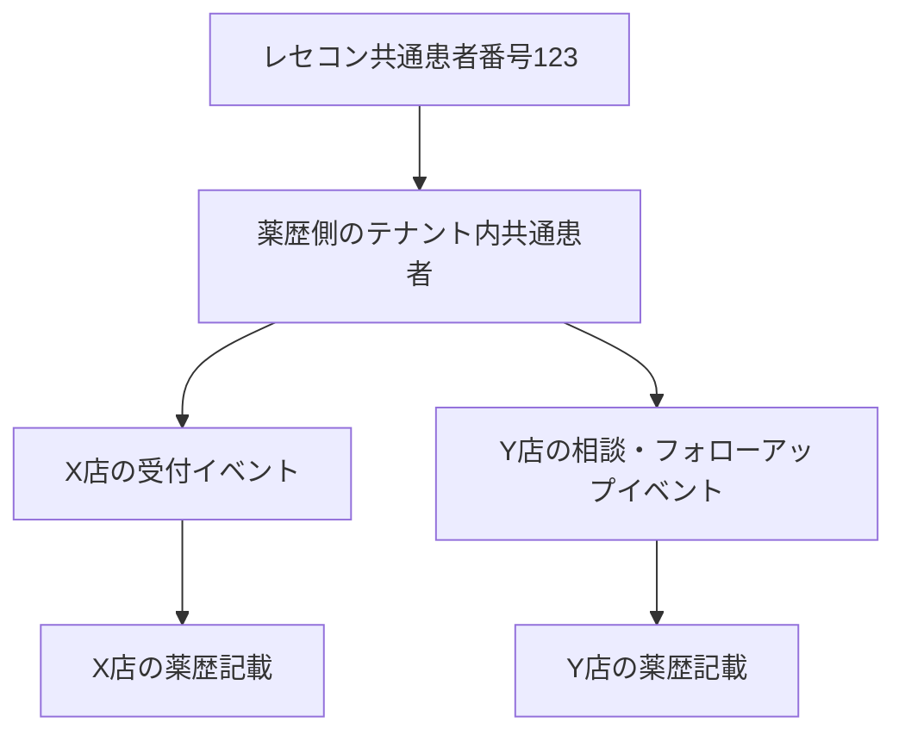
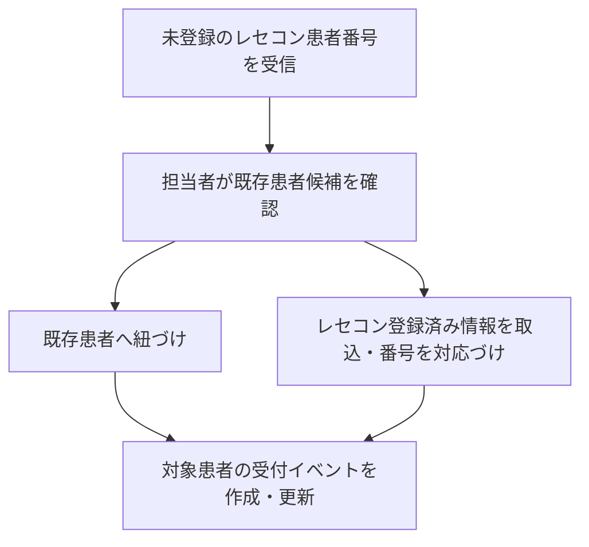
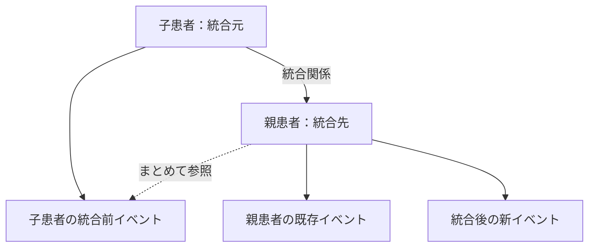
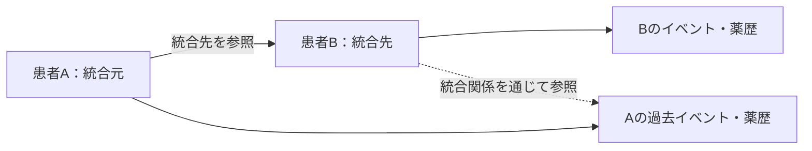

# 患者

状態: 確認済みの管理方針と、相談用の詳細案を記載する。

## 一体型システムの前提

確認済み: レセコンと薬歴の一体型クラウドシステムを想定する。「レセコン側」「薬歴側」は同一システム内の業務機能の区分であり、別製品・別DBを意味しない。

患者管理を共通の責務とし、レセコンの登録機能・薬歴の参照編集機能から同じ患者を扱う構成をモデル案とする。独立した患者マスタ同士の同期や、店舗ごとの更新先選択を前提としない。一体型内部では直接情報を共有する。NSIPSは外部連携用とし、DB・内部通知の具体的な実装方式は未定。

## 確認済みの方針

- 新規患者の登録元はレセコンとする。通常は処方箋入力を契機に登録する。薬歴側から独立した新規患者登録は行わず、レセコンで登録した患者情報を取り込む。

- **レセコン側も薬歴側もクラウドで患者情報を一元管理する。** 同じ管理範囲ではレセコンの患者情報を変更すると薬歴へ反映され、別店舗からも更新後の情報を使う。
- 薬歴からレセコンへの患者基本情報更新は、店舗別の複製への個別配信ではなく、レセコンの共有患者データの更新として扱う。

- 患者を入口にイベントを作成し、そのイベントへ薬歴記載を紐づける。
- 同じテナント（同一法人または同一個人開設者）では、同じ人を一人の患者として管理する。
- レセコン患者番号もテナント内の全店舗で共通とし、薬歴側の内部患者IDへ対応づける。店舗ごとに別番号を持つ前提は採用しない。
- 同一テナント内の店舗間で、同一患者のイベント・薬歴を参照できる。記録の追記・訂正は記録元店舗の権限に従う。

## 管理する概念の案

レセコン・薬歴それぞれの共有患者を対応づける。どの店舗で業務を行ったかは、患者番号ではなくイベントの実施店舗として保持する。

| 概念 | 情報の候補 |
| --- | --- |
| 患者 | 内部患者ID、テナント、氏名、生年月日、連絡先等 |
| 外部患者番号の対応 | テナント、受信元レセコン、共通患者番号、対応する内部患者ID、確認状態・履歴 |
| イベント | 患者を参照する各店舗の受付・相談・フォローアップ |

内部患者IDとレセコン患者番号を区別する。患者番号は同じテナントの全店舗で共通とし、店舗を番号の識別範囲に含めない。異なるテナントの同じ番号を同一患者とは扱わない。

## 新規患者登録の入口

確認済み: 患者の新規登録はレセコン側で行う。処方箋入力が契機になることがほとんどであり、薬歴側は登録済みの患者情報を受信して参照する。患者基本情報の編集を薬歴からレセコンへ送る要求とは別に扱う。

確認済み: 来局相談・電話相談・OTC相談で未登録の患者が来た場合も、先にレセコンの患者登録機能で登録し、薬歴側で参照できるようにしてから相談イベントを作成する。薬歴側だけで匿名・未登録患者のイベントを作る方針には変更しない。

## 外部連携：NSIPS受信との関係

テナントとレセコン共通患者番号の対応から、テナント内の患者に対応づけたうえで、受付番号を基に受付イベントを作成・更新する。患者の対応づけと、受付イベントの識別を別に扱う。

確認済み: **未登録のレセコン患者番号を受信した場合、担当者が候補を確認してから登録・紐づける。** 既存患者なら番号の対応を確認し、新しい患者ならレセコンに登録済みの受信情報を薬歴側へ取り込んで対応づける。薬歴側の操作からレセコン未登録の患者を新規作成する意味ではない。氏名等の一致だけで自動的に同一人物と判断しない。

### 未登録番号の確認フロー

未登録番号の確認前は受信データを保留し、薬歴側の患者データや患者なしの受付イベントを自動作成しない案とする。確認が終わったら、保留した受信内容を対象患者へ反映する。候補の検索条件・表示内容、確認担当の権限、保留中の再受信・取消の扱いは未決定。

既に確認済みの患者番号の対応がある場合は、その対応で受信内容を対象患者へ結びつける案とする。患者基本情報は受信内容で自動更新する。未登録番号に対する患者候補確認と、対応済み患者の情報更新を区別する。

## 重複患者の統合

確認済み: **同じテナント内で重複して登録された患者を、一人の患者へ統合できる必要がある。** 統合元の患者IDと過去の記録を残し、統合先から双方のイベント・薬歴を参照できる形とする。

### 親患者・子患者を選ぶ

統合操作の入口はレセコン側とし、そこで指定した親・子と統合・分離結果を薬歴側へ反映する。以下は両側で維持したい業務上の意味であり、薬歴側に別の統合操作を設ける意味ではない。

**統合中は、業務上はあくまで一人の患者として扱う。** 親・子は統合先の選択と、誤統合時に元へ戻すための内部的な関係を表す。利用者が日常業務で親患者・子患者を選び直して使い分けるものではない。

統合した患者を一つの入口に、基本情報の参照・更新、イベント作成、過去のイベント・薬歴の参照を行う。内部では元の識別と履歴を保持し、代表となる親のIDを使う案とする。

確認済み: 統合操作で**親患者（統合先）と子患者（統合元）を選択する**。親子は統合上の役割を表す用語であり、家族関係ではない。統合後に新しく作成するイベントは親患者へ紐づける。

子患者の既存イベントと薬歴は元の所属を保持し、親からまとめて参照する。新イベントの作成先は親とし、子へ紐づいていた外部患者番号から受信した場合も、統合関係を解決して親へ新イベントを作成する案とする。同じ受付の再受信は、イベントを新規作成するのではなく既存イベントを更新する。

過去のイベント・薬歴の患者IDを一括で書き換えず、統合関係をたどって参照する案とする。各記録の元店舗・記載者・確定履歴も維持する。

統合には対象患者、統合先、実施者、日時、理由・確認根拠を残す案。レセコン共通患者番号が統合後の患者へ到達するよう対応を保つ。氏名等の一致だけで自動統合しない。

統合後の新しいイベントは親患者へ紐づける。基本情報は親の情報を使い、子は元のまま保持する。統合操作の権限は未決定。統合により店舗別の追記・訂正権限を広げない。

## 統合後の基本情報

確認済み: **統合後の患者基本情報は親患者の情報を使う。** 氏名・住所・電話番号等が子と異なる場合も、統合時に子の値を自動採用したり項目ごとに選択したりしない。子患者の基本情報は元のまま保持する。

分離後は、それぞれの患者の基本情報を再び参照する。確認済み: 統合後に親の基本情報を更新・訂正していても、分離時はその更新を親に残し、統合前へ巻き戻さない。分離は統合の紐づけを解除する操作とし、親に対する後日の更新とは分ける。SOAP等の原記載や、受信当時のNSIPS内の患者情報は共通患者の現在値とは区別して保持する。

## 誤統合の取消と分離

確認済み: **誤って統合した患者は分離でき、元の状態へきれいに戻せる必要がある。** 統合前から存在した患者の識別、基本情報、店舗別レセコン患者番号の対応、イベント・薬歴の所属を復元可能にする。

そのため、統合元・統合先それぞれの統合前の情報と対応関係、統合操作の履歴を保持する案とする。統合先の値で統合元の情報を不可逆に消したり、統合だけを理由に過去記録の患者IDを一括変更したりしない。

### 分離時のイベント所属（確認済み）

| イベント | 分離後の所属 |
| --- | --- |
| 統合前から親にあったもの | 親患者に残す |
| 統合前から子にあったもの | 子患者の所属を維持し、親からの統合参照を解除する |
| 統合後に追加したもの | 親患者に残す |

各イベントに紐づく薬歴記載・確定・訂正履歴もそのイベントとともに維持する。分離を理由に記載を複製・移し替えしない。

### 復元対象の案

| 対象 | 分離時に戻したい状態 |
| --- | --- |
| 患者 | 元の患者IDと統合前の利用状態。子は保持していた基本情報を参照し、親は統合後の更新を含む現在の基本情報を維持 |
| 外部患者番号 | 統合前のテナント内のレセコン患者番号と患者の対応 |
| イベント・薬歴 | 統合前に所属していた患者。記載者・確定・訂正履歴も保持 |
| 統合関係 | 誤った統合関係を解除し、取消の実施者・日時・理由を履歴に残す |

復元は統合操作を取り消すためのものとし、統合後のすべての更新を無条件に巻き戻すとは決めない。確認済み: 統合後に追加した新イベントは、分離時も親患者へ残す。子患者への移し替えは、この統合取消では行わない。親の基本情報への統合後の更新も親に残す。統合後に追加された患者番号と、イベント間の関連の扱いは別途確認する。分離そのものの履歴も保持する。

## 外部連携：NSIPSによる患者基本情報の更新

確認済み: **NSIPSに住所・電話番号等の値が含まれない場合、登録済みの値を保持する。** 欠落・未入力を理由に既存値を自動消去しない。明示的に値を削除したい場合の操作・連携上の表現は、未受信と区別して別途決める。

確認済み: **NSIPSで受信した患者基本情報は、差分の採用操作を求めず自動更新する。** 確認済みの外部患者番号の対応で患者を特定してから、氏名・住所等の基本情報へ反映する。初めて受信する番号について候補確認を行う方針は維持する。

受付ごとの受信内容と、患者の現在の基本情報を区別する。患者の現在値が変わっても、過去NSIPSの受信履歴、薬剤師が記載・確定したSOAP等をその値で書き換えない。

統合中はどの対応済みレセコン患者番号から受信しても、一人の患者の情報として扱い、現在の基本情報（内部的には親側）を更新する。元の子番号からの受信も同じ扱いとし、別の子患者を更新する操作にはしない。新イベントも統合した一人の患者へ作成する。

子側の統合前情報は分離のために保持する。受付番号やレセコン患者番号の元の対応は受信履歴とともに追跡できる形にする。共有患者データの更新順序、古い受信データの遅延到着、明示的な削除指定の扱い、直接訂正できる範囲は未決定。

## 一体型システム内の操作分担

| 操作 | 入口と反映 |
| --- | --- |
| 新規患者登録 | レセコンの登録機能。通常は処方箋入力が契機。処方箋なしの相談でも先に登録する |
| 患者基本情報の編集 | レセコン・薬歴のどちらの機能からも変更でき、共有患者の情報として反映する |
| 患者の統合・分離 | レセコンの機能から操作し、薬歴からも同じ結果を参照する |
| 処方・調剤の登録訂正 | 基本的にレセコンの機能から行う。薬歴記載の編集と分ける |

外部レセコンAPIの対応可否や別製品間の同期は、一体型の基本モデルの前提にしない。NSIPSの受信・履歴・差分について先に確認した要件は外部連携用として保持する。一体型内部では共通患者を扱い、NSIPSを必須の受け渡し経路にはしない。

## テナント境界

別テナントに同じ人が登録されても、自動的には共有・統合しない。親子法人の関係も患者共有の根拠にはしない。

患者基本情報は共通の患者管理で扱う案とする。薬歴の臨床情報から現在の患者像・申し送りをどう構成するかは別途確認する。共通患者に紐づけることだけで、元の記録の店舗・記載者・確定情報を変更しない。

## 未決事項

- 候補検索・表示項目、確認権限、保留中の受信処理と再確認条件。
- 統合・分離操作の権限、統合後の患者番号・イベント間関連の分離方法、誤った番号対応の訂正と解除。
- 共有患者データの反映順、明示的な削除指定の扱い、直接訂正の範囲。
- 患者番号の変更・再利用・レセコン入替への対応。

関連: [イベント](care-event.md)、[薬歴記載](medication-history.md)、[テナント・アクセス管理](../01-organization/tenant-access.md)。
