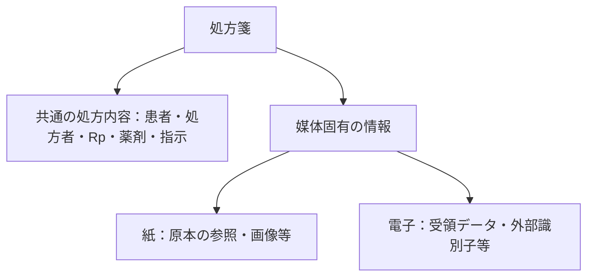

# 処方箋と処方内容

状態: 相談用のモデル案。ユーザーの要望として、処方箋とその記載内容を対象に含める。

確認済みの対象: **紙の処方箋と電子処方箋の両方を扱う**。共通の処方内容と媒体固有の情報を分ける。具体的な項目・識別方法・連携方式は引き続き検討する。

## 入力と情報共有

一体型内部ではレセコンの処方入力・訂正機能で処方内容を管理し、薬歴機能から同じ情報を直接参照する。内部の受け渡しにNSIPSを必須としない。薬歴のSOAP等の記載を編集することと、処方内容の登録・訂正を分ける。

外部レセコン等から受け取る場合は、NSIPS等の連携方式を介して外部情報を業務モデルへ対応づける。外部製品・規格の版・対象項目は未決定。紙・電子の両方を対象とし、媒体と入力・連携経路を区別する。外部データの受信だけで電子処方箋原本を取得・検証済みとは扱わない。

外部機器への送信は [内部と外部連携の境界](../external-integration.md) を参照。

## 外部連携：同じ受付のNSIPS再取込

確認済み: レセコンを登録・訂正元とし、NSIPSを受け取る薬歴側は最新の受信内容で上書き更新する。同じ受付のイベントは維持し、新イベントを作らない。以前の差分確認後に採用内容を選ぶ方針を置き換え、通常の反映に差分承認操作は設けない。

この決定はレセコンから受信したデータの更新方針として整理する。旧受信データは履歴として保持し、差分を確認できるようにする。差分承認で更新を止める方式にはしない。同一受付の識別キー、訂正・取消通知の区別、受信順序の逆転への対応は未決定。

NSIPSの受付番号を基に受付イベントを作り、SOAP・病歴等の薬歴記載はそのイベントに紐づける。薬剤師が入力・確定した記載と追記・訂正履歴はそのまま保持し、NSIPS再受信では上書きしない。受付番号の一意範囲は別途確認する。

## 紙と電子の整理

上図の項目はモデル案。紙の画像や転記データと紙原本、電子の表示・印刷物と受領した電子データを区別する。受領した内容と確認後の構造化データを対応づけ、再入力・取込で原記載を黙って変更しない。法的な原本の扱い、保存要件、外部規格の版は一次資料を確認して定義する。

## 区別したい概念

| 概念 | 主な責任 |
| --- | --- |
| 処方箋 | 発行された文書の同一性と原記載を保持する |
| 処方内容 | 患者に対する薬剤・使用方法等の指示を表す |
| 処方箋の受付 | 店舗が受け付けた出来事と状態を表す |
| 処方内容の変更 | 変更前後、理由、根拠、確認者を追跡する |
| 調剤実績 | 実際に調剤した薬剤・数量等を表す |

発行時の原記載、確認・変更後の指示、実際の調剤結果を対応づける。原記載の転記訂正と、処方者の指示変更も区別する案とする。

## 記載内容の候補

以下は項目を相談するための分類であり、様式や法定必須項目を確定した一覧ではない。

| 単位 | 項目の候補 | 確認したい意味 |
| --- | --- | --- |
| 処方箋全体 | 患者、発行元、処方者、発行日、使用期間、保険等の記載、備考 | 文書に記載された情報と各マスタの現在値の関係 |
| 処方のまとまり（Rp候補） | 用法、日数・回数、共通指示 | 何を一つのまとまりとするか |
| 薬剤明細 | 薬剤名・識別情報、分量、単位、剤形、個別指示 | 一回量・一日量・総量など数量の意味 |
| 変更に関する指示 | 変更の可否、条件、対象範囲 | 処方箋全体・まとまり・明細のどこに適用するか |
| 特殊な取扱い | リフィル、分割等に関する記載 | 元の処方、各受付、各調剤実績との対応 |

薬剤名の自由記載、一般名等による指示と、調剤した具体的製品の識別をどう対応づけるか検討する。数量は値だけでなく単位と意味を扱う。

## 代表的な相談シナリオ

1. 複数薬剤に共通する用法と、薬剤ごとに異なる指示がある。
2. 疑義照会への回答により、用量や薬剤が変更される。
3. 記載された指示に基づき、調剤する具体的製品を選択する。
4. 同じ処方に対して複数回の受付・調剤がある。
5. 読み取れない記載や転記誤りを確認・訂正する。

## 他領域との境界案

- 患者・医療機関は識別先を提供し、処方箋側は受領した記載を保持する案とする。
- 処方監査・疑義照会は評価と確認経緯を担当し、処方内容側から変更の根拠を参照する。
- 調剤は実施結果を担当し、どの版の処方内容に基づいたかを追跡する。
- 算定は処方と実績等を参照する。処方内容だけで請求額が確定するとは仮定しない。

## 次に決めること

- 処方箋、受付、調剤をそれぞれ何で識別するか。
- 紙・電子等の原本、画像、構造化データの関係をどう表すか。
- Rpの意味、指示の適用範囲、数量の表現を具体例で確かめる。
- 変更の承認、履歴、取消をどう扱うか。
- 制度に依存する項目は、対象の様式・制度と適用時点を決めて一次資料を確認する。

NSIPSの過去受信内容は [イベントの受信履歴](care-event.md#nsips受信履歴と差分確認) と対応づけて保持し、最新値への上書き前後を比較できるようにする。

薬歴側からレセコンへの更新要求は患者基本情報に限定し、処方・調剤情報は対象に含めない。
