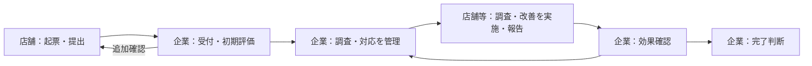

# 品質・インシデント

状態: 相談用のモデル案。

確認済みの運用方針: インシデント・ヒヤリハットは店舗から起票し、その店舗の開設者（法人：区分 `法人` / `個人`）が管理する。以下の担当・操作の詳細はこの方針に基づく案。

## 責務

インシデント・ヒヤリハットの報告から、事実確認、対応、改善、効果確認までを追跡する。**薬局ヒヤリ・ハット事例収集・分析事業への報告をベースとし、同事業へ報告する目的でのデータ登録フォーマットを備える**。患者への対応や処方・調剤記録の訂正は、それぞれの業務領域が担当する。

## 店舗と企業の役割

以下の「企業の管理担当」は法人開設の場合の呼称。個人開設では個人開設者側の担当者に読み替え、同じ受付・対応管理・完了の流れを使う。本人が全操作を行うことは前提にせず、操作する担当者と権限を別に定める。

| 担当 | 操作・責任の案 |
| --- | --- |
| 起票店舗 | 発生・発見の状況、初期対応、関連記録を入力し、企業へ提出する |
| 企業の管理担当 | 受付、初期評価、担当割当、追加確認、対応・改善の進捗管理、効果確認、完了判断を行う |
| 店舗の対応担当 | 企業からの追加確認に回答し、調査・改善を実施して結果を報告する |

企業が複数店舗の案件を管理する。管理担当となることと、関連する患者の薬歴を直接閲覧できることは別に認可する。

### 管理主体

法人が開設する店舗の報告はその法人（個人区分含む）が管理する。親法人を含む他法人へ、親子関係を理由に案件管理・閲覧権限を自動付与しない。管理は当該開設者のテナント内で行う。

- 起票店舗と発生店舗が異なる場合は、**発生店舗（およびその開設法人）**を管理主体とする。
- 店舗譲渡（開設者変更）前に起票された案件は、原則として起票時の旧法人が管理・完了させ、必要な場合のみデータ承継の承認を経て新法人へ引き継ぐ。

## 管理する概念

| 概念 | 主な情報 |
| --- | --- |
| 報告 | 報告ID、起票店舗、発生店舗、管理主体、発生時点、発見時点、報告者、提出日時、概要、確認状態 |
| 関連記録 | 処方・調剤・指導等の参照先、必要に応じた患者参照 |
| 調査 | 確認した事実、未確認事項、原因の仮説と根拠 |
| 対応・改善 | 緊急対応、是正措置、企業側の管理担当、店舗等の実施担当、期限、実施結果 |
| 効果確認 | 確認方法、結果、判断者、残課題 |

## 流れの案

緊急対応は調査完了を待たず実施できる。重複報告・対象外は理由付きで整理し、再発・追加情報があれば再開できる案とする。

## モデル上のルール案

- 報告された内容と調査で確認した事実を区別する。
- 報告者の訂正、調査結果、判断と承認を履歴として残す。
- 下書きと企業へ提出済みの報告を区別する。追加確認時は提出済み内容を保持し、追記・訂正の経緯を残す。
- 起票時点の店舗と管理主体の関係を保持する。店舗譲渡や企業合併で既存案件の管理主体を自動的に変更せず、引継ぎの判断・承認を記録する。
- 報告に記載された調剤内容を変更しても、調剤領域の正本は自動更新しない。
- 患者情報を複製する範囲を抑え、調査担当・店舗管理者・本部等の閲覧範囲を別途設定する。
- 親法人等への報告・傾向集計の共有は別の要求として扱い、今回の管理方針から自動的に追加しない。

## 確認する例

A社の薬局Xで薬剤の取り違えを発見する。Xが初期対応と報告の起票・提出を行う。A社の管理担当が受け付け、調査と改善の担当・期限を設定する。Xが結果を報告し、A社が効果を確認して完了を判断する。調剤領域での訂正はその参照を報告に関連づける。A社の薬局Yに案件の個別内容を自動公開しない。

## 保存方針と未決事項

訂正・追記は履歴付きで保持し、原則として物理削除は行わない（取り下げ・重複統合は状態変更で表現）。具体的な保存年数は法人ごとの運用・社内規程に委ねる。なお、緊急連絡機能および法人側の固定的な完了承認者は設けない。

現時点で品質・インシデントに関する主要な未決事項は解消済み。

関連: [店舗](../01-organization/store.md)、[スタッフ](../01-organization/staff.md)、[アクセス管理](../01-organization/tenant-access.md)。
