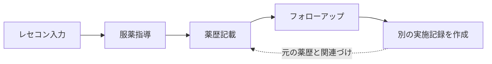

# レセコン入力からフォローアップまで

最新の前提: レセコンと薬歴の一体型クラウドシステム。以下の「側」は同一システム内の業務機能の区分を表す。外部製品間の同期が必須という意味ではない。内部では情報を直接共有し、NSIPSは外部連携用とする。患者マスタの物理配置は未決定。

整理の軸はユーザーが示した次の順番とする。各工程の詳細と外部レセコンとの分担は相談用の案。

## 各工程の役割

| 工程 | 行うことの案 | 次へ渡す情報 |
| --- | --- | --- |
| レセコン入力 | 患者・資格・処方内容等を入力・確認する。連携時は受信データと対象患者・受付の対応を確認する | 対象患者、受付・処方、調剤内容等の参照先と確認状態 |
| 服薬指導 | 患者から情報を得て、説明・確認・評価・薬剤交付を行う | 指導内容、患者の反応、評価、継続確認したい事項 |
| 薬歴記載 | 指導等の情報・評価・計画を記録し、確認・確定する | 確定記録、次回の確認事項、フォローアップ計画 |
| フォローアップ | 対象・予定を管理し、連絡・服薬状況等の確認・評価・必要な対応を行う | 実施結果、未解決事項、次回計画。別の実施記録を作り元の薬歴に関連づける |

## 周辺業務との関係

処方監査・疑義照会・調剤・鑑査は、指導に至る過程で関連する業務として保持する。算定・会計・請求、在庫の更新も関連するが、この4工程だけで薬局業務のすべての順序を定義したとはしない。並行作業や差し戻しの詳細は今後整理する。

レセコン入力は複数ドメインの情報を扱う入口。患者、資格、処方、調剤、算定を一つの記録にまとめることは意味しない。入力するシステムと各情報の正本を決める。

処方入力は基本的にレセコン側で行い、本モデルではレセコンから受領した内容を扱う。特定製品の選定や連携方式は未定。処方内容の登録・訂正は基本的にレセコン側で行い、本モデルは受領内容を確認して反映する。

## 記録と訂正の案

確認済み: 薬歴は下書き中は編集でき、確定後は元の記載を残して追記・訂正履歴で管理する。訂正者・日時・対象・理由を残す。詳細は [薬歴記載](medication-history.md) を参照。

薬歴の記載者と確定者を別々に保持する。記録元店舗の確定権限を持つ別の薬剤師も下書きを確認して確定できる。イベント全体の必須事項の充足判定は確定済みの記載のみを対象とする。

確定後はアクセス条件を満たす別の薬剤師も追記・訂正できる。原記載と元の確定者は維持し、追記・訂正した薬剤師・日時・内容・理由を記録する。追記・訂正は実施した薬剤師本人が確定し、元の記載者の承認は不要とする。

同じテナント内では、別店舗の同一患者の薬歴を閲覧できる。指導・フォローアップ時に過去の記録を参照する。追記・訂正は記録元店舗に限定し、他店舗では閲覧のみとする。

- 指導を実施した時点と、薬歴を入力・確定した時点を区別する。
- レセコンから受信した情報は、同じ受付のNSIPS再受信で最新内容に上書き更新する。
- 再取込時の差分承認操作は設けない。薬剤師が入力・確定したSOAP・病歴等はそのまま残す。旧受信データを履歴として保持し、差分を確認できるようにする。差分確認は自動更新の承認条件にしない。
- フォローアップの予定、実施、連絡不能、再予定を区別する。
- フォローアップは同一テナントの別店舗へ引き継げる。新しい実施記録は実施店舗に帰属させ、元の薬歴と関連づける。
- フォローアップ結果は元の薬歴へ追記するのではなく、実施日時・担当者を持つ別記録として作り、元の薬歴に関連づける。

## 未決事項

レセコン連携の規格・対象項目、再取込時の反映単位、指導中の記録方法、フォローアップの開始条件を確認する。

## 処方箋によらない業務

処方箋の場合も、レセコンから薬歴側へのNSIPS受信で受付イベントを作り、処方箋との対応を持たせ、後から記録を紐づける。来局相談・電話相談・OTC相談・フォローアップも先にイベントを作成し、後から記録できる。イベント同士も関連づけられる。処方箋受付から始まらない業務も扱う。詳細は [イベント](care-event.md) を参照。

## イベントの完了条件

開設者・イベント種別ごとの必須事項を確定済みの記載全体で満たさない間は、イベントを完了にできない。各薬歴記載の確定は可能だが、イベントは未完了のままとする。記載確定により必須事項を満たした時点で、イベントも自動完了する。別の手動完了操作は設けない。訂正反映で必須事項が不足した場合は自動で未完了へ戻し、再充足で自動完了する。過去の確定・完了履歴は保持する。必須設定はイベント作成時に固定し、新設定は変更後の新規イベントから適用する。既存イベントは未完了・完了にかかわらず元の設定を維持する。

NSIPSの受付番号を基に受付イベントを作成し、そのイベントにSOAP等の薬歴記載を紐づける。同じ受付の再受信ではイベントと記載の関連を維持し、取込データのみ最新内容で上書きする。受付番号の一意範囲は別途確認する。

NSIPS変更後の完了イベントの扱いは法人設定に従い、「未完了へ戻す」または「完了を維持して変更を表示」を選べる。必須事項不足による未完了化とは別に、変更確認の状態を扱う。記載の修正が不要なら差分確認だけで再完了できる。ただし必須事項が不足していれば確認だけでは完了できない。

NSIPS変更の確認・再完了は、記録元店舗の操作権限を持つ薬剤師なら誰でも行える。確認者は元の記載者・確定者に限定しない。他店舗からの閲覧だけでは確認・再完了できない。

## 患者を入口とする業務

レセコンで患者を登録し、薬歴側へ取り込んで患者を特定した後、その患者の配下にイベントを作成する。処方箋受付・来局相談・電話相談・OTC相談・フォローアップのすべてで患者は必須。イベント作成後に薬歴記載を追加する。NSIPS受信では患者への対応づけを行って受付イベントを作成・更新する。未登録のレセコン患者番号は候補確認後に既存患者へ対応づけるか、レセコン登録済みの新規患者情報を薬歴へ取り込む。確認前は受信を保留する案とし、患者なしのイベントを自動作成しない。

患者基本情報もNSIPS受信内容で自動更新する。未登録の外部患者番号は候補確認後に患者を特定する方針を維持する。患者の現在値を更新しても過去NSIPSや薬剤師の確定記載は書き換えない。

NSIPSの患者基本情報に住所・電話番号等が含まれない場合は既存値を保持し、欠落を理由に消去しない。明示的な削除指示の扱いは別途決める。

## 薬歴側からレセコンへの更新要求

現在はレセコン→薬歴の一方向のデータフロー。新しい要求として、薬歴側の操作からレセコンのデータを更新したい。更新対象は患者基本情報のみとし、処方・調剤情報は含めない。個別項目、管理元、外部レセコンの更新手段、更新結果の再受信との整合は未決定。連携が実現済みという前提にはしない。

## クラウドでの一元管理

レセコン側・薬歴側の双方で患者情報をクラウド一元管理する。レセコン側の患者情報の変更は薬歴へ反映され、別店舗でも同じ更新後の情報を使う。薬歴からの患者基本情報更新は店舗ごとの送信先選択ではなく、レセコン側の共有患者情報への更新として整理する。これは全テナントで患者情報を共有する合意ではなく、従来のテナント境界は維持する。

患者の統合・分離はレセコン側で操作し、その結果を薬歴側へ反映する。両側で同じ一人の患者として扱う。薬歴側からの統合・分離操作は設けない。通知・受信方法、失敗時の整合、対応する外部機能は未決定。

新規患者の登録はレセコン側で行い、通常は処方箋入力が契機となる。薬歴からの基本情報更新は既存患者の編集を対象とし、薬歴独自の新規登録とは分ける。処方箋なしの相談も先にレセコン機能で患者登録し、薬歴側で患者を参照してイベントを作成する。

## 一体型としての整理

患者は共通管理するモデル案とし、レセコンの登録・統合分離と、薬歴の参照・基本情報編集を同一患者に対する操作として整理する。先の外部レセコンAPI・別マスタへの更新要求は、必須構成として扱わない。NSIPSの履歴・差分要件は外部連携として残す。内部の受付・処方情報は直接共有する。

## 外部機器への連携

レセコン機能から他社の分包機等への連携も対象とする。機器への指示と調剤・鑑査の実施記録を区別し、具体的な連携内容は [内部と外部連携の境界](../external-integration.md) で整理する。上記のNSIPS受信・差分・患者照合の手順は外部連携の場合のものとする。
