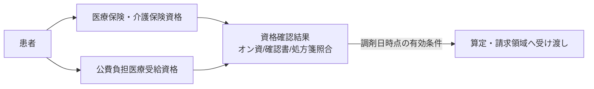

# 保険・公費等

## 責務と基本方針

患者が受ける調剤・薬学的管理・在宅医療における**費用負担の条件（医療保険・公費負担医療・介護保険・労災・自賠責・自費等）**と、その**資格確認結果・有効期間**を管理する。

- **処方箋原記載との分離**: 処方箋に記載された保険者番号・記号・番号等の文字列は「原記載」として [処方箋](../04-prescription-dispensing/prescription.md) に保持し、実際に資格確認した「有効な資格情報」を本領域で管理する。両者に差異がある場合は確認要（不整合）として検知する。
- **時点による適用判定**: 資格には必ず有効期間（開始日・終了日）を持たせ、**調剤実施日（または訪問実施日）時点**で有効な資格組み合わせを算定領域へ渡す。月跨ぎや資格喪失後の遡及変更でも、過去の実施時点の資格を参照できるようにする。

## 管理する概念

| 概念 | 主な情報 | 設計上のポイント |
| --- | --- | --- |
| 保険資格 (`InsuranceCoverage`) | 患者ID、保険種別（社保・国保・後期高齢・介護保険・労災・自賠責等）、保険者番号（8桁/6桁）、記号・番号・枝番（2桁）、**被保険者・被扶養者の別（本人/家族区分：調剤録法定記載事項）**、**職務上の事由（別表9コード：非該当時は記録省略）**、**一部負担金区分・年齢所得区分特記（未就学者 `6歳` / 高齢受給者・後期高齢一般・低所得 `高一` / 7割給付 `高7` / 8割給付 `高8` / 9割給付 `高9`）**、適用期間 | 個人単位で識別し、レセ電（`RE` 特記事項・`HO` レコード等）および負担金計算に直結。介護保険（居宅療養管理指導・要支援/要介護度）も併せて管理 |
| 公費資格 (`PublicExpenseCoverage`) | 患者ID、法別番号（2桁）、公費負担者番号（8桁）、受給者番号（7桁以内の数字）、自己負担上限額・適用区分、**優先順位（第1〜第4公費、`KO` 記録順）**、適用期間 | 複数公費の併用順序や疾患限定（難病・小児慢性・自立支援等）の条件を保持 |
| 限度額・特例情報 (`CopaymentLimit`) | 限度額適用認定区分、特定疾病療養受療証、高齢受給者証区分、**窓口負担額区分（`MF` レコード用：数字2バイト固定）**、適用期間 | 窓口負担の上限計算および月途中資格喪失時のレセプト振替・分割対象判定に利用 |
| 資格確認記録 (`EligibilityVerification`) | 対象資格、**負担者種別（別表6：1桁）**、**確認区分（別表7：2桁、例 `02` 変更なし / `03` 確認不能等）**、確認方法（マイナ保険証・資格確認書・災害時医療情報閲覧・目視）、確認日時、確認者、確認後の保険者番号・記号・番号・枝番・受給者番号（`SN` レコード用）、**取得した薬剤情報・特定健診・診療情報の参照ID**、処方箋記載との一致/不一致結果 | 「未確認」「不一致」のまま確定請求へ進めないための根拠および `SN` レコード出力・オン資閲覧証跡 |
| 資格適用セット (`CoverageSnapshot`) | 受付・調剤日時点で使用すると確定した保険＋公費の組み合わせ、**当月来局日スロット（`JD` レコード用：1日〜31日の受付区分マッピング）**、適用理由（自費切り替え等含む） | 後日の資格喪失や訂正があっても当時の適用判断を追跡し、月途中の資格変更時に `HO`/`SN`/`JD` を新旧分離できるようにする |

## モデル上のルール

- **記号・番号のレセ電フォーマット制約と省略ルール（`HO` / `SN`）**:
  - 保険者証の記号と番号の間や内部にスペース・中点（・）・ハイフン等を含めない。記号に含まれる**丸数字（例：「港②」）は「港（２）」のように全角括弧＋数字へ変換**する。
  - 記号と番号の合計バイト数は38バイト（全角19文字）以内とし、番号は英数モードまたは漢字モードの単一モード（混在不可）で保持・検証する。
  - **後期高齢者医療の場合**: 記号および枝番が存在しないため、`HO` の記号ならびに `SN` の記号・枝番を**必ず省略**する。
  - **公費負担医療の場合**: `SN` の記号・番号・枝番を省略し、`受給者番号`（7桁）のみを記録する（逆に負担者種別が医療保険等の場合は `SN` の受給者番号を省略する）。また電子資格確認対象外の場合は `SN` の枝番を省略する。
- **窓口負担額区分（`MF`）の常時保持**: `MF` レコード（窓口負担額区分）は任意項目であるが、未記録の場合は月途中の資格喪失が確認されたレセプトに係る「レセプト振替・分割」の対象外（基準点数以下を除く）となるため、原則として常時記録する。
- **非破壊履歴管理と同一月内資格変更検知**: オンライン資格確認等で保険者の変更が判明しても、過去の資格レコードを上書き消去せず、旧資格に終了日を設定して新資格を追加する。同一月内に保険資格が切り替わった場合は、算定・請求領域での**レセプト分割（振替）トリガー**として通知・参照できるようにする。
- **オンライン資格確認と処方箋記載の照合**: オンライン資格確認で取得した最新資格と処方箋記載の保険情報が異なる場合（転職による保険証切替直後など）、自動上書きせず差異を明示し、確認済み資格を適用セットとして記録する。
- **公費対象外の切り分け**: 処方箋内に「公費対象疾患の薬剤」と「対象外の薬剤」が混在する場合や、公費適用外の自費項目（容器代・選定療養・交通費等）が発生する場合は、算定側で明細単位に適用を切り分けられるよう公費の適用条件を明示する。
- **在宅における医療保険と介護保険の優先**: 要介護・要支援認定を受けている患者の訪問薬剤管理指導は原則として介護保険（居宅療養管理指導費）が優先されるため、介護保険被保険者証の資格・認定有効期間も本領域で管理し、[在宅](../06-home-care/home-care.md) へ渡す。
- **資格喪失・返戻への耐性**: 調剤後に資格喪失が判明し返戻となった場合、当時の `CoverageSnapshot` を維持したまま、訂正後の資格で再請求できるよう履歴を保持する。

## 他領域との受け渡し

- **レセコン入力・受付へ**: 患者特定後の資格確認ステータス（有効・期限切れ・不一致）を提供する。
- **在宅へ**: 要介護認定の有無・有効期間（介護保険優先判定の根拠）を提供する。
- **算定・会計・請求へ**: 実施日時点で有効と確認された保険・公費・負担割合・上限情報の確定セットを渡す。

関連: [患者](patient.md)、[処方箋](../04-prescription-dispensing/prescription.md)、[レセコン入力・連携](../04-prescription-dispensing/reception-entry.md)、[在宅](../06-home-care/home-care.md)。
