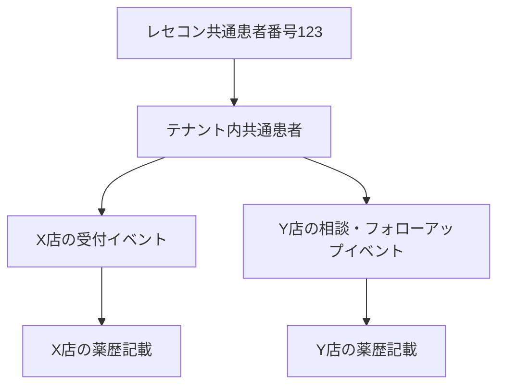
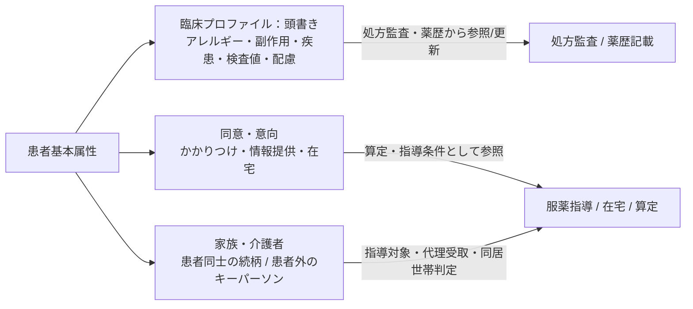
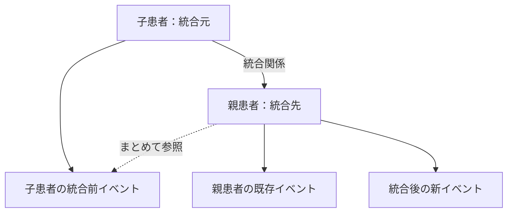
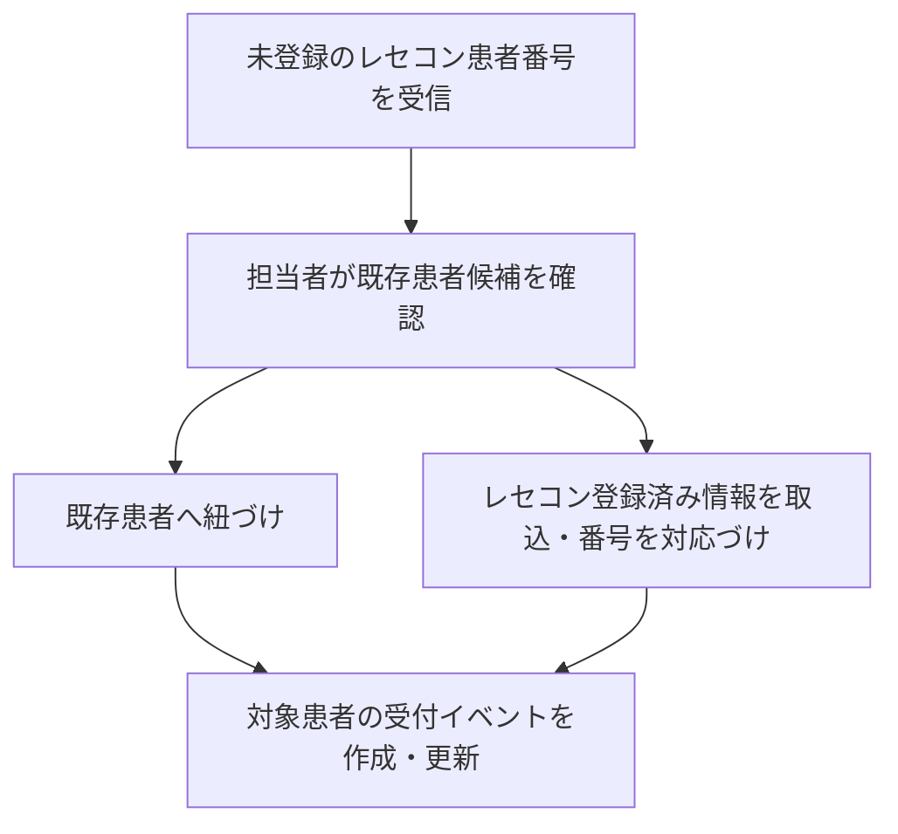

# 患者

## 一体型システムの前提

レセコンと電子薬歴の一体型クラウドシステムを前提とする。「レセコン機能」「薬歴機能」は同一システム内の業務機能の区分であり、患者管理を共通の責務として同じ患者エンティティを扱う。一体型内部では直接情報を共有し、NSIPSは外部連携時に用いる。

## 基本方針

- **新規患者登録の入口**: 新規患者の登録元はレセコン機能とする。通常は処方箋入力を契機に登録し、来局相談・電話相談・OTC相談で未登録の患者が来局した場合も、先にレセコンの患者登録機能で登録してからイベントを作成する（匿名・未登録患者のイベントは作成しない）。
- **クラウド一元管理**: レセコン機能・薬歴機能の双方でテナント内の患者情報を一元管理する。患者基本情報の編集はどちらの機能からも行え、同一テナント内の全店舗で最新の共有患者情報を参照する。
- **テナント内共通の患者番号**: 同じテナント（同一法人または同一個人開設者）では同一人物を一人の患者として管理する。レセコン共通患者番号もテナント内の全店舗で共通とし、内部患者IDへ対応づける。
- **店舗間参照と追記制限**: 同一テナント内の店舗間で同一患者のイベント・薬歴を参照できる。記録の確定・追記・訂正は記録元店舗の操作権限に従う。

## 管理する概念と保持情報

どの店舗で業務を行ったかは患者番号ではなくイベントの実施店舗として保持する。患者情報は**基本属性**、**外部患者番号の対応**、**臨床プロファイル（頭書き）**、**同意・意向**、**家族管理**に分けて一元管理する。

| 概念 | 主な情報項目 | 設計上のポイント |
| --- | --- | --- |
| 患者基本属性 (`Patient`) | 内部患者ID、所属テナント、氏名（漢字・カナ：処方箋・資格確認書等と一致、JAHIS/レセ電文字制約考慮）、生年月日（西暦・和暦変換）、性別（`RE` および薬学管理料通則(4)ア必須）、住所・郵便番号（**薬歴必須、また麻薬処方・調剤時は薬剤師法第27条により処方箋・調剤録への住所記載が必須**）、連絡先（電話・携帯・メール：レセ電上は省略可）、**緊急連絡先（氏名・続柄・電話番号）**、利用状態（利用中・転出・死亡等） | テナント内で一意。別テナントの同一人物とは自動共有しない |
| 外部患者番号の対応 (`ExternalPatientMapping`) | テナント、受信元レセコン、共通患者番号、対応する内部患者ID、確認状態・履歴 | 内部患者IDとレセコン患者番号を区別。店舗を番号の識別範囲に含めない |
| 身体的特徴・状態 (`PatientPhysicalStatus`) | 体重、身長、体表面積、**血液型**、**腎機能・透析状況**、妊娠の有無（予定日等）、授乳の有無、更新日時・確認元 | 小児用量・抗悪性腫瘍剤・腎機能計算・妊婦/授乳婦禁忌チェックのため、最新値と確認日を保持 |
| アレルギー・副作用歴 (`AllergyAndAdverseEffect`) | 種別（アレルギー / 副作用）、対象物質（医薬品・成分・食物等）、症状、重症度・重篤度、発現時期、**確認状態（`未聴取` / `なし（確認済み）` / `あり（本人申告・医師確認等）`）**、記録店舗・記録者 | 「未聴取」と「なし（確認済み）」を区別し、未聴取のまま処方監査が完了しないよう制御する。誤登録の訂正・無効化は履歴付きで行う |
| 疾患・既往歴 (`PatientCondition`) | 疾患名・コード、区分（現病歴 / 既往歴 / 禁忌疾患 / 他科受診加療中疾患）、発症・診断時期、確認元、状態（継続・治癒・訂正） | 疾病禁忌・併用禁忌チェックや調剤後薬剤管理指導（糖尿病・慢性心不全等）の対象判定に利用 |
| 併用薬・生活習慣 (`ConcomitantAndLifestyle`) | 他院処方薬、OTC・要指導医薬品（名称・JANコード・成分名コード・服用期間）、医薬部外品・サプリ・健康食品、嗜好品・相互作用飲食物（GFJ・納豆・セントジョーンズワート等）、職業・生活リズム、更新日時 | 相互作用・重複投薬・生活指導の前提情報 |
| 検査値 (`LabResult`) | 検査項目（eGFR、Cr、AST、ALT、HbA1c、K 等）、測定値・単位、検査日、出典（検査結果用紙・お薬手帳・医療機関連携） | 検査日と併せて保持し、腎機能低下時の用量監査等に利用 |
| ケア・服薬上の配慮 (`CarePreference`) | 嚥下・視覚・聴覚・手指巧緻性等の配慮、一包化/粉砕/剤形希望、主たる介護者・家族連絡先、**お薬手帳利用状況（1冊活用 / 当日持参忘れ［指導料2説明・次回持参指導フラグ］ / 不使用［理由必須］ / 複数冊非統合［理由必須］、媒体［紙/電子JAHIS］、日常利用薬局記載有無）**、後発品・バイオ後続品・選定療養に関する意向 | 不使用・複数冊非統合時は理由入力を必須とし、当日持参忘れ時は理由ではなく説明・次回指導フラグと紐づける（特定共同指導指摘事項対応） |
| 同意・契約状態 (`PatientConsent`) | 同意種別（個人情報利用、かかりつけ薬剤師、情報提供文書、調剤後フォロー、在宅訪問等）、同意日時、取得者、対象店舗/薬剤師、有効状態 | 算定要件（かかりつけ・特定薬剤管理指導2・吸入薬指導・服薬情報等提供料・在宅）の根拠 |
| 家族関係・家族連絡先 (`PatientFamilyRelation` / `PatientFamilyContact`) | 患者同士の紐づけ（対象患者ID、続柄、同居/別居区分、期間）と、患者以外の家族・介護者（氏名、続柄、連絡先、役割［緊急連絡先・主介護者・代理受取・在宅立会者等］） | 重複統合の「親患者・子患者」とは完全に別概念。家族関係だけで他人の薬歴閲覧や代理同意を自動許可しない |

`Patient` が保持するのは**最新のプロファイルおよび変更履歴**であり、過去の処方受付・薬歴記載・調剤報酬明細では、**「調剤・指導実施当時の資格・負担区分・体重・臨床プロファイル」がスナップショットとして不変に参照・保持される**。

## 一体型システム内の操作分担

| 操作 | 入口と反映 |
| --- | --- |
| 新規患者登録 | レセコンの登録機能。通常は処方箋入力が契機。処方箋なしの相談でも先に登録する |
| 患者基本情報の編集 | レセコン・薬歴のどちらの機能からも変更でき、共有患者の情報として即時反映する |
| 患者の統合・分離 | レセコンの機能から操作（RBACで権限制御）し、薬歴機能からも同じ結果を参照する |
| 処方・調剤の登録訂正 | レセコンの機能から行い、薬歴記載の編集と分離する |

## 重複患者の統合（M&A等によるマージ）と分離

基本的には同一テナント内では共通患者データをもとにレセコン入力するため患者は重複しないが、M&A（事業譲渡・吸収合併等によるデータ承継）等で同一人物が別レコードとして取り込まれ、患者をマージ（統合）する場合がある。

### 親患者・子患者による統合構造

- **親患者（統合先）と子患者（統合元）の選択**: レセコン機能での統合操作において親患者と子患者を指定する（統合上の役割であり、家族関係ではない）。統合中は業務上一人の患者として扱い、新規イベントはすべて親患者へ紐づける。
- **過去イベントの非破壊参照**: 子患者の既存イベントと薬歴は元の患者ID・記録元店舗・記載者・確定履歴を保持したまま、統合関係を通じて親患者からまとめて参照する（過去記録の患者IDを一括上書きしない）。
- **最新基本情報の採用**: 親患者・子患者の更新日時（または確認日時）を比較し、**より新しい情報を正解として統合後の現在値に採用**する。統合前の親・子それぞれの基本情報は分離・監査用に履歴保持する。
- **臨床プロファイル（頭書き）の合算**: アレルギー・副作用歴・疾患・検査値等の臨床プロファイルは、統合中は親・子双方の登録分を合算して処方監査・指導で参照し、各レコードの登録元患者IDは保持する。

### 誤統合の取消（分離）ルール

誤って統合した患者を分離する際は、以下のルールで元の状態を復元し、分離の実施者・日時・理由を履歴に残す。

| 対象 | 分離後の状態 |
| --- | --- |
| 患者基本情報 | 子患者は保持していた統合前の基本情報を参照し、親患者は統合後の更新を含む現在の基本情報を維持する |
| 臨床プロファイル（頭書き） | 登録元患者IDに基づき、親・子それぞれの所属へ戻る |
| 統合前から親にあったイベント・薬歴 | 親患者に残す |
| 統合前から子にあったイベント・薬歴 | 子患者の所属を維持し、親からの統合参照を解除する |
| 統合後に追加した新イベント・薬歴 | 親患者に残す |

## 家族管理のルール

- **自局患者同士の家族と、患者外の家族・キーパーソンの管理**:
  - 家族も自局の患者として登録されている場合は `PatientFamilyRelation` で患者同士を紐づけ、続柄・同居/別居区分を保持する。
  - 自局の患者ではない家族・介護者（緊急連絡先、小児の保護者、在宅の主介護者・立会者等）は `PatientFamilyContact` として氏名・続柄・連絡先・役割を保持する（処方箋なしの架空患者としては登録しない）。
- **プライバシー・閲覧境界**: 家族関係があることだけで別患者（特に成人家族）の薬歴や処方内容を自動共有・閲覧許可しない。服薬指導・交付における「患者又はその家族等」の特定、代理受取人の記録、および在宅医療における「同居する同一世帯の患者（R8区分15の単一建物診療患者判定の特例）」の確認材料として参照する。

## 外部連携：NSIPS受信時の患者照合・更新

- **未登録番号の候補確認フロー**: 外部NSIPSで未登録のレセコン患者番号を受信した場合、確認前は受信データを保留し、担当者が候補を確認してから既存患者へ紐づけるか新規取込を行う（氏名一致だけで自動統合したり、患者なしのイベントを自動作成したりしない）。
- **確認済み番号の基本情報自動更新**: 対応づけ済みの患者番号から受信した患者基本情報は自動更新する。ただし、NSIPSに住所・電話番号等の値が含まれない（空欄）場合は登録済みの既存値を保持し、欠落を理由に自動消去しない。患者の現在値が更新されても、過去のNSIPS受信履歴や確定済み薬歴記載は書き換えない。

関連: [保険・公費等](coverage.md)、[受付・相談・フォローアップのイベント](../05-pharmaceutical-care/care-event.md)、[薬歴記載](../05-pharmaceutical-care/medication-history.md)、[処方監査・疑義照会](../04-prescription-dispensing/prescription-review.md)、[テナント・アクセス管理](../01-organization/tenant-access.md)。
