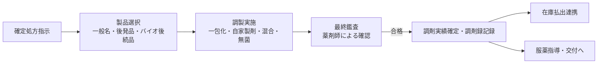

# 調剤・鑑査

## 責務と基本方針

確定した処方指示（疑義照会による変更後指示を含む）に基づき、**実際の薬剤の選択・調製（ピッキング・計数・計量混合・一包化・自家製剤・無菌製剤等）**と、**最終鑑査**を実施し、調剤実績および**調剤録**の根拠となる記録を確定する。

- **処方指示と調剤実績の分離**: 一般名処方や後発品変更可能処方では、「指示された一般名/先発品」と「実際に調剤した具体的製品（銘柄・規格・包装）」が異なる。両者を紐づけつつ調剤実績を正本として管理する。
- **調製者と最終鑑査者の区別**: 誰が調製（計量・分包等）し、誰が最終鑑査（内容・数量・外観・薬袋等の確認）を行ったかを別々に保持する。
- **時点スナップショットの根拠**: 特定共同指導やレセプト電算出力に備え、調剤年月日時点の開設者・管理薬剤師・保険薬局コード・届出施設基準を参照できる状態で調剤実績を保持する。

## 管理する概念

| 概念 | 主な情報 | 設計上のポイント |
| --- | --- | --- |
| 調剤指示展開 (`DispensingPlan`) | 対象受付、処方Rp単位、剤形、用法（注射薬・外用薬はレセ電 `CZ` 上省略可）、服用時点・日数・回数、変更可否・選定療養対象区分 | **服用時点が同一でも投薬日数が異なる内服薬は別剤（別 `CZ`）とし、1剤とすべき内服薬の2剤分割を禁止**。`CZ` の処方箋受付回数は `KI` と必ず一致させる |
| 調剤明細実績 (`DispensedItem`) | 使用医薬品（YJコード/レセプト電算コード/GS1等）、**剤形別用量（内服薬・湯薬＝1日用量 ／ 内服用滴剤・注射薬・外用薬［貼付剤除く］＝投薬全量 ／ 屯服薬＝1回用量＋投薬全量 ／ 浸煎薬＝投薬全量＋投薬日数 ／ 鎮痛消炎貼付剤＝枚数としての投薬全量＋1日用量または投与日数）**、特定保険医療材料（`TO`：請求不可の衛生材料等を除外）、ロット/使用期限（必要時）、変更区分（通常後発変更 / **含量規格変更 / 類似別剤形変更** / バイオ後続品等）、変更前後薬剤料比較・患者説明同意・医療機関情報提供記録、長期収載品選定療養・評価療養等区分（`薬評` 等） | 剤形別のレセ電 `IY` 用量定義を厳守し、患者希望による先発品選択・医療上の必要性等を区別 |
| 調剤手技記録 (`CompoundingRecord`) | 手技区分（一包化・自家製剤・予製剤・錠剤分割・計量混合［液剤/散剤/軟硬膏］・無菌製剤処理［中心静脈/抗悪性腫瘍/麻薬］）、対象Rp、**製剤工程詳細**、**薬学的問題なし判断**、**同一剤形・規格の薬価収載品非存在確認**、実施理由・医師了解記録 | R8薬剤調製料の各加算（注2・注6・注7）および外来服薬支援料2（一包化）の算定適格性チェックに用いる |
| 供給不安対応記録 (`SupplyShortageRecord`) | 区分（他薬局在庫確認・案内 `別紙様式4-2` / 他薬局への分譲 `別紙様式4-1`）、相手先薬局・確認者、対応日時、**物理保管場所・保存期限（分譲日から2年間）管理メタデータ** | 供給不足時の特定薬剤管理指導加算3「ロ」・自家製剤特例・摘要欄記載および2年保存要件に対応 |
| 規制薬品取扱い (`ControlledDrugHandling`) | 麻薬・向精神薬・覚醒剤原料・毒薬の該当区分、使用数量、麻薬帳簿連携用情報、有効期限内の麻薬小売業免許番号参照 | R8薬剤調製料注3（麻薬70点、向精神薬/覚醒剤原料/毒薬8点）および算定摘要欄の免許番号抽出の根拠 |
| 分割・リフィル進捗 (`SplitDispensingRecord`) | 区分（保存困難分割［注9］・後発品お試し分割［注10］・医師分割指示［注11］・リフィル）、総回数、今回回数、**注9時の受付時医療機関照会記録・分割理由**、次回予定日・調剤可能期間、**リフィルチェック欄（`✓`/`×`）記入状態** | 2回目以降の調剤において、前回までの実績・残回数・算定制限とチェック欄・次回予定日記載漏れを防止 |
| 最終鑑査 (`FinalVerification`) | 鑑査者（薬剤師）、鑑査日時、確認方法（目視・分包監査システム・バーコード照合等）、判定（合格・差し戻し）、差し戻し理由 | 調剤過誤防止の最終ゲート |
| 調剤記録・調剤録元データ (`DispensingRecord`) | **保険調剤区分（保険調剤 / 保険調剤以外［自費等］）**、法定全項目（患者基礎情報、記号番号・保険者名・公費番号、医薬品名・分量・調剤量・用法用量・既調剤量・使用期間、調剤年月日・服薬指導年月日・調剤/指導した保険薬剤師氏名・指導要点、処方箋交付年月日・医療機関名/所在地・保険医氏名、**単一ソース参照による疑義照会ID・残薬調整ID**・分割理由、請求項目・点数・患者負担金額）、調剤済みにした旨、**調剤した保険薬剤師自らの署名/記名押印（事務員等による代筆不可）**、**処方箋原本＋電送情報（FAX・オンライン等）のペア突合完了フラグ・3年保存（公費5年）期限管理**、**調剤録訂正履歴（`DispensingRevision`）** | 保険調剤と自費等の混在を禁止。疑義照会・残薬調整は処方監査の単一IDを引用し薬歴との3者一致を保証。確定後は二本線抹消相当の追記型訂正履歴を保持 |

## モデル上のルール

- **保険調剤と自費等の調剤録分離**: 集約生成時に「保険調剤」「保険調剤以外（自費等）」を排他的に指定し、混在を禁止する。
- **無資格調剤・代筆署名の禁止**: 調剤行為（H31.4.2通知で非薬剤師に許容される業務を除く）および調剤済処方箋の署名・記名押印は、保険薬剤師登録を持つスタッフのみが実行できる（事務員による代筆署名は不可）。
- **後発品・バイオ後続品への変更調剤ルール**:
  - 一般名処方・変更可処方で備蓄・支給可能な後発品があるにもかかわらず先発品を調剤する場合は、患者説明のうえ合理的理由を記録し、レセプト摘要欄記載対象とする。
  - **含量規格変更・類似別剤形変更**は、①患者説明・同意、②効能・効果および用法・用量が同一、③やむを得ない状況でない限り変更後の薬剤料が変更前より高額にならないこと、④処方箋発行医療機関への情報提供（事前合意含む）、の4要件すべてを満たさない限り実行できない。
- **自家製剤・計量混合の算定適格性**:
  - **自家製剤**: 同一剤形・同一規格の医薬品が薬価基準に収載されている場合は算定対象としない（供給上の問題で必要数量確保不可の例外時は薬剤名とやむを得ない事情を摘要欄必須記載）。また、製剤工程の記録を必須とする。
  - **計量混合**: 薬学的に問題ないという判断記録を必須とする。
- **確定後のイミュータブル保存と追記訂正**: 確定後の直接上書き・削除は禁止し、修正前後スナップショット・理由・訂正者・日時を持つ追記型訂正履歴（`DispensingRevision`）のみ許可する。保存期間は完結の日から3年間（生活保護法等は5年間）とする。
- **開局時間外・夜間休日等の時間区分**: 実際の調剤受付/実施時刻と、店舗の営業時間マスタ（曜日別営業時間・日別祝日/臨時例外）を照合し、時間外・休日・深夜加算（注4）または夜間・休日等加算（注5）の判定材料を保持する。
- **外部調剤機器との連携**: 分包機・散薬監査システム・PTP払出機等への指示送信は、一体型内部の調剤情報から外部機器連携用インターフェース（NSIPS等）を介して行う。詳細は [内部と外部連携の境界](../external-integration.md) を参照。
- **在庫領域との境界**: 調剤実績が確定した時点（または払出確定時点）で、使用した具体的製品・数量を `08-inventory-retail`（在庫）の払出実績へ連携する。調剤側で在庫残高を直接書き換えない。
- **分割・リフィル時の管理**:
  - 長期保存困難等による分割調剤（R8注9）では、**処方箋受付時に処方箋発行医療機関へ照会を行うとともに、調剤録に分割理由を必ず記載**する。
  - 医師の分割指示（R8注11）やリフィル処方箋では、1回目・2回目の調剤時にリフィルチェック欄（`✓`/`×`）・調剤日・次回調剤予定日を記入して写しを保管し、2回目以降の調剤時に「投薬中の患者の服薬状況確認」および必要に応じた処方医への情報提供有無を記録して [服薬指導・交付](../05-pharmaceutical-care/medication-counseling.md) と連携する。
- **オンライン服薬指導時の処方箋原本・電送情報保存**: オンライン服薬指導に伴い医療機関から処方箋情報の電送を受けた場合は、送付された処方箋原本と電送情報の双方を3年間（生活保護法等は5年間）保管する。
- **長期収載品の選定療養・後発品体制**: 変更不可理由や患者希望によって先発品を調剤した場合は、その区分を記録し算定・窓口会計での特別の料金計算に備える。

## 他領域との受け渡し

- **服薬指導・交付へ**: 鑑査済みの調剤内容・変更された銘柄（後発品変更等）・一包化/粉砕等の注意事項を渡す。
- **在庫領域へ**: 調剤で消費した製品・数量の払出連携。
- **算定領域へ**: 剤形・剤数、調剤手技（自家製剤・計量混合・無菌製剤）、規制薬品区分、時間外区分、分割/リフィル回数、選定療養区分を渡す。

関連: [処方箋](prescription.md)、[処方監査・疑義照会](prescription-review.md)、[服薬指導・交付](../05-pharmaceutical-care/medication-counseling.md)、[店舗](../01-organization/store.md)。
