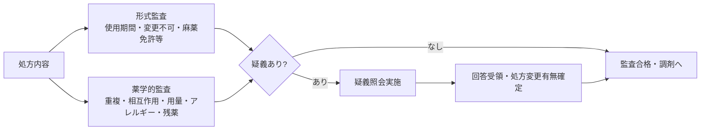

# 処方監査・疑義照会

## 責務と基本方針

受け付けた処方箋について、**形式的な適法性（形式監査）**と**薬学的な安全性・妥当性（薬学的監査）**を評価し、疑義や調整事項があれば処方医へ照会して、その結果と変更根拠を確定する。

- **原記載の保全**: 疑義照会によって処方内容が変更された場合でも、[処方箋](prescription.md) の「発行時の原記載」は書き換えず、「疑義照会の経緯」と「変更後の指示」を分離して保持する。
- **算定根拠の構造化**: 調剤管理料の **調剤時残薬調整加算**（R8区分10の2注3）および **薬学的有害事象等防止加算**（R8区分10の2注4）の算定可否を算定領域が判定できるよう、照会の目的・結果・変更内容を構造化して記録する。

## 管理する概念

| 概念 | 主な情報 | 設計上のポイント |
| --- | --- | --- |
| 処方監査結果 (`PrescriptionAudit`) | 監査ID、対象受付、監査者（薬剤師）、監査日時、形式監査チェック結果、薬学的監査チェック結果（警告・確認結果）、判定（合格・要照会・不可） | システムの自動チェック（併用禁忌・重複警告等）と、薬剤師による最終確認・判断を区別して保持 |
| 重複・相互作用確認 (`SafetyCheckLog`) | 確認源（自店舗薬歴・同一法人他店舗薬歴・電子処方箋重複投薬等チェック・お薬手帳）、検出されたリスク種別、薬剤師の判断理由 | 電子処方箋の重複投薬等チェックの照会結果を証跡として残せるようにする |
| 疑義照会 (`PrescriptionInquiry`) | 照会ID、対象受付・明細、照会区分（形式不備・薬学的有害事象防止・残薬調整・剤形/規格変更・一包化了解・一般名/後発品確認等）、照会日時、照会者、照会先（医療機関・処方医）、照会方法、照会内容 | 照会区分により、後続の算定加算判定や処方箋備考記載要否を識別する |
| 照会回答・変更 (`InquiryResponse`) | 回答日時、回答者（処方医等）、回答内容、処方変更の有無、変更前後の指示差分、調整日数（残薬調整時） | 「照会したが変更なし」と「照会により処方変更・削除・日数調整あり」を明確に区別 |
| 処方前提案 (`PrePrescriptionProposal`) | 在宅患者等への処方箋交付前の処方相談・提案内容、処方箋への反映結果 | R8調剤管理料注3イ・注4イ（在宅患者の処方交付前提案反映）に対応 |

## モデル上のルール

- **「取りそろえ前確認」の保険薬剤師専権**: 処方箋の受付後、薬を取りそろえる前の患者確認（体質、疾患、併用薬・飲食物、服薬・残薬状況、体調変化）は、事務員ではなく**保険薬剤師**が実施しなければならない。
- **形式・薬学的疑義時の調剤確定ブロック**: 使用期間超過、医療機関所在地・名称欠落、用法・用量・規格単位の欠落、**曖昧な用法記載（「医師の指示どおり」等）**、患者基礎情報の欠落、または薬学的確認で疑義（禁忌、承認外効能・用法・用量、使用期間限定薬の超過、漫然長期投与、過量・倍量、期間上限超過、併用禁忌/注意、重複投薬、多剤併用等）が検知された場合、**疑義照会記録（回答・変更同意含む）が完了するまで調剤確定状態へ遷移できない**。
- **処方変更時の二本線抹消相当の原記載保持**: 処方医の同意を得て処方内容を変更する場合は、元記載を判読可能な状態で保持（紙処方箋の二本線抹消に相当）したまま変更内容を記録し、照会内容と回答を処方箋備考欄および調剤録へ必ず連携する。
- **形式監査の必須観点**:
  - 処方箋の使用期間、保険・公費記載、患者氏名・生年月日、医療機関・処方医記名押印（または電子署名）。
  - 「変更不可」欄・患者希望欄（長期収載品の選定療養対象かどうかの判定材料）、リフィル可否・総使用回数、医師の分割指示回数。
  - 麻薬処方箋における麻薬施用者免許番号・患者住所、向精神薬・長期投与制限薬の日数上限。
- **残薬調整の区分（R8対応）**:
  - 残薬確認に基づく処方医への照会・調整では、**変更された調剤日数の差分（7日分以上相当 vs 6日分以下相当）** を記録し、6日分以下の場合は「保険薬剤師が患者の服薬状況等により必要性があると判断した理由（レセプト記載用）」を必須とする。
- **薬学的有害事象等防止の区分（R8対応）**:
  - 残薬調整とは区別し、薬歴や電子処方箋の仕組みを用いた重複投薬・相互作用・併用禁忌・過量投与・副作用歴等の確認に基づく照会によって処方変更が行われたことを記録する。
- **処方箋への変更内容記載・調剤録・薬歴との「3者一致」単一ソース化**: 疑義照会による変更内容・照会先・回答日時・回答者および残薬調整内容は、本領域で確定した**同一の疑義照会ID（`PrescriptionInquiryId`）・残薬調整IDを [調剤・鑑査](dispensing.md)（調剤済処方箋備考・調剤録）と [薬歴記載](../05-pharmaceutical-care/medication-history.md)（薬歴・加算算定根拠）の双方が単一ソースとして引用**する。これにより、処方箋備考・調剤録・薬歴の3箇所への別々の手入力による記載齟齬を構造的に防止する。

## 他領域との受け渡し

- **処方箋へ**: 変更後の確定指示（変更経緯付き）を紐づける（原記載は不変）。
- **調剤・鑑査へ**: 監査合格状態、変更後の調剤すべき薬剤・数量・一包化指示・変更理由を渡す。
- **薬歴記載へ**: 薬学的分析の内容・疑義照会の経過を薬歴の参照材料として渡す。
- **算定領域へ**: 調剤時残薬調整加算・薬学的有害事象等防止加算等の判定に必要な「照会区分・事前提案有無・変更結果・調整日数・かかりつけ薬剤師実施か・在宅患者か」の事実を渡す。

関連: [処方箋](prescription.md)、[調剤・鑑査](dispensing.md)、[薬歴記載](../05-pharmaceutical-care/medication-history.md)、[在宅](../06-home-care/home-care.md)。
