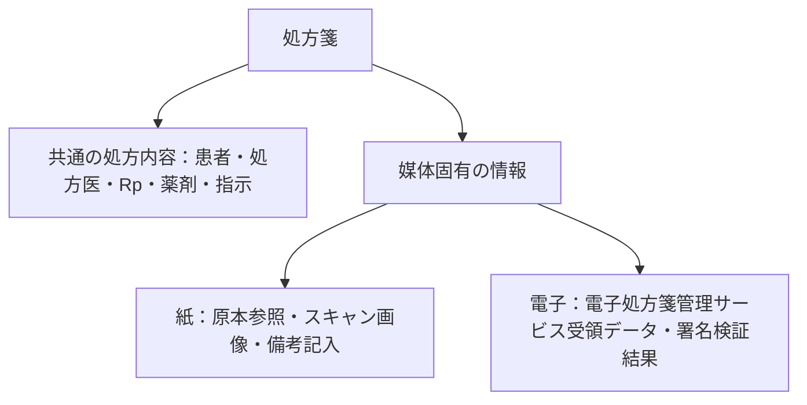

# 処方箋と処方内容

## 基本方針

- **紙処方箋と電子処方箋の両対応**: 紙の処方箋と電子処方箋の両方を対象とし、共通の処方内容構造と媒体固有の情報（紙原本参照・スキャン画像、電子処方箋引換番号・電子署名検証済み受領データ等）を分離して管理する。
- **一体型内部と外部連携の整理**: 一体型システム内部ではレセコンの処方入力・訂正機能で処方内容を管理し、薬歴機能から同じ情報を直接参照する。外部レセコンと連携する場合はNSIPSを介して処方内容を取り込む。機器連携の境界は [一体型内部と外部連携の境界](../external-integration.md) を参照。
- **原記載・変更後指示・調剤実績の分離**: 処方医が発行した「原記載」、疑義照会等を経た「変更後の確定処方指示」、および実際にピッキング・調製した「調剤実績」を明確に区別して保持し、再入力や変更調剤によって原記載を上書きしない。

## 管理する概念

| 概念 | 主な責務 |
| --- | --- |
| 処方箋 (`PrescriptionDocument`) | 発行された文書の同一性、媒体種別（紙/電子）、発行時原記載、原本保管参照を保持する |
| 処方内容 (`PrescriptionContent`) | 患者に対するRp・薬剤明細・用法・用量・日数・変更可否等の処方指示を表す |
| 処方箋の受付 (`Reception`) | 店舗が処方箋を受け付けた出来事と使用期間検証・状態を表す（[レセコン入力・連携](reception-entry.md)） |
| 処方内容の変更 (`PrescriptionAmendment`) | 疑義照会等による変更前後の差分、理由、根拠、照会相手（処方医）、確認薬剤師を追跡する |
| 調剤実績 (`DispensingRecord`) | 実際に選択・調製した具体的医薬品・数量・手技を表す（[調剤・鑑査](dispensing.md)） |

## 処方内容の構造

| 単位 | 保持する情報項目 | ドメイン上の意味・制約 |
| --- | --- | --- |
| 処方箋ヘッダ | 患者記載、交付医療機関（名称・所在地・機関コード）、処方医（氏名・保険医確認・麻薬施用者番号）、交付年月日、使用期間、保険・公費原記載、備考・残薬調整指示（減数調剤指示） | 処方箋に記載された当時の情報と各マスタの現在値を区別して保持。**同一医療機関で一連の診療に基づき同一患者へ交付され受付回数1回とされた異なる保険医の処方箋は、それぞれ別の処方基本ブロック（`SH`）として分離記録する** |
| 処方のまとまり（Rp） | Rp番号、剤形区分（内服・屯服・外用・注射等）、用法（服用時点・回数・タイミング）、調剤日数・回数、Rp共通指示 | **服用時点が同一であっても投薬日数が異なる内服薬は別剤（別の `CZ` 欄）**として分け、逆に1剤とすべき内服薬を2剤に分割算定することを禁止する |
| 薬剤明細 | 処方薬品名称（一般名 / 銘柄名）、コード、分量（1回量 / 1日量 / 総量）、単位、変更不可区分、患者希望（長期収載品の選定療養対象）区分、個別指示 | 一般名・銘柄指示と、調剤時に選択する具体的製品（YJ・レセ電コード）を対応づける |
| 分割・リフィル指示 | リフィル可否・総使用回数（最大3回）、医師の分割指示回数・間隔、保存困難・後発品お試し分割の区別 | 元の処方箋と各回の受付・調剤実績・チェック欄記入を紐づける |

## 他領域との境界

- **患者・外部関係者マスタ**: 識別先を提供し、処方箋側は交付時点の記載スナップショットを保持する。
- **処方監査・疑義照会**: 適法性・安全性の評価と処方医への確認経緯を担当し、処方内容の変更根拠を供給する（[処方監査・疑義照会](prescription-review.md)）。
- **調剤・鑑査**: 確定した処方指示の版に基づき具体的製品を選択・調製し、調剤実績を記録する（[調剤・鑑査](dispensing.md)）。
- **薬歴記載**: 処方・調剤の登録・訂正はレセコン機能を正本とし、薬歴記載側から処方・調剤正本を直接書き換えない。

## 外部連携：同一受付のNSIPS再取込仕様

- **自動上書きと履歴保持**: 外部レセコン連携において同一受付のNSIPSを再受信した場合、既存イベントを維持したまま処方・調剤取込データを最新受信内容へ自動上書き更新する（差分承認操作で更新を止めない）。上書き前の旧受信データは受信履歴として保持し、前後差分を比較確認できるようにする（[受付・相談・フォローアップのイベント](../05-pharmaceutical-care/care-event.md#nsips受信履歴と差分確認)）。
- **薬歴記載の保護**: 受付イベントに紐づく薬剤師のSOAP・病歴等の記載、確定情報、追記・訂正履歴はNSIPS再受信では上書きせず保持する。

関連: [レセコン入力・連携](reception-entry.md)、[処方監査・疑義照会](prescription-review.md)、[調剤・鑑査](dispensing.md)、[受付・相談・フォローアップのイベント](../05-pharmaceutical-care/care-event.md)。
