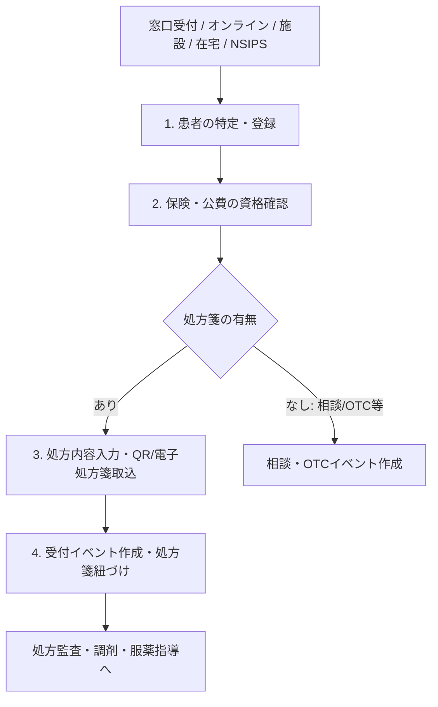

# レセコン入力・連携

## 責務と基本方針

薬局窓口・在宅・相談等で発生した業務の**入口（受付）**を担い、患者特定・資格確認・処方内容の取込または入力を行い、[受付・相談・フォローアップのイベント](../05-pharmaceutical-care/care-event.md) を立ち上げる。

- **一体型内部と外部連携の整理**: 一体型システム内部ではレセコン入力機能で登録した患者・処方・受付情報を薬歴機能と直接共有する（NSIPSを必須としない）。外部レセコンと連携する場合のみ NSIPS 等の受信によりイベントを作成する。詳細は [業務フロー](../workflow.md) と [内部と外部連携の境界](../external-integration.md) を参照。
- **複数ドメインの入口だが正本は混ぜない**: レセコン入力は「患者」「保険・公費」「処方箋」「受付イベント」を同時に扱う入口だが、各情報の正本はそれぞれのドメインに保持する。

## 管理する概念

| 概念 | 主な情報 | 設計上のポイント |
| --- | --- | --- |
| 受付 (`Reception`) | 受付ID、受付番号、受付日時、受付店舗、受付経路（窓口・FAX事前・オンライン・在宅・電子処方箋）、受付種別（処方箋・分割・リフィル・相談等） | 受付番号の一意範囲（店舗×日別等）は店舗単位で管理 |
| 患者対応づけ (`PatientMatching`) | 入力/受信患者情報と内部患者ID（[患者](../03-patient-coverage/patient.md)）の対応結果、照合根拠 | 同姓同名だけで自動統合せず、確認済み患者へ紐づける |
| 受付媒体取込 (`PrescriptionIntake`) | 紙処方箋スキャン画像、2次元シンボル（JAHIS QR）読取生データ、電子処方箋引換番号・取得データ、NSIPS受信生データ | 原データ（生データ）と構造化された処方内容を区別して保持 |
| 同時受付グループ (`ConcurrentReceptionGroup`) | 同一患者・同日・複数医療機関から同時に受け付けた受付群、代表（100/100）と他（80/100）の判定材料 | R8調剤基本料注3（複数医療機関の同時受付減算）の判定に必要 |

## モデル上のルール

- **受け入れ禁止処方箋のブロック**:
  - 投薬期間に上限が設けられている医薬品について、2枚以上の処方箋（いわゆる二枚処方箋）により上限を超える処方、または翌週・翌月等に交付予定の処方箋を受け付けてはならない。
  - 特定の医療機関の従業員が、患者の同意なく処方箋を持参するケースを受け付けてはならない。
  - 保険医以外の医師から交付された処方箋による保険調剤を禁止する。
- **処方箋使用期間の確認**: 処方箋の交付日を含めて原則4日以内（休日含む）の有効期限を受付時に検証する。長期海外渡航・災害・特別な事情による延長記載がある場合は例外理由を記録する。使用期間を超過した処方箋の受付・調剤を禁止する。
- **電送処方箋（FAX等）の原本受領・同一性確認**: FAX・メール等で事前に処方内容を受領した場合は仮受付状態とし、患者来局時または在宅訪問時に**必ず処方箋原本を受領して電送内容と同一であることを保険薬剤師が確認**するまで、調剤確定・交付を完了させない。
- **分割調剤・リフィル受付の識別**:
  - 通常の分割調剤（保存困難・後発品お試し・医師の分割指示）およびリフィル処方箋（2回目・3回目）は、**元の処方箋（または親受付）への参照**と**今回何回目の受付か**を保持する。
  - R8点数表上、保存困難（注9）・後発品お試し（注10）・医師分割指示（注11）は算定ルールが異なるため、区分を明確に区別する。
- **外部NSIPS再受信時の扱い**: 同一受付の NSIPS 再受信時は、最新の受信データで受付・処方情報を上書き更新する（差分承認操作は設けない）。ただし、薬剤師がすでに入力・確定した薬歴記載や追記・訂正履歴は上書きしない。詳細は [処方箋](prescription.md#外部連携同じ受付のnsips再取込) を参照。
- **電子処方箋の取得・検証・ライフサイクル同期**: 外部から引換番号等を受け取っただけでは「電子処方箋原本を取得・検証済み」とは扱わず、電子処方箋管理サービスからの取得・署名検証ステータスを別管理する。
  - **調剤結果取消後のステータス同期**: 薬局側で「調剤結果取消」を実行した場合、電子処方箋管理サービス上のステータスは「調剤中」ではなく**「調剤済み」**に戻るため、その仕様に合わせて状態を同期する。
  - **処方箋回収（未調剤）時の閲覧範囲**: 疑義照会等で調剤せず処方箋回収した場合、1回目回収時は「回収済み処方情報」のみ閲覧可とし、リフィル2回目以降の回収時は「回収済み処方情報＋回収前の過去調剤情報」が閲覧可として扱う。
  - **職域診療所・100日超登録対応**: 職域診療所が発行した紙処方箋に対する調剤結果登録、および処方箋登録から100日経過後の保管調剤結果登録に対応する。

## 他領域との受け渡し

- **患者・保険ドメインへ**: 新規患者の登録、資格確認のトリガー。
- **処方箋・イベントドメインへ**: 確定した受付イベントと処方内容（原記載・構造化データ）の生成。
- **処方監査・調剤へ**: 受付完了した処方内容・同時受付情報・分割/リフィル回数情報の受け渡し。

関連: [業務フロー](../workflow.md)、[患者](../03-patient-coverage/patient.md)、[保険・公費等](../03-patient-coverage/coverage.md)、[処方箋](prescription.md)、[受付・相談・フォローアップのイベント](../05-pharmaceutical-care/care-event.md)。
