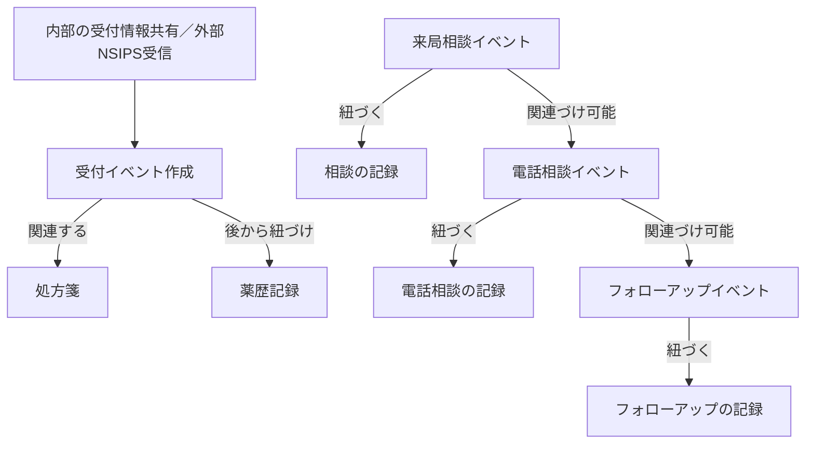
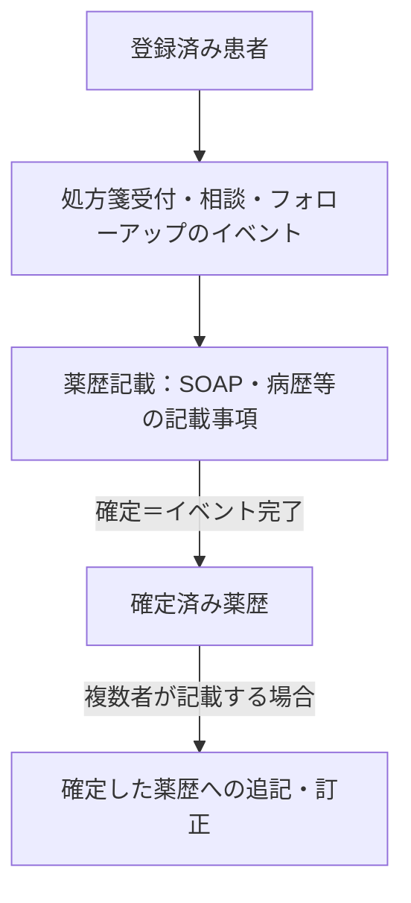
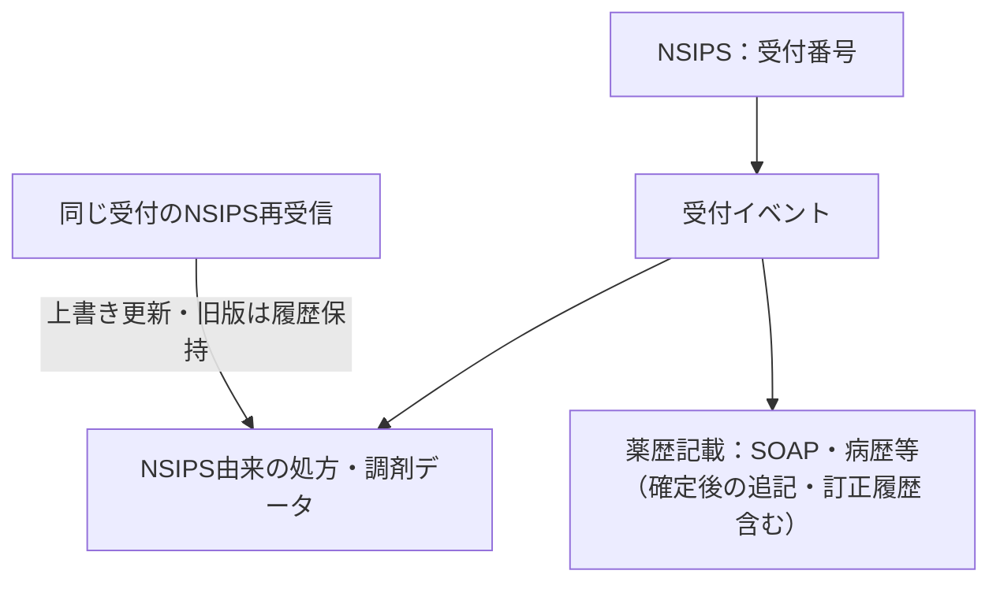

# 受付・相談・フォローアップのイベント

## 一体型内部と外部連携

一体型システム内部ではレセコンの受付・処方入力機能から情報を直接共有し、患者配下の受付イベントへ関連づける。イベント先行作成と後からの薬歴記載という構造は全業務で共通とする。NSIPSは外部連携用であり、内部でのイベント作成にNSIPS受信を必須としない。外部連携の詳細は [一体型内部と外部連携の境界](../external-integration.md) を参照。

## 基本方針

- **患者を必須入口とする**: 登録済み患者に紐づけてイベントを作成する。処方箋受付・来局相談・電話相談・OTC相談・フォローアップ・在宅訪問のすべてで患者を必須とし、患者未登録・匿名のイベントは作成しない。
- **処方箋もイベントを介する**: 処方箋がある場合も受付イベントを作成し、処方箋との関連を保持する。処方箋とイベントを二者択一にはしない。
- **イベントの先行作成**: 内部の受付情報共有、外部NSIPS受信、または来局・電話相談等の発生時にイベントだけを先に作成でき、薬歴記載は後から紐づける。
- **イベント間の関連**: 同一テナント・同一患者の範囲で、イベント同士（別店舗のイベントを含む）を多対多で関連づけられる。

## 患者を入口とする構造と薬歴記載の単位

- **薬歴記載の単位**: SOAP・病歴等の記載事項をまとめた一つの薬歴記載を単位とする。イベント作成直後は薬歴記載が未作成（または下書き）でもよい。
- **複数者による記載は確定薬歴への追記**: 複数の薬剤師が記載することもあるが、1つのイベントに複数の薬歴記載を別々に作るのではなく、**確定した薬歴に追記（または訂正）という形にする**。記載者・確定者の識別と追記・訂正履歴は [薬歴記載](medication-history.md) で管理する。

## イベント種別と開設者独自種別

- **共通種別と独自種別**: 処方箋受付・来局相談・電話相談・OTC相談・フォローアップ・在宅訪問の共通種別に加え、**開設者（法人・個人）ごとに自テナントの独自イベント種別を追加できる**。追加した独自種別にも開設者の記載チェック項目を設定できる（他テナントへは自動共有しない）。
- **独自種別の利用停止**: 使わなくなった独自種別は削除せず「利用停止」とし、新規イベント作成時の選択を停止する。過去に作成したイベントや薬歴記載はそのまま保持する。

## 管理する情報

| 概念 | 主な情報 |
| --- | --- |
| イベント (`CareEvent`) | イベントID、イベント種別（共通/開設者独自）、対象患者ID、実施店舗、発生日時、担当者、登録日時、完了状態（未完了/完了）、完了日時、固定された記載設定の版。受付イベントは処方箋・NSIPS受信情報との対応を持つ |
| 薬歴記載 (`MedicationHistory`) | 対応するイベントID、記載内容（SOAP・法定確認事項等）、記載者、確定者・確定日時、追記・訂正履歴（[薬歴記載](medication-history.md)） |
| イベント間の関連 (`CareEventLink`) | 関連元イベントID、関連先イベントID、関係種別、登録者、登録日時 |

イベントの発生（実施）日時と、システムへの登録・薬歴記載日時を区別する。

## イベントの完了と不足事項の注意喚起

- **薬歴確定によるイベント完了**: **薬歴記載者が薬歴を確定するときに、イベントも完了として扱う。**
- **不足事項がある場合の注意喚起**: 開設者・イベント種別ごとに設定された記載事項について、**不足事項があった場合には確定時に注意を促す**。
- **設定のイベント作成時固定**: 開設者・イベント種別ごとの記載設定の変更は新規作成するイベントから適用し、既存イベントは未完了・完了にかかわらずイベント作成時点の設定を維持する。

## イベント間の関連と店舗境界

- **同一テナント・同一患者内の店舗横断関連**: 同じテナント・同じ患者のイベント同士は、店舗が異なっていても関連づけられる（例：X店の処方箋受付イベントとY店の電話フォローアップイベント、または1回のフォローアップイベントと複数の受付イベント）。別テナントや別患者のイベントとは関連づけない。
- **認可境界の維持**: イベントを関連づけても、相手記録の所属店舗や追記・訂正権限は変更しない。関連先の記録の追記・訂正は記録元店舗の操作権限に従う。

## 外部連携：NSIPS受付番号と受信履歴・差分確認

- **受付番号によるイベント作成と再受信上書き**: 外部NSIPS受信時は、登録済み患者へ対応づけた上でNSIPS受付番号を基に受付イベントを作成する（未登録患者番号は [患者](../03-patient-coverage/patient.md) の候補確認完了まで保留）。同一受付の再受信では新イベントを作らず、既存イベントの処方・調剤取込データを最新内容へ自動上書き更新する。薬剤師が入力したSOAP等の記載・確定情報・追記訂正履歴は上書きせず保持する。
- **NSIPS受信履歴と差分確認**: 上書き前のNSIPSデータも受信元・受信日時・受信順序とともに履歴保持し、追加・変更・削除された差分を比較確認できるようにする。

### 完了後のNSIPS変更時の設定と再完了

完了済みイベントに対してNSIPSの処方・調剤内容が変更された場合の挙動は、開設者（法人・個人）ごとに以下の二方式から設定できる（初期値は安全側の「未完了へ戻す」）。

| 開設者設定 | 挙動 |
| --- | --- |
| 未完了へ戻す（初期値） | 最新NSIPSを反映して既存の薬歴記載を保持し、変更確認が必要な未完了状態へ戻す |
| 完了を維持 | 最新NSIPSを反映して既存の薬歴記載を保持し、完了は維持したまま変更発生を表示する |

- 「未完了へ戻す」により未完了となったイベントは、記載の修正が不要であれば、**その受付イベントの記録元店舗の操作権限を持つ薬剤師（元の記載者・確定者に限定しない）が差分確認を行うだけで再完了できる**（追記・訂正は必須とせず、記載修正を行う場合は確定済み薬歴へ追記・訂正を確定する。確認者・確認日時・確認対象受信版を記録する）。他店舗の閲覧権限のみでは確認・再完了できない。

関連: [処方箋](../04-prescription-dispensing/prescription.md)、[薬歴記載](medication-history.md)、[フォローアップ](follow-up.md)、[テナント・アクセス管理](../01-organization/tenant-access.md)。
