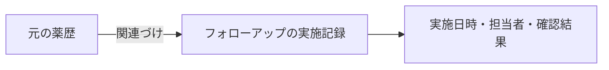
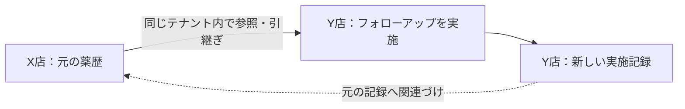

# フォローアップ

## 基本方針

- **元の薬歴と関連づける独立した実施記録**: フォローアップの実施結果は、元の薬歴への追記ではなく、**実施日時・担当者を持つ独立した別記録として作成し、元の薬歴・イベントと関連づける**。
- **同一テナント内の店舗間引継ぎ**: 同じテナント内の別店舗でも引き継いで実施できる。元の薬歴を参照し、実施した店舗の新しい記録として残す（元店舗の薬歴への追記・訂正権限を広げるものではない）。
- **登録済み患者を必須入口とする**: フォローアップも登録済み患者配下の [イベント](care-event.md) として作成し、元の薬歴がない相談起点の場合でも患者への紐づけを必須とする。

## 管理する概念

| 概念 | 主な情報 |
| --- | --- |
| フォローアップ計画 (`FollowUpPlan`) | 計画ID、対象患者、目的、確認事項、予定日時、担当店舗・担当者、元の薬歴・受付イベントの参照、状態（予定・実施済・連絡不能・再予定） |
| フォローアップ実施記録 (`FollowUpRecord`) | 記録ID、イベントID、患者、実施店舗、実施薬剤師、実施日時、連絡方法（電話・情報通信機器等）、確認内容、薬学的評価、対応結果、処方医への情報提供有無、次回方針 |
| 関連 (`CareEventLink`) | 元の薬歴・受付イベント（複数関連づけ可）、フォローアップ計画、前回実施記録への参照 |

予定日時、実際の連絡・確認日時（実施日時）、およびシステムへの記載・確定日時を区別して保持する。

## 店舗間の引継ぎ仕様

- Y店で引き継いでフォローアップを実施した場合、Y店の実施記録にはY店・実施薬剤師・実施日時を記録し、元のX店の記録は変更しない。
- 同じテナント・同じ患者であることを条件に、1回のフォローアップイベントを複数の受付・相談イベント（別店舗を含む）と関連づけられる。

## ドメイン不変条件（確定・訂正・算定適正性）

記録の確定・訂正およびイベント完了は [薬歴記載](medication-history.md) と同一のルールを適用する。

- **確定と追記・訂正**: 下書き中は編集でき、記載者と確定者を別々に保持する（記録元店舗の確定権限を持つ別の保険薬剤師も確定可能）。複数者が記載することもあるが、確定した記録に追記（または訂正）という形にする。確定後は原記載・確定者を保持し、実施店舗の操作権限を持つ薬剤師が追記・訂正を行い本人が確定する。他店舗からは閲覧のみとする。
- **記録確定によるイベント完了と不足事項の注意喚起**: フォローアップ記録を確定するときに、フォローアップイベントも完了として扱う。開設者・イベント種別ごとの記載設定（イベント作成時の版を固定維持）に不足事項があった場合には、確定時に注意を促す。
- **継続的服薬指導の適正性ガード**:
  - 患者等に対して一律の内容の電子メール等を一斉送信するだけの対応は継続的服薬指導として登録不可とし、個別の服薬状況・体調変化を踏まえた**双方向の確認・助言**（AI活用時は薬剤師による確認・介入必須）を必須とする。
  - **麻薬交付後の継続確認**: 麻薬を調剤・交付した患者については、交付後の服用状況・残薬状況・保管状況を継続的に確認し記録する。
  - **調剤後薬剤管理指導料（区分14の4の1・2）**を伴うフォローアップ（糖尿病・慢性心不全患者等）は、**調剤日と同日の実施不可（翌日以降）**とし、事前の患者同意および医療機関への文書情報提供と紐づける。
  - **処方医等への情報提供（トレーシングレポート等）**: フォローアップ等で確認した服薬状況・残薬・副作用疑い等を処方医へ文書提供する場合、服薬情報等提供料1は「保険医療機関からの求め」がある場合に限り算定対象とし、提供した文書の写しまたは要点を必ず薬歴（または関連づけられたフォローアップ記録）に記載・添付する。

関連: [受付・相談・フォローアップのイベント](care-event.md)、[薬歴記載](medication-history.md)、[服薬指導・交付](medication-counseling.md)、[業務フロー](../workflow.md)。
