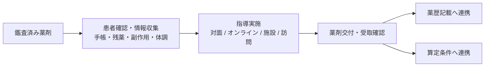

# 服薬指導・交付

## 責務と基本方針

鑑査完了した薬剤について、患者またはその家族等から服薬状況・体調・併用薬・副作用の有無等を確認し、**必要な薬学的指導を行って薬剤を交付する**工程を管理する。指導で得た情報と実施事実は [薬歴記載](medication-history.md) へ引き継ぎ、算定要件となる実施事実は算定領域へ渡す。

- **実施時点と薬歴記載時点の分離**: 実際に指導・交付を行った日時（`実施日時`）と、薬歴を作成・確定した日時を区別する（[業務フロー](../workflow.md)）。
- **指導形態と同意の明確化**: 来局対面、オンライン（情報通信機器）、介護老人福祉施設等への訪問、患家訪問を明確に区別し、必要な患者同意・医師了解の事実を保持する。

## 管理する概念

| 概念 | 主な情報 | 設計上のポイント |
| --- | --- | --- |
| 服薬指導実施 (`MedicationCounseling`) | 指導ID、対象受付イベント、実施店舗、実施薬剤師、実施日時、指導形態（来局対面 / オンライン / 施設訪問 / 患家訪問）、対象者（患者本人 / 家族 / 施設職員） | 指導形態により R8服薬管理指導料（1〜4）の区分が決まる |
| お薬手帳確認・記載 (`NotebookRecord`) | 手帳提示有無（紙 / 電子お薬手帳）、前回からの3月以内判定材料、手帳記載有無 | R8服薬管理指導料1（3月以内・手帳あり）と2（以外）の判定、および乳幼児/小児特定加算の必須要件 |
| かかりつけ薬剤師同意・24時間対応管理 (`KakaritsukeAgreement`) | 患者ID、担当保険薬剤師ID（施設基準届出・要件充足者）、同意取得日、**患者署名付き同意書原本の保管場所・スキャン参照**、**24時間相談応需連絡先および勤務日等の周知確認フラグ**、**お薬手帳への担当薬剤師名・連絡先記載確認フラグ**、**他院受診/他薬局利用時の「かかりつけ有」明示指導フラグ**、**開局時間外等に別薬剤師が対応した場合のかかりつけ薬剤師への情報共有記録**、有効/撤回/終了状態 | 有効な同意記録がない患者へのかかりつけ指導料・包括管理料の算定を禁止。開局時間外等にやむを得ず別薬剤師が対応した場合は、かかりつけ薬剤師への情報共有記録を完了条件とする |
| 特定指導実施記録 (`SpecializedGuidance`) | 指導種別（麻薬指導 / 特定薬剤管理指導1［イ：ハイリスク新規・変更／ロ：既存処方で特に指導が必要と判断した理由要点］ / 同2［悪性腫瘍レジメン確認・副作用状況・文書提供要点］ / 同3［イ：RMP資材等説明交付／ロ：供給不足・長期収載品の該当医薬品名と説明要点］ / 乳幼児［体重・年齢・手帳記載］ / 小児特定［障害児］ / 吸入薬指導［練習用吸入器実技・習得確認・文書提供］）、使用資料、患者同意、医療機関への文書提供有無 | R8服薬管理指導料注6〜12の算定要件・薬歴の構造化算定根拠（`FeeJustification`）および服薬情報等提供料との排他判定に用いる |
| 薬剤交付記録 (`MedicationDelivery`) | 交付ID、交付日時、交付方法（窓口手渡し / 配送［配送業者・追跡情報］ / 訪問手渡し）、受取人区分、受取確認 | オンライン服薬指導時の配送手配と実際の受取完了を管理 |

## モデル上のルール

- **オンライン服薬指導（情報通信機器）の区分**: R8点数表4（イ〜ニ）に対応し、「原則3月以内再度処方箋（手帳あり/なし）」「在宅療養患者（通常 / 状態急変）」を区別して記録する。在宅訪問薬剤管理指導と同日の実施制限（注5）も判定できるようにする。
- **加算と別点数の排他・関連管理（服薬情報等提供料の要件）**:
  - 特定薬剤管理指導加算2（注8）・吸入薬指導加算（注12）を算定する場合、同一内容の服薬情報等提供料（区分15の5）は算定不可となるため、指導実施と文書情報提供の紐づけを保持する。
  - 服薬情報等提供料1は**保険医療機関からの求めがある場合のみ**算定可能とし、提供した文書の写しまたは提供内容の要点を [薬歴記載](medication-history.md) に必ず記載・添付する。
  - かかりつけ薬剤師フォローアップ加算（注13）は、前回の特定管理料算定後に電話等で継続フォローしていた実績（[フォローアップ](follow-up.md)）と紐づけて判定する。
- **調剤後薬剤管理指導料（区分14の4）**: 糖尿病患者・慢性心不全患者に対し、処方医了解または医療機関求め・患者同意のもとで調剤後（同日除く）に電話等確認・継続指導・文書提供を行った実績を管理する。
- **薬剤情報提供文書の記載要件と禁止事項**: 調剤した薬剤と無関係な事項の記載を禁止し、用法・用量・効能・効果・副作用・相互作用・保管上の注意は患者等が理解しやすい平易な表現で提供する。また、**後発医薬品・バイオ後続品の薬価収載有無、および自局で支給可能な備蓄品名と価格比較情報（備蓄がない場合はその旨）**、長期収載品の選定療養に関する説明事項を明記する。
- **JAHIS電子お薬手帳連携の出力制約**: 電子お薬手帳データ（薬品補足`281`、服用注意`291`、用法`301`、残薬確認`421`、備考`501`、患者記入`601`等）を連携する際、**調剤を行わず医薬品提供を伴わない情報提供のみの場合は、処方・薬剤レコード（`51`〜`401`）を出力してはならない**。
- **交付時の確認と取り違え防止**: 患者本人・複数品目の照合確認と交付完了を記録する。

## 他領域との受け渡し

- **薬歴記載へ**: 収集した患者情報、実施した指導内容、交付確認結果を薬歴記載の下書き・参照情報として渡す。
- **フォローアップへ**: 指導時に設定した次回確認計画（調剤後薬剤管理指導やかかりつけフォローアップ等）を引き継ぐ。
- **算定領域へ**: 指導形態、かかりつけ薬剤師実施有無、手帳提示・3月以内条件、実施した特定指導区分（麻薬・ハイリスク・RMP・吸入・乳幼児・小児特定等）、文書情報提供有無を渡す。

関連: [業務フロー](../workflow.md)、[調剤・鑑査](../04-prescription-dispensing/dispensing.md)、[薬歴記載](medication-history.md)、[フォローアップ](follow-up.md)。
