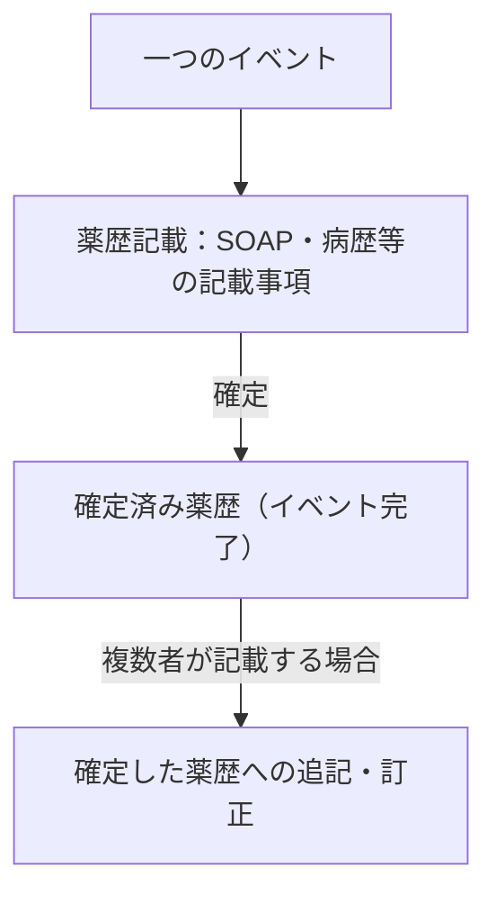
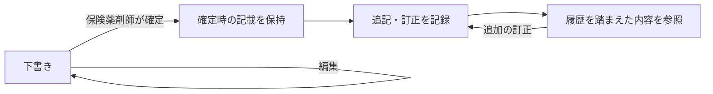

# 薬歴記載

## 基本方針

- **下書きと確定・追記型訂正履歴**: 下書き中は編集でき、確定後は元の記載を残して二本線抹消相当の追記・訂正履歴（誰が・いつ・何を・なぜ訂正したか）で管理する。確定後に下書きへ戻して原記載を上書き消去する操作は設けない。
- **記載者と確定者の分離**: 薬歴の記載者と確定者を別々に保持する。記録元店舗の確定権限を持つ別の保険薬剤師も下書き内容を確認して確定でき、その場合も記載者を確定者へ付け替えない。
- **確定後の追記・訂正と本人確定**: 確定後は、記録元店舗の操作権限を持つ別の薬剤師も追記・訂正できる。原記載・元の記載者と確定者は保持し、追記・訂正は実施した薬剤師本人が確定する（元の記載者の承認は不要であり、元記載者の退職後も行える）。
- **店舗間閲覧と記録元店舗での編集制限**: 同一テナント（同一法人または同一個人開設者）の店舗間では同一患者の薬歴を閲覧できるが、確定・追記・訂正は記録した店舗でのみ行える（他店舗からは閲覧のみ）。

## 薬歴記載の単位と確定・イベント完了・不足事項の注意喚起

- **薬歴記載の単位と複数者による追記**: SOAP・病歴等の記載事項をまとめた一つの薬歴記載を単位とし、1つの [イベント](care-event.md) に紐づける。複数の薬剤師が記載することもあるが、イベントに複数の独立した薬歴記載を並立させるのではなく、**確定した薬歴に追記（または訂正）という形にする**。
- **薬歴確定によるイベント完了と不足事項の注意喚起**: **薬歴記載者が薬歴を確定するときに、イベントも完了として扱う。** 開設者（法人または個人）とイベント種別（処方箋受付・来局相談・電話相談・OTC相談・フォローアップ・在宅訪問・独自種別）の組み合わせごとに設定された記載事項に**不足があった場合には、確定時に注意を促す**。設定変更は新規イベントから適用し、既存イベントは作成時の設定を維持する。

## 情報項目と薬学的構造

調剤管理料（R8区分10の2）・服薬管理指導料（R8区分10の3）・保険薬局及び保険薬剤師療養担当規則（薬担規則）で求められる記録要件を満たすため、一つの薬歴記載は以下の構造化要素を持つ。

| 区分 | 主な情報項目 | 目的・根拠 |
| --- | --- | --- |
| 記載ヘッダ・監査メタデータ | 記録ID、関連イベントID、患者ID、記録店舗、実施薬剤師（指導・分析者）、実施日時、**指導場所（対面窓口 / オンライン / 患家訪問 / 施設訪問）**、作成者ID・作成日時（標準時刻NTP同期）、確定者ID（保険薬剤師）・確定日時、**代行入力情報（代行入力フラグ・誰の代行を誰がいつ行ったかの都度記録）**、適用した記載設定の版 | 実施時点と記載・確定時点の分離、代行入力の追跡性、記録元店舗の特定、監査証跡 |
| 頭書き（患者プロファイル）の時点参照 | 指導時点で参照した患者のアレルギー・副作用・既往歴・併用薬・検査値・配慮事項・同意状態のスナップショット | 後日の患者情報更新によって、当時の判断前提が曖昧にならないようにする |
| 処方・調剤・照会参照 | 対象処方内容（医療機関名・処方医・処方日・調剤日）、**単一ソース参照による疑義照会ID・残薬調整ID**（処方箋備考・調剤録・薬歴の3者完全一致用）、調剤実績（銘柄・後発品変更・一包化・手技等） | 処方箋・調剤録・薬歴の3箇所への二重手入力による記載齟齬を構造的に防止 |
| 前回継続的留意点の引き継ぎ (`CarryOverPrecaution`) | 発生元の前回薬歴記録ID、前回記載された継続的留意点（申し送り）テキスト、**今回指導での確認結果（`確認済み` / `継続観察` / `今回未確認の理由`）** | 前回の「エ：継続的留意点」を自動引き継ぎし、書きっぱなし（次回未確認の放置）を防止 |
| 収集情報・法定確認事項 | 服薬状況（アドヒアランス）、**残薬状況（確認有無・残薬有無・「残薬なし」明記・残薬数・残薬理由・未確認時次回確認指導）**、**副作用・体調変化の有無**、併用薬・OTC・健康食品・相互作用飲食物（GFJ等）の確認結果（**該当なし時も確認事実を記録**）、**お薬手帳提示有無・不利用理由・複数冊未統合理由・当日持参忘れ時指導**、後発品・選定療養の意向、**患者・家族の相談事項の要点** | 残薬ゼロ時も空欄不可（「残薬なし」明記必須）。R8調剤管理料および服薬管理指導料の算定根拠 |
| 薬学的分析・指導（SOAP等） | **S**（患者・家族等の訴え・申告）、**O**（処方・残薬・検査値・電子処方箋重複チェック結果等の客観事実）、**A**（重複・相互作用・用量・RMPに基づく安全性評価・副作用リスク・残薬原因等の薬学的分析）、**P**（実施した指導内容、医師等への情報提供・提案、**次回確認事項［エ：継続的留意点］**、フォローアップ計画） | 薬学的管理の中核記録と次回対応・多職種連携への引き継ぎ |
| 加算コード別構造化算定根拠 (`FeeJustification`) | 算定する加算コードごとの必須構造化フィールド（特定薬剤管理指導1イ/1ロ・2・3イ/3ロ、吸入薬指導、乳幼児服薬指導、重複投薬・相互作用等防止、麻薬管理指導等） | 汎用テキストのみによる法定必須項目の記載漏れを防止 |
| 外部連携・物理保管メタデータ | **処方医や他職種へ提供したトレーシングレポート（服薬情報等提供文書）等の写し・要点**、同意書・指導計画書・**返納麻薬廃棄届の写し（在宅麻薬等）**の添付参照、**過去の紙薬歴（電子化以前・併用分）の保管場所・最終記入日＋3年（公費5年）廃棄ロック管理** | 多職種連携の証跡保持および紙・電子併用患者の過去紙薬歴誤廃棄の防止 |
| 確定・追記訂正履歴 | 対象記録・項目、**変更前後の内容スナップショットと更新の順序性**、理由、追記・訂正者ID、記録日時（標準時刻NTP同期）、本人による確定日時（**二本線抹消相当の追記型履歴**） | 厚労省ガイドライン第7.0版準拠の真正性担保（上書き消去禁止）と訂正順序・経緯の完全追跡（別途 [テナント・アクセス管理](../01-organization/tenant-access.md) のセキュリティアクセスログにも記録） |

### 加算コード別の構造化確認・記載要件 (`FeeJustification`)

算定する管理料・加算コードに応じて、以下の構造化フィールドの記録を求める。

| 対象管理料・加算 | 薬歴に必須となる構造化確認・記載項目 |
| --- | --- |
| **特定薬剤管理指導加算1** | ・**区分イ（新規・変更）**: 対象薬効群（ハイリスク薬）の確認、副作用の初期症状・発現時の対応、併用薬・生活上の注意事項の指導内容 ・**区分ロ（既存処方）**: 従来と同一処方でありながら**「特に指導が必要と保険薬剤師が判断した理由の要点」** |
| **特定薬剤管理指導加算2** | レジメン（治療計画）の確認、副作用の発現状況および指導内容、医療機関へ情報提供した要点 |
| **特定薬剤管理指導加算3** | ・**区分イ（RMP等）**: RMPに基づく患者向け資材や製薬企業資材等を用いた説明と交付事実 ・**区分ロ（供給不足・長期収載品）**: 供給不足等で説明・変更を行った**該当医薬品名**および患者への説明要点（レセプト `TK` 摘要欄へ連動） |
| **吸入薬指導加算** | 文書および**練習用吸入器等を用いた実技指導**の実施、手技の習得確認結果（6月に1回制限チェック含む） |
| **乳幼児服薬指導加算** | 体重・年齢の確認、保護者等への服用・保管上の指導要点、**お薬手帳への必要事項記載** |
| **重複投薬・相互作用等防止加算（残薬調整／有害事象防止）** | 薬学的問題点の検出内容、処方医への疑義照会日時・回答、**処方変更の事実**（単一ソースの疑義照会ID・残薬調整IDを引用し、処方変更がない残薬確認のみでの算定等をブロック） |
| **麻薬管理指導加算** | 調剤後の電話等による**継続的な服用・残薬・保管状況の確認**記録、指導要点、返納麻薬がある場合は**麻薬廃棄届の写し添付**（在宅等） |

### 頭書き（患者臨床プロファイル）との連動

指導や確認の中で新たに判明したアレルギー歴・副作用歴・既往歴・併用薬・検査値・服薬上の配慮事項は、当該イベントの薬歴記載（S/O等）に記録するとともに、テナント共通の [患者臨床プロファイル（頭書き）](../03-patient-coverage/patient.md#管理する概念と保持情報) へ追記・更新する。これにより、他店舗での受付や次回の [処方監査](../04-prescription-dispensing/prescription-review.md) でも最新の安全情報が参照・警告される。過去の確定済み薬歴記載の内容自体は当時の記録として変更しない。

## ドメイン不変条件（ビジネスルール）

特定共同指導の指摘事項および厚労省「医療情報システムの安全管理に関するガイドライン」に準拠するため、以下の不変条件を持つ。

1. **指導完了と記録の同期（即時完了検知・代行入力滞留アラート）**: 指導後速やかに記載を完了させる。下書き状態で放置された記録、調剤実施日を跨いで未確定のままの記録、および**事務員等による代行入力から保険薬剤師承認までの経過時間（未承認滞留）を監視し、管理薬剤師等へアラート**する。
2. **前回「継続的留意点（申し送り）」の自動引き継ぎと回収確認**: 新規に薬歴記載を作成する際、同一患者の前回確定記録にある「継続的留意点」を自動的に未処理タスク（`CarryOverPrecaution`）として引き継ぎ、今回の確認結果（確認済み / 継続観察 / 今回未確認理由）の記録漏れに対して確定時に注意を促す。
3. **定型文・画一的記載の抑止**: テンプレートをそのまま保存しただけの画一的記載を防ぐため、患者固有の訴え・体調変化・残薬理由等の実質的な記載がない状態での完了を制約する。
4. **加算算定と構造化根拠記録（`FeeJustification`）の整合**: 特定薬剤管理指導加算（1イ/1ロ・2・3イ/3ロ）、調剤後薬剤管理指導料、外来服薬支援料（一包化理由・医師了解）、吸入薬指導加算、乳幼児服薬指導加算、麻薬管理指導加算等を算定する場合は、加算コード別の構造化根拠フィールドが揃っていることを検証する。
5. **追記型履歴による真正性担保**: 確定後の修正は上書き消去（塗りつぶし）を禁止し、二本線抹消に相当する追記型履歴（変更前後・理由・修正者・修正日時）で保持する。
6. **保存期間の起算点と過去紙薬歴の廃棄ロック（患者単位の全記録保持）**: 法定保存期間（原則3年、生活保護法5年）は「各調剤日から」ではなく**「最終記入日から起算して」**であるため、直近3年分だけ残して過去分を廃棄することは禁止し、電子化以前・併用分の**過去の紙薬歴についても最終記入日＋3年（公費5年）未満の廃棄を禁止するロック管理**を行う。
7. **承認ゲートによる無根拠請求の防止（代行入力対応）**: 事務員等が下書き・代行入力（承認待ち）を行った状態や未確定の状態では、その調剤に対する調剤報酬の確定およびレセプト請求（`07-reimbursement-billing`）への組み込みをブロックする。確定（承認）操作は有効な**保険薬剤師**登録を持つスタッフのみが行える。
8. **残薬ゼロ・併用薬該当なしの明記**: 残薬がない場合でも空欄を認めず「残薬なし」の明記を必須とする（確認できない場合は次回確認指導の旨を記録）。併用薬・相互作用についても該当なしの確認事実を残す。

## 他領域との境界

- **処方・調剤との分離**: 処方・調剤内容の登録・訂正はレセコン機能側で行い、薬歴の追記・訂正によって処方や調剤の正本を変更しない。また、外部NSIPS再受信で処方・調剤取込データが更新されても、薬剤師の記載・確定・追記訂正履歴は上書きしない。
- **フォローアップとの連携**: フォローアップの実施結果は元の薬歴への追記ではなく、実施日時・担当者を持つ独立した別記録として作成し元の薬歴に関連づける（[フォローアップ](follow-up.md)）。
- **認可制御**: 記録元店舗の操作権限や必須設定変更権限は [テナント・アクセス管理](../01-organization/tenant-access.md) の RBAC モデルで制御する。

関連: [患者](../03-patient-coverage/patient.md)、[処方箋](../04-prescription-dispensing/prescription.md)、[処方監査・疑義照会](../04-prescription-dispensing/prescription-review.md)、[服薬指導・交付](medication-counseling.md)、[業務フロー](../workflow.md)。
