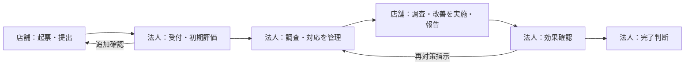

# 品質・インシデント

## 基本方針

- **薬局ヒヤリ・ハット事例収集・分析事業フォーマット準拠**: インシデント・ヒヤリハットの起票から事実確認、是正措置、効果確認、完了判断までを追跡し、薬局ヒヤリ・ハット事例収集・分析事業へ報告可能なデータ構造を備える。
- **発生店舗の開設法人による管理**: インシデント・ヒヤリハットは店舗から起票し、発生店舗の開設者（法人：区分 `法人` / `個人`）が自テナント内で管理する。患者への臨床対応や処方・調剤記録そのものの訂正は、それぞれの業務領域が正本として担当する。

## 店舗と開設法人の役割

| 担当 | 責務と操作 |
| --- | --- |
| 起票店舗 | 発生・発見の状況、初期対応、関連記録（処方・調剤・指導等）を入力し、開設法人へ提出する |
| 法人の管理担当 | 受付、初期評価、担当割当、追加確認指示、調査・是正措置の進捗管理、効果確認、完了判断を行う（個人開設では個人開設者テナントの管理担当者が担う） |
| 店舗の対応担当 | 追加確認に回答し、原因調査・是正改善を実施して結果を報告する |

### 管理主体とテナント境界

- **親法人への自動委任禁止**: 法人が開設する店舗の報告はその法人（個人区分含む）のテナント内で管理する。親子法人関係を理由に親法人等へ案件管理・閲覧権限を自動付与しない。
- **起票店舗と発生店舗が異なる場合**: **発生店舗（およびその開設法人）**を管理主体とする。
- **店舗譲渡（M&A）時の扱い**: 店舗譲渡（開設者変更）前に起票された案件は原則として起票時の旧法人が管理・完了させ、必要な場合のみデータ承継の承認を経て新法人へ引き継ぐ。

## 管理する概念

| 概念 | 主な情報 |
| --- | --- |
| 報告 (`IncidentReport`) | 報告ID、起票店舗、発生店舗、管理主体（法人）、発生日時、発見日時、報告者、提出日時、事象区分・概要（ヒヤリハット収集事業準拠項目）、状態（下書き・提出済・調査対応中・効果確認中・完了・取下げ） |
| 関連記録参照 | 関連する処方・調剤・指導・薬歴等の参照先、必要最小限の患者参照 |
| 原因調査 (`IncidentInvestigation`) | 確認した事実、発生要因（当事者・環境・システム・手順等）、原因の根拠 |
| 対応・是正措置 (`CorrectiveAction`) | 緊急対応、再発防止策、法人側の管理担当、店舗側の実施担当、期限、実施結果 |
| 効果確認 (`EffectivenessReview`) | 確認方法、確認結果、判断者、完了日時 |

## 業務フロー

緊急対応は原因調査の完了を待たずに記録・実施できる。重複報告や対象外案件は状態変更（取下げ・統合）として理由付きで整理し、再発や追加情報があれば再開できる。

## モデル上のルール

- **報告内容と調査事実の分離**: 起票時の報告内容と、調査で確認した事実・判断を区別し、提出後の追加確認・追記・訂正はすべて履歴として保持する（提出済み原記載の上書き消去および物理削除は行わない）。
- **臨床正本との分離**: インシデント報告内の記述を更新しても、[調剤・鑑査](../04-prescription-dispensing/dispensing.md) や [薬歴記載](medication-history.md) の正本は自動更新しない（各領域での正式な訂正記録への参照を紐づける）。
- **患者プライバシーと認可制御**: 案件管理担当であることと個別患者の薬歴全文を閲覧できることは別に認可し、他店舗へ個別案件を自動公開しない。なお、緊急連絡通知機能や固定的な完了承認者ロールは設けず、[テナント・アクセス管理](../01-organization/tenant-access.md) の RBAC で権限を制御する。

関連: [店舗](../01-organization/store.md)、[スタッフ](../01-organization/staff.md)、[テナント・アクセス管理](../01-organization/tenant-access.md)。
