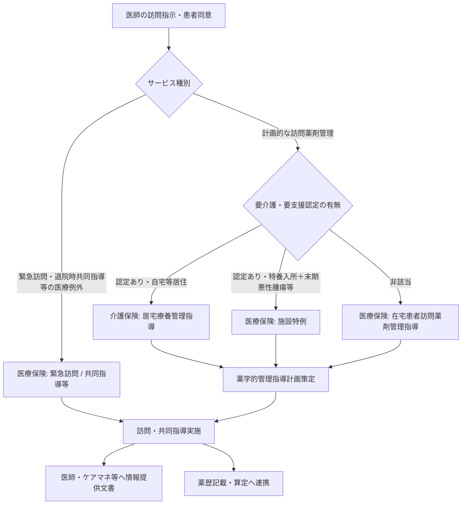

# 在宅医療・訪問薬剤管理

## 責務と基本方針

通院が困難で在宅療養を行っている患者（自宅・施設居住者含む）に対し、**医師の訪問指示と患者・家族の同意**に基づき、薬学的管理指導計画の策定、患家・施設への訪問、多職種連携、および緊急時の訪問・指導を管理する。

- **医療保険と介護保険の切り分け（居住形態・提供サービス別判定）**:
  - **計画的な訪問薬剤管理**: 要介護・要支援認定を受けている患者が自宅等に居住している場合は、末期悪性腫瘍や特定疾患であっても**介護保険（居宅療養管理指導費・介護予防居宅療養管理指導費）**が優先され、医療保険の在宅患者訪問薬剤管理指導料（区分15）は算定できない。末期悪性腫瘍患者に対して計画訪問で医療保険が例外適用されるのは、**特別養護老人ホーム（介護老人福祉施設）入所者**など居宅療養管理指導の対象外となる施設居住形態に限られる。
  - **緊急訪問・共同指導等の個別サービス**: 計画訪問とは切り分け、急性増悪等による医師の求めに基づく緊急訪問薬剤管理指導料（区分15の2）や退院時共同指導料（区分15の4）など、給付調整通知で医療保険算定が認められる個別サービスのみを例外として扱う。
- **施設種別による区分**: 特別養護老人ホーム（介護老人福祉施設）入所者への訪問（R8服薬管理指導料3や外来服薬支援料2施設連携加算、末期悪性腫瘍時の特例等）と、自宅・有料老人ホーム等への訪問（居宅療養管理指導費／医療保険非該当時の在宅患者訪問薬剤管理指導料）を区別する。



### 在宅療養契約のライフサイクル（状態遷移）

```text
[契約準備・退院時共同指導]
   │ (医師の訪問指示受領 ＆ 患者同意 ＆ 指導計画策定)
   ▼
[在宅管理中 (ACTIVE)]
   ├──▶ 定期訪問 / 緊急訪問 / 医師同時指導 ──▶ [訪問実績確定] ──▶ (薬歴・調剤録・報酬算定へイベント通知)
   │
   └──(施設入所・入院・契約終了・患者死亡)──▶ [終了 (TERMINATED)]
```

## 管理する概念

| 概念 | 主な情報 | 設計上のポイント |
| --- | --- | --- |
| 在宅契約・同意 (`HomeCareAgreement`) | 患者ID、対象店舗、利用制度（医療保険 / 介護保険）、患者・家族同意取得日、同意書参照、開始日・終了日、交通費負担説明 | [保険・公費等](../03-patient-coverage/coverage.md) の要介護認定情報と連動して制度区分を決定 |
| 医師の訪問指示 (`HomeCareOrder`) | 指示医療機関、指示医師、指示日、対象期間・頻度、急変時緊急訪問指示有無、経過措置該当（H24.3.31以前指示） | 緊急訪問（区分15の2）は在宅療養を担う保険医または連携医の求めが必要 |
| 薬学的管理指導計画 (`PharmaceuticalCarePlan`) | 計画ID、患者、担当薬剤師、策定日、見直し日、対象疾患・服薬管理目標、訪問予定頻度、配薬方法（一包化・カレンダー等） | 計画策定・見直し履歴を保持し、計画外の臨時疾病対応と区別 |
| 居住建物・距離判定 (`ResidenceContext`) | 患家住所・建物ID、同一建物内の当該薬局訪問対象者数（**単一建物診療患者人数**：1人 / 2〜9人 / 10人以上）、店舗からの直線距離（**16km判定**・特殊事情メモ） | R8点数区分（1/2/3）および在宅薬学総合体制加算2（イ/ロ）の判定根拠。店舗拠点の緯度経度（[店舗](../01-organization/store.md)）と患家住所から確認 |
| 訪問実施記録 (`HomeVisitRecord`) | 訪問ID、区分（計画訪問 / 緊急訪問［急変・それ以外・感染症］ / 医師同時指導 / 複数名訪問［同行職員・在宅協力薬局職員］ / 退院時共同指導 / 緊急時等共同指導カンファレンス / 在宅移行初期管理）、訪問開始終了日時（夜間・休日・深夜判定）、実施薬剤師、麻薬・持続注射・中心静脈栄養・経管投薬・乳幼児・小児指導実績、交通費実費 | 訪問回数の月次・週次上限（月4回、末期悪性腫瘍等は週2回かつ月8回、薬剤師1人週40回上限）のカウント元 |
| 多職種情報提供・カンファレンス (`MultidisciplinaryReport`) | 提供先（指示医・連携医・ケアマネジャー等）、参加職種（退院時/緊急時共同指導）、提供日時、提供文書内容、算定区分 | 退院時共同指導・緊急時等共同指導・在宅患者への情報提供（服薬情報等提供料との排他管理）を記録 |

## モデル上のルール

- **介護保険優先と医療保険との重複禁止（居住形態・提供サービス別判定）**: 要介護・要支援認定を受けている患者が自宅等に居住している場合は、末期悪性腫瘍等であっても計画的な訪問薬剤管理には**介護保険（居宅療養管理指導）**を優先適用し、同一月・同一定期訪問で医療保険の在宅患者訪問薬剤管理指導料（区分15）を重複算定させない。末期悪性腫瘍患者に対する計画訪問の医療保険特例は特別養護老人ホーム（介護老人福祉施設）入所者等の居宅療養管理指導対象外施設に限定し、自宅患者への医療保険算定は急性増悪時の緊急訪問（区分15の2）や退院時共同指導（区分15の4）など、給付調整通知で認められる個別サービスに限定する。
- **医師指示・同意・指導計画の事前条件**: 有効な `HomeCareOrder`（医師訪問指示・指示期間内）および患者・家族の同意、薬学的管理指導計画が存在しない状態での定期訪問確定・算定を禁止する。
- **訪問時の処方箋原本受領義務（特定共同指導 I-1 3(2)）**: FAX等で事前に処方内容を受領して調製し患家を訪問した場合、訪問時に必ず**処方箋原本を受領し、電送内容と同一であることを確認**しなければならない。
- **回数上限の追跡**:
  - 同一患者に対する計画訪問（在宅患者訪問薬剤管理指導料）＋オンライン在宅服薬指導（区分10の3の4ロ）の合算は、原則**月4回**（末期悪性腫瘍・注射麻薬・中心静脈栄養対象患者は**週2回かつ月8回**）。
  - 緊急訪問（区分15の2）＋オンライン緊急指導（区分10の3の4ハ）も同様の月次上限管理対象。
  - 保険薬剤師1人あたりの算定上限（**週40回**）を集計・警告できるよう、担当薬剤師ごとの実施回数を集計可能にする。
- **16km 制限と交通費**: 薬局所在地と患家所在地の距離が16kmを超える場合は特殊事情を除き算定不可（平成24年3月31日以前指示の経過措置除く）。交通費は患家負担として窓口会計（自費項目）へ連携する。
- **他区分との同日・併用・算定要件の整合（R8対応）**:
  - **在宅移行初期管理料（15の8、1回まで）**: 在宅患者訪問薬剤管理指導料 `1` の算定時のみ許可し、同日の外来服薬支援料1（14の2の1）は不可とする。
  - **複数名薬剤管理指導訪問料（15の10、1回ごと）**: 在宅患者訪問薬剤管理指導料 `1` または緊急訪問薬剤管理指導料 `1/2` の算定時のみ許可する。
  - 訪問薬剤管理医師同時指導料（15の9）や複数名薬剤管理指導訪問料（15の10）の同日併用制限（15の3・15の8等）を判定できるよう、同日実施イベントを照合できる構造とする。
  - 在宅患者訪問薬剤管理指導料を算定している患者に対する別疾病の臨時投薬時は、外来服薬管理指導料（区分10の3注15）の例外として区別する。
- **在宅協力薬局との連携**: 複数名薬剤管理指導訪問料（15の10）や在宅協力薬局が分析・指導を実施し在宅基幹薬局が算定する場合は、同行職員・在宅協力薬局情報および連携区分（`調管`, `調時`, `支B` 等）を明示して記録する。

## 他領域との受け渡し

- **保険・公費等へ**: 介護保険・医療保険の適用区分確認。
- **薬歴記載へ**: 訪問時の確認事項・指導内容・計画変更・カンファレンス内容を薬歴記録として保持。
- **算定・会計へ**: 単一建物診療患者数区分、訪問種別、加算要素（麻薬・持続注射・IVH・乳幼児・小児特定・夜間休日深夜）、同日併用情報、交通費実費を渡す。

関連: [保険・公費等](../03-patient-coverage/coverage.md)、[服薬指導・交付](../05-pharmaceutical-care/medication-counseling.md)、[フォローアップ](../05-pharmaceutical-care/follow-up.md)、[店舗](../01-organization/store.md)。
