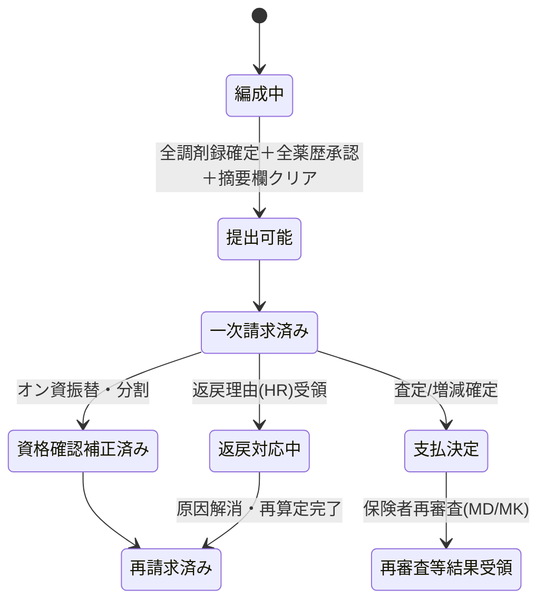

# 保険等の請求・審査支払

## 責務と基本方針

月次の調剤報酬算定結果（[調剤報酬算定](reimbursement.md)）を保険者・公費組合せ・提出先機関単位で束ねて**調剤報酬明細書（レセプト）**を編成し、**一次請求・資格確認補正/振替・返戻対応・再請求・再審査**のライフサイクルを管理する。

- **請求前承認ゲート**: 調剤録が確定済みであり、かつ紐づく薬歴が**保険薬剤師により確定・承認済み**でない限り、レセプトを提出可能状態へ進めない（未承認代行入力のままの請求防止）。
- **非破壊の履歴完全性**: 資格確認による振替・分割、返戻後の再請求、再審査が行われても、過去の請求提出スナップショットは削除せず、レセ電データ識別コード（`1`〜`16`）で世代を区別して追記保持する。

## 管理する概念

| 概念 | 主な情報 | 設計上のポイント |
| --- | --- | --- |
| 月次レセプト (`MonthlyReceipt`) | レセプトID、調剤年月、患者ID、保険者・公費組合せ、提出先機関（支払基金 `14_RECODEINFO_PHA.CSV` / 国保連 `24_RECODEINFO_PHA.CSV`）、レセプト管理番号（9〜16桁、`MN`）、薬局情報（`YK`）、レセプト共通（`RE`）、保険者（`HO`）、公費（`KO`）、資格確認（`SN`）、受診日等（`JD`）、窓口負担額（`MF`）、処方基本（`SH`）、調剤情報（`CZ`）、医薬品（`IY`）、特定器材（`TO`）、コメント（`CO`）、摘要欄（`TK`）、基本料・薬学管理料（`KI`）、分割技術料（`ST`）、状態 | 1件のレセプト先頭に1つの `MN` を持ち、`MN` → `YK` → `RE`〜`MF` → `SH` → `CZ` → `IY` → `TO` → `CO` → `TK` → `KI` → `ST` の16レコード順序・文字コード・バイト数制約を厳守 |
| 請求提出スナップショット (`ClaimSubmissionSnapshot`) | データ識別コード（一次請求 `1` / 資格確認前 `5` / 再請求 `1` / 再請求前 `11`, `15`）、提出日時、受付回数・合計点数、出力データ参照 | 提出した原本スナップショットを不変保持 |
| 資格確認補正・振替記録 (`EligibilityAdjustmentRecord`) | データ識別（`6` 資格確認補正 / `2` 支払決定・補正 / `12`, `16` 再請求前）、事由レコード（`JY`：補正区分 `1:追加`, `2:修正`, `3:削除`, `4:分割`, `5:復活`、補正対象/補正後行番号・枝番号・事由）、資格確認運用（`ON`：資格有効期間・仮払請求等理由・資格喪失前後点数）、審査運用・管理（`EX`/`RC`）、振替先/分割先レセプトID | オンライン資格確認による保険者振替・分割の差分を履歴として取り込む |
| 返戻・再請求記録 (`ReturnAndReclaimRecord`) | 返戻理由レコード（`HR`：データ識別 `14`）、返戻受領日、是正内容、再請求スナップショット（データ識別 `11`〜`16` ＋ 最新 `1`/`2`） | 返戻理由を取り込み、原因解消後の再請求履歴を連結管理 |
| 再審査等記録 (`ReexaminationRecord`) | 再審査申し出（`MD`, `RT`, レセプト縦覧 `JR`: データ識別 `3`/`13`）、申し出結果（`MK`, 補正データ `JY`/`EX`/`RC`: `4`/`14`） | 保険者からの再審査請求・縦覧情報と結果を保持 |
| 請求前突合点検記録 (`PreClaimReconciliation`) | 対象請求年月・店舗、処方箋・調剤録・レセプト3者突合確認者（保険薬剤師）、確認完了日時、自動整合チェック結果 | システム自動チェックに加え、保険薬剤師による3者突合点検完了を提出可能化（`READY_TO_SUBMIT`）の業務証跡として保持 |
| 増減通知管理 (`AssessmentAdjustmentNotice`) | 審査支払機関からの増減点通知書参照、受領日、減点対象レセプト・減点事由分析、**翌月以降の算定・摘要欄・薬歴記載への是正アクション記録** | 特定共同指導指摘事項（増減通知の保管と翌月以降の請求・記載改善への活用）を構造化して追跡 |

## モデル上のルール（不変条件）

1. **提出前ゲートと5大整合性チェック（無根拠請求・形式エラーの防止）**: `MonthlyReceipt` が `提出可能` へ遷移するためには、以下の5条件をすべて満たさなければならない。
   - **① データ識別とレコード順序**: `MN`〜`ST` のレコード並び順・バイト数・文字モードがレセ電仕様通りであること。
   - **② 受付回数の一致**: `HO`/`KO` の処方箋受付回数（同一薬局の分割調剤2回目以降はカウント除外）と、`CZ` および `KI` の処方箋受付回数（両者は必ず同一値）に矛盾がないこと。
   - **③ 医薬品（`IY`）用量定義の剤形一致**: 内服/湯薬＝1日量、外用/注射/滴剤＝全量、屯服＝1回量＋全量、浸煎薬＝全量＋日数、鎮痛消炎貼付剤＝枚数全量＋1日量/日数のルールに従っていること。
   - **④ 摘要欄（`TK`）電算コードの網羅**: 算定項目に対応する選択式コメントコード（麻薬免許番号、一包化 `(支B)`、供給不足特例、重複防止要点、一般名先発理由、特定指導2/3ロ、介護保険訪問日・要支援/要介護度、14日超理由、分割後レセプト旨）がすべて揃っていること（フリーテキスト単独不可）。
   - **⑤ 調剤録確定と薬歴の保険薬剤師承認**: すべての調剤行為について [調剤・鑑査](../04-prescription-dispensing/dispensing.md) の調剤録が確定済みであり、かつ `KI` に計上された全薬学管理料・加算について [薬歴記載](../05-pharmaceutical-care/medication-history.md) 上で**保険薬剤師によって確定・承認済みの算定根拠**が存在すること。
2. **レセ電データ識別による非破壊履歴**:
   - 資格確認により振替・分割が発生した場合は、元の薬局請求内容を「資格確認前請求データ（`5`）」、置換後を「請求データ（`1`）」、差分を「資格確認補正データ（`6`）」として区別して保持する。
   - 返戻後の再請求や再審査時は、過去の請求決定データを削除せず、再請求前データ識別（`11`, `12`, `15`, `16`）へ退避し、最新のみを `1`, `2` として扱う。
3. **振替・分割時のレセ電レコード整合性**:
   - **分割調剤（同一薬局2回目以降）**: 保険者（`HO`）・公費（`KO`）レコードの「処方箋受付回数」としてカウントしない。また、調剤情報（`CZ`）と基本料・薬学管理料（`KI`）の処方箋受付回数は必ず同一値を記録する。
   - **振替発生時の保険者（`HO`）**: 変更後保険者のレコードには薬局が記録した「証明書番号」を記録しない。
   - **振替・分割時の受診日（`JD`）と摘要欄（`TK`）**: 算定日情報に不一致がある場合は受付等区分コード `9` を記録し、分割後のレセプト最終行には「分割後のレセプトである旨」の摘要欄レコードを記録する。
4. **返戻再請求の是正ゲートと増減通知フィードバック**: `返戻理由 (HR)` を受領したレセプトは、原因となった上流領域（[保険・公費等](../03-patient-coverage/coverage.md) の資格修正、[調剤・鑑査](../04-prescription-dispensing/dispensing.md) の訂正、[調剤報酬算定](reimbursement.md) の再計算等）での是正が完了するまで再請求状態へ遷移できない。また、審査支払機関からの増減点通知（査定結果）は保管・記録し、その増減原因を翌月以降の算定・薬歴記載・摘要コメントチェックへフィードバックする。
5. **M&A（事業譲渡）時の責任境界**: 譲渡日前に調剤されたレセプトの請求・返戻対応・増減通知確認は譲渡元（旧法人）の責任とし、譲渡先（新法人）側からの遡及変更・修正請求を禁止する。

## 他領域との受け渡し

- **調剤報酬算定から**: 確定した算定明細・必須摘要欄コメントを受け取る。
- **保険・公費等から**: 月内資格変更イベントおよび有効な保険・公費組合せを受け取る。
- **介護保険請求**: 要介護被保険者の居宅療養管理指導費等の介護給付費明細書は、医療保険レセプトとは別の国保連提出系統として編成・出力する。

関連: [調剤報酬算定](reimbursement.md)、[窓口会計](payment.md)、[保険・公費等](../03-patient-coverage/coverage.md)、[共通の詳細論点](../01-organization/cross-cutting-issues.md)。
