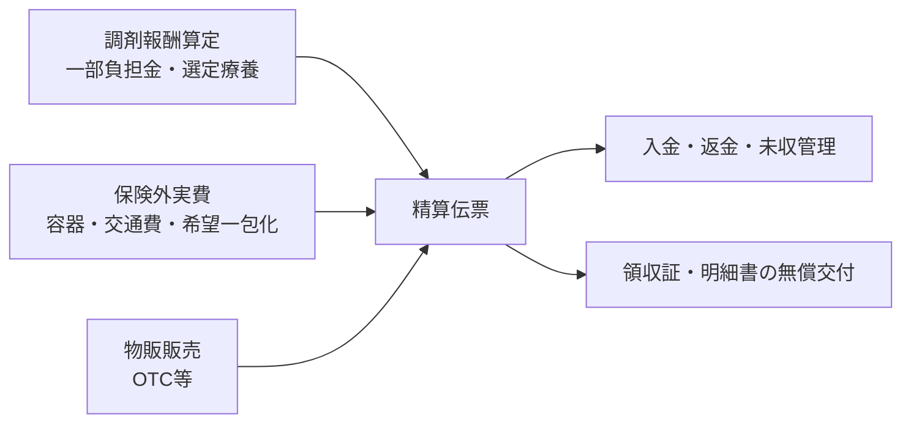

# 窓口会計

## 責務と基本方針

[調剤報酬算定](reimbursement.md) が算出した保険調剤の一部負担金・選定療養費と、保険外の自費項目（容器代・交通費等）、および物販（`08-inventory-retail`）を束ねて**患者への請求・精算・入金・返金・未収金（債権）**を管理し、法定の**領収証および明細書**を発行する。

- **算定結果と実支払の分離**: 「算定上いくらか（請求額）」と「実際に窓口等でいくら受領・返金したか（決済・未収）」を明確に区別する。
- **領収証・明細書の無償交付義務（薬担規則第4条の2）**: レセプト電子請求が義務付けられた保険薬局では、一部負担金等の支払いがある場合はもちろん、**公費負担医療等で患者負担が0円の場合であっても明細書を無償交付**する（患者が交付を希望しない場合は事前の申し出により対応）。

## 管理する概念

| 概念 | 主な情報 | 設計上のポイント |
| --- | --- | --- |
| 精算伝票 (`PaymentStatement`) | 精算ID、店舗、患者、精算対象（調剤受付 / 在宅訪問 / 物販）、保険一部負担金、選定療養費（特別の料金）、自費項目明細、消費税対象、合計請求額、精算状態（未精算・一部入金・精算済・取消） | 保険調剤と自費・物販の区分を明細レベルで保持 |
| 自費・実費項目 (`OutOfPocketItem`) | 区分（薬剤容器代［再使用不可容器は不可］、小型吸入器・散粉器実費［返還時返金］、治療上必要性なき希望一包化、紛失再交付薬剤費、在宅/訪問交通費、16km超自費訪問等）、金額 | R8点数表通知で徴収可否が定められた項目のみを適正に扱う |
| 入金・返金記録 (`PaymentTransaction`) | 取引ID、精算ID、取引種別（入金 / 返金）、支払手段（現金・キャッシュレス等）、金額、取引日時、担当者 | 返戻・資格変更による過誤精算時の差額返金・追徴を追跡 |
| 未収金・債権 (`Receivable`) | 精算ID、発生店舗、発生時点の開設法人、未収残高、回収状態、催促履歴 | M&A（事業譲渡）時に譲渡前未収債権の回収・返金責任者を明確にするため発生時法人を保持 |
| 領収証・明細書交付記録 (`ReceiptIssueLog`) | 発行種別（領収証 / 明細書 / 領収証兼明細書）、発行日時、発行区分（無償発行 / 患者希望により省略）、記載内容変更時の情報提供有無 | 薬担規則第4条の2（0円患者への無償交付、内容変更時の通知努力義務）の証跡 |

## モデル上のルール

- **一部負担金の適正徴収義務（減免・値引きの禁止）**: 薬担規則に基づき、法定の負担割合および10円未満四捨五入ルールに従って算出した患者一部負担金は適正に徴収しなければならず、恣意的な減免・値引き・端数切り捨てを禁止する。
- **容器・吸入器・薬袋の費用ルール**: 薬包紙・薬袋の費用や、直接投薬用に製品化されたチューブ・使い捨て容器の費用は患者から徴収できない。小型吸入器・散粉器の実費を徴収した場合で患者が返還したときは実費を返還する。
- **保険資格変更・返戻時の再精算**: 資格喪失や保険切替・負担割合変更により再算定が行われた場合、元の精算・入金履歴を消さずに差額精算（返金または追加請求）の記録を追加する。
- **M&A（事業譲渡）時の債権境界**: 譲渡日前に発生した未収金・返金義務は原則として発生時の旧法人に帰属し、譲渡後の回収代行や債権譲渡を行う場合も承継記録（[共通の詳細論点](../01-organization/cross-cutting-issues.md)）と連動して責任者を追跡する。

## 他領域との受け渡し

- **調剤報酬算定から**: 一部負担金額・選定療養費・算定項目内訳を受け取る。
- **在宅・服薬指導から**: 交通費実費・オンライン配送実費・治療上必要性なき一包化等の情報を受け取る。
- **在庫・物販から**: OTC・一般商品の販売金額を受け取る。

関連: [調剤報酬算定](reimbursement.md)、[保険等の請求](billing-claim.md)、[在宅](../06-home-care/home-care.md)、[商品・物販](../08-inventory-retail/README.md)。
