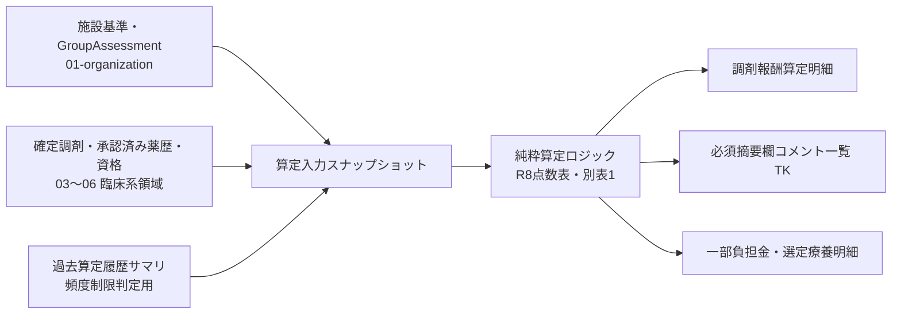

# 調剤報酬算定

## 責務と基本方針

1回の調剤（または在宅訪問等）について、上流領域から受け取る**不変の入力スナップショット**に基づき、**調剤報酬点数・加算・減算・患者一部負担金・必須摘要欄コメント**を決定論的に算出する。

- **ステートレスな純粋計算**: 算定ロジック自体は永続的な状態を持たず、同じ入力スナップショット（施設基準・資格・調剤・承認済み薬歴・過去算定履歴）からは常に同じ計算結果を返す純粋ドメインサービスとして設計する。
- **承認済み根拠との連動（初期設定での自動算定禁止）**: レセコンの初期設定（デフォルト値）のまま指導未実施で服薬管理指導料や各種加算を自動算定することを禁止する。[薬歴記載](../05-pharmaceutical-care/medication-history.md) で保険薬剤師により確定・承認された指導記録と紐づかない薬学管理料・指導加算は算定を許可しない。
- **制度改定への隔離**: 令和8年度改定（調剤ベースアップ評価料・調剤物価対応料・地域支援再編等）や令和9年6月以降の点数変更（200/100）を制度版付きルールとして保持する。

## 入力と出力モデル（値オブジェクト群）

| 区分 | モデル要素名 | 主な情報・属性 | 役割・制約 |
| --- | --- | --- | --- |
| 入力 | **施設算定プロフィール** | 調剤基本料区分（1/2/3イロハ/特別A/B）、注4該当有無、地域支援・医薬品供給対応体制加算（1〜5）、連携強化、バイオ後続品、在宅薬学総合（1/2イロ）、電子的調剤情報連携、門前立地依存減算、ベースアップ届出 | [施設基準・届出](../01-organization/facility-compliance.md) から調剤日時点で有効な届出状態を取得 |
| 入力 | **調剤・薬歴算定コンテキスト** | 受付日時区分（時間外/休日/深夜/夜間休日等）、複数医療機関同時受付（注3）、剤(RP)・薬剤・特定器材、特殊調製（自家製剤等）、分割調剤区分、承認済み薬学管理料・加算根拠一覧、介護/医療保険区分 | [調剤・鑑査](../04-prescription-dispensing/dispensing.md)・[薬歴記載](../05-pharmaceutical-care/medication-history.md)（承認済みのみ）等から構成 |
| 入力 | **過去算定履歴サマリ** | 当月・過去3月・過去6月・生涯1回限りの既算定回数（物価対応料、吸入薬、フォローアップ、服用薬剤調整支援料2等） | 算定頻度制限（「3月に1回」「6月に1回」「1回まで」）の判定に使用 |
| 出力 | **調剤報酬算定明細** | 調剤基本料、薬剤調製料、調剤管理料、薬学管理料、薬剤料、特定保険医療材料料、その他（区分40・41）、合計点数 | 各区分ごとの所定点数・加算・減算の内訳を保持 |
| 出力 | **必須摘要欄コメント一覧** | 算定項目に連動してレセプト摘要欄（`TK`）へ記載必須となる文字列と対象剤番号 | 記載漏れによる返戻・査定を防ぐため算定結果と一体で出力 |
| 出力 | **一部負担金・選定療養明細** | 保険負担割合、公費負担額、患者一部負担金額、長期収載品の特別の料金（選定療養費） | [窓口会計](payment.md) の徴収金額およびレセプト `MF` レコードの根拠 |

## 計算順序とビジネスルール（不変条件）

1. **調剤基本料（区分00）の3段階計算順序**
   - **第1段階（乗算減算と端数処理）**: 所定点数（47/30/25/20/37/5/3点）に対し、注3（複数医療機関同時受付 `80/100`）および注4（妥結率5割以下・未報告・かかりつけ基本的業務1年未実施 `50/100`）を乗じ、**小数点以下第一位を四捨五入**する。
   - **第2段階（加算・減算の適用）**:
     - 地域支援・医薬品供給対応体制加算（1〜5）：特別調剤基本料Aは `10/100`（小数点以下第一位四捨五入）、特別調剤基本料Bは算定不可。
     - 連携強化加算（5点）：特別Aで対象医療機関が感染対策向上加算等届出時は算定不可。特別Bは算定不可。
     - バイオ後続品調剤体制加算（50点）：インスリン製剤を除く。特別Aは `10/100`（四捨五入）、特別Bは算定不可。
     - 後発医薬品減算（-5点）：月間処方箋受付回数600回以下の薬局を除く。
     - 在宅薬学総合体制加算1/2、電子的調剤情報連携体制整備加算、門前薬局等立地依存減算を反映。
   - **第3段階（下限ガード）**: 最終的な調剤基本料の算定点数が3点未満となった場合は **3点** とする。
2. **時間外・休日・深夜加算の基礎額ルール（区分01）**
   - **基礎額** ＝ 調剤基本料（注1〜16適用後）＋ 薬剤調製料 ＋ 無菌製剤処理加算 ＋ 調剤管理料。
   - 麻薬・向精神薬等加算、自家製剤加算、計量混合調剤加算、調剤時残薬調整加算、薬学的有害事象等防止加算は**基礎額から除外**する。
   - 時間外（`100/100`）、休日（`140/100`）、深夜（`200/100`）の重複算定は禁止する。
3. **特別調剤基本料A/Bにおける多剤減算（7種類以上内服薬 90/100）**
   - 同一処方月日において7種類以上の内服薬を調剤した場合に薬剤料を `90/100` に減算し、レセプト医薬品（`IY`）の該当薬剤名の下に「`薬剤料逓減（90/100）（内服薬）`」を表示する。
   - 残薬調整等により処方箋から削除された内服薬は種類数にカウントせず、医療上の必要性が認められる賦形剤・矯味矯臭剤はカウントに含める。
4. **別表1（併算定可否マトリクス）と算定頻度制限・重複記載禁止**
   - 主たる指導料（服薬管理指導料 1イ/ロ, 2イ/ロ, 3, 4イ〜ニ / 在宅患者訪問薬剤管理指導料 1, 2・3, 緊急, 共同, 医師同時）と各薬学管理料・加算の組合せを検証し、不可の組合せをブロックする。
   - 外来の特定薬剤管理指導加算1〜3、乳幼児服薬指導加算、吸入薬指導加算、服薬情報等提供料1〜3は在宅系指導料と併算定不可。
   - 調剤ベースアップ評価料（区分40：4点）は処方箋受付1回につき、調剤物価対応料（区分41：1点）は**3月に1回に限り**算定する（いずれも令和9年6月以降は `200/100`）。
   - 基本料・薬学管理料レコード（`KI`）において、**調剤管理料および外来服薬支援料2の点数は所定の欄に記録し、薬学管理料欄に重複記載しない**（医師指示の分割調剤時を除く）。医師指示の分割調剤（注11）等に伴う分割技術料（5点等）は分割技術料レコード（`ST`）へ記録する。
5. **摘要欄コメント（`TK`）の選択式コメントコード自動導出（フリーテキスト単独記載不可）**
   - **大原則**: 摘要欄の記載には**レセプト電算処理システム用コード（選択式コメントコード等）を使用しなければならず、フリーテキストのみでの記載は禁止**する（指導指摘 V-3 4(1)）。
   - **麻薬調剤時**: 有効期限内の**麻薬小売業者免許番号**を必須抽出。
   - **外来服薬支援料2（一包化）**: 一包化を行った**すべての剤**の加算料欄／摘要欄に「**`(支B)`**」を付記。
   - **自家製剤加算（供給不足特例）**: 薬価基準収載品でありながら供給上の問題で算定する場合、**必要数量が確保できなかった薬剤名**と**やむを得ない事情**を抽出。
   - **重複投薬・相互作用等防止加算（残薬調整・有害事象防止）**: 処方医に連絡・確認を行った**内容の要点**を抽出。
   - **一般名処方で後発医薬品を調剤しなかった場合**: **その理由**を抽出。
   - **特定薬剤管理指導加算2**: 医療機関への確認・指導内容等の所定記載事項を抽出。
   - **特定薬剤管理指導加算3「ロ」（供給不足）**: 説明等を行った**該当医薬品の名称**を必須抽出。
   - **介護保険相当サービスの併用時**: 居宅療養管理指導費（介護予防含む）により訪問指導を行った**訪問日**、および当該請求月の最終算定時の**要支援度または要介護度**を抽出。
   - **14日超投与の特別事情（長期旅行等）**: 投与日数制限のある医薬品を特別事情により投薬した場合の**その理由**を抽出。

## 他領域との受け渡し

- **窓口会計へ**: 患者一部負担金額、長期収載品の選定療養費、算定明細内訳を渡す。
- **保険等の請求へ**: 確定した算定明細と必須摘要欄コメント一覧を月次レセプト編成元として渡す。

関連: [窓口会計](payment.md)、[保険等の請求](billing-claim.md)、[施設基準・届出](../01-organization/facility-compliance.md)、[調剤・鑑査](../04-prescription-dispensing/dispensing.md)、[薬歴記載](../05-pharmaceutical-care/medication-history.md)。
