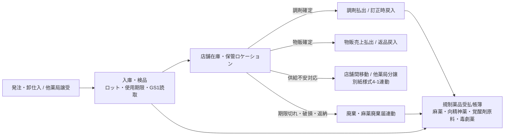

# 調達・在庫管理 (`inventory`)

## 責務と基本方針

各店舗における医療用医薬品・特定保険医療材料・要指導/一般用医薬品（OTC）・一般商品の**発注、入庫・検品、ロット・使用期限、調剤・物販に伴う払出・戻入、店舗間移動・他薬局への分譲、廃棄、および規制薬品受払帳簿**を管理する。

- **実物の在庫移動と所有権・売買の分離**: 同一法人（テナント）内の店舗間移動と、別法人（他薬局）との医薬品分譲・卸からの仕入を明確に区別する。
- **調剤・物販正本からのイベント連動**: [調剤・鑑査](../04-prescription-dispensing/dispensing.md) や [商品・物販](retail.md) 側で在庫残高数値を直接上書きせず、確定した払出・戻入イベントを受けて本領域が在庫受払履歴と現在庫を更新する。

## 管理する概念

| 概念 | 主な情報 | 設計上のポイント |
| --- | --- | --- |
| 在庫アイテム・ロット (`InventoryLot`) | 店舗ID、対象医薬品/商品（[医薬品情報マスタ](../02-reference/medicine-catalog.md) の調剤単位・包装単位）、ロット番号、使用期限、保管ロケーション（冷所・麻薬金庫・毒薬庫・通常棚）、現在庫数量 | 使用期限切迫・期限切れロットの調剤・販売引当をブロック |
| 発注・入庫 (`PurchaseReceipt`) | 発注ID、仕入先（医薬品卸・メーカー）、納品日、包装単位（GS1-128）・入数、検品担当者、入庫数量、仕入伝票参照 | 妥結率報告の基礎となる取引実績およびロット追跡の起点 |
| 在庫受払トランザクション (`StockMovement`) | 移動ID、発生日時、店舗ID、対象品目・ロット、移動種別（`仕入入庫` / `調剤払出` / `調剤訂正戻入` / `物販売上払出` / `物販取消戻入` / `同一法人店舗間移動` / `他薬局分譲払出` / `他薬局譲受入庫` / `棚卸調整` / `廃棄`）、数量、参照元伝票ID、担当者 | すべての在庫変動を追記型トランザクションとして記録し、物理削除・直接数値上書きを禁止 |
| 他薬局分譲・譲受記録 (`InterPharmacyTransfer`) | 区分（分譲払出 / 譲受入庫）、相手先薬局（[外部関係者マスタ](../02-reference/external-parties.md)）、対象医薬品・規格・数量・ロット、確認薬剤師、対応日時、**別紙様式4-1参照、保存期限（分譲日から2年間）** | [調剤・鑑査](../04-prescription-dispensing/dispensing.md) の供給不安対応記録（`SupplyShortageRecord`）と双方向連携 |
| 規制薬品管理帳簿 (`ControlledSubstanceLedger`) | 規制区分（麻薬 / 向精神薬 / 覚醒剤原料 / 毒薬・劇薬）、受入日・払出日、受入数量・払出数量・残高、患者氏名（麻薬等）、処方箋/調剤録参照、事故届・麻薬廃棄届・調剤済麻薬廃棄届の写し参照、確認薬剤師 | 麻薬及び向精神薬取締法・薬機法に基づく法定帳簿の整合性を担保 |

## モデル上のルール

- **調剤訂正・販売取消時の逆仕訳（戻入）管理**: 調剤確定後の処方変更・やり直しや物販返品時は、元の払出トランザクションを消去せず「戻入（`調剤訂正戻入` / `物販取消戻入`）」を記録した上で新たな払出を記録する。
- **使用期限切れ・経過措置切れの引当防止**: 使用期限を過ぎたロットや薬価経過措置が満了した品目は、調剤・物販の通常引当対象から除外し警告する。
- **麻薬帳簿と調剤録・薬歴の整合**: 麻薬の入庫・調剤払出・患者からの返納・廃棄（麻薬廃棄届／調剤済麻薬廃棄届）は、[調剤・鑑査](../04-prescription-dispensing/dispensing.md) および [薬歴記載](../05-pharmaceutical-care/medication-history.md) と件数・数量が完全一致するよう追跡する。

関連: [商品・物販管理](retail.md)、[医薬品情報マスタ](../02-reference/medicine-catalog.md)、[調剤・鑑査](../04-prescription-dispensing/dispensing.md)。
