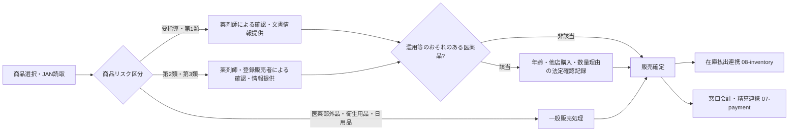

# 商品・物販管理 (`retail`)

## 責務と基本方針

薬局で販売する**要指導医薬品・一般用医薬品（OTC第1〜3類）・指定医薬部外品・衛生材料・医療機器・健康食品・日用品**の販売・返品・取消と、薬機法上義務付けられた**資格者による確認・情報提供記録**を管理する。

- **保険調剤との厳格な分離**: 処方箋に基づく保険調剤（非課税・調剤録・調剤報酬算定）と、OTC・一般商品の物販（課税［標準税率10% / 軽減税率8%］・販売記録）を明確に分離し、窓口での同時精算時は [窓口会計](../07-reimbursement-billing/payment.md) の精算伝票上で別枠として合算する。
- **OTC相談イベントとの連携**: 患者が特定されているOTC販売・健康相談では、[受付・相談・フォローアップのイベント](../05-pharmaceutical-care/care-event.md)（OTC相談イベント）および患者の併用薬プロファイル（[患者](../03-patient-coverage/patient.md)）へ連携し、医療用医薬品との重複・相互作用監査に活用できるようにする。

## 管理する概念

| 概念 | 主な情報 | 設計上のポイント |
| --- | --- | --- |
| 物販商品 (`RetailProduct`) | 商品ID、JANコード、商品名、分類（`要指導医薬品` / `第1類医薬品` / `指定第2類医薬品` / `第2類医薬品` / `第3類医薬品` / `指定医薬部外品` / `管理医療機器・高度管理医療機器` / `衛生用品` / `健康食品・軽減税率対象` / `日用品`）、**濫用等のおそれのある医薬品該当フラグ**、**セルフメディケーション税制対象フラグ**、販売価格、消費税率区分（10% / 8%） | リスク区分により販売可能な資格者と必須確認事項が決定される |
| 医薬品販売確認記録 (`OtcComplianceRecord`) | 販売取引ID、対応資格者（[スタッフ](../01-organization/staff.md)：薬剤師 / 登録販売者）、購入者・使用者区分、年齢・性別・症状・併用薬・副作用歴の確認結果、情報提供実施日時、購入者の理解確認、**濫用等のおそれのある医薬品の確認事項（若年者氏名年齢・他店購入状況・複数個購入時の適正理由）** | 要指導医薬品・第1類医薬品および濫用等のおそれのある医薬品の法定確認・記録要件を担保 |
| 物販取引・明細 (`RetailTransaction`) | 取引ID、店舗ID、取引日時、患者ID（特定時のみ任意紐づけ）、明細（商品・数量・単価・税率）、合計金額、状態（確定 / 返品・取消）、関連OTC相談イベントID | 確定時に [調達・在庫](inventory.md) へ払出を連携し、[窓口会計](../07-reimbursement-billing/payment.md) へ請求明細を渡す |

## モデル上のルール

- **リスク区分別の資格者販売ガード（薬機法第36条の5〜10）**:
  - **要指導医薬品・第1類医薬品**: **薬剤師**による使用者状況確認および書面（または電磁的記録）を用いた情報提供・理解確認が完了していない状態での販売確定を禁止する。
  - **指定第2類・第2類・第3類医薬品**: **薬剤師または登録販売者**の関与・確認のもとで販売する。
- **濫用等のおそれのある医薬品の販売制限ガード**: 指定成分を含む医薬品（エフェドリン、コデイン、ジヒドロコデイン、ブロモバレリル尿素、プソイドエフェドリン、メチルエフェドリン等）の販売時は、①若年者（高校生・中学生等）の場合は氏名・年齢、②他店での購入状況、③原則1人1包装単位（複数購入を希望する場合はその必要理由）、の確認記録がない限り販売確定をブロックする。
- **セルフメディケーション税制対応**: 対象OTC医薬品の販売時は、[窓口会計](../07-reimbursement-billing/payment.md) で発行する領収証・レシートにセルフメディケーション税制対象品目である旨の識別マークを印字できるよう区分を渡す。

関連: [調達・在庫管理](inventory.md)、[医薬品情報マスタ](../02-reference/medicine-catalog.md)、[スタッフ](../01-organization/staff.md)、[受付・相談・フォローアップのイベント](../05-pharmaceutical-care/care-event.md)、[窓口会計](../07-reimbursement-billing/payment.md)。
