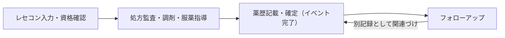

# 薬局全体のドメイン

全体構成の詳細は [ドメイン一覧](domain-candidates.md) を参照。

レイヤー（ディレクトリ）は DDD の境界づけられたコンテキストとデータのライフサイクルに沿って、組織・基盤（`01`）、マスタ・外部参照（`02`）、患者・受給資格（`03`）、処方・調剤（`04`）、服薬指導・薬歴・継続ケア（`05`）、在宅医療・訪問契約（`06`）、算定・会計・請求（`07`）、在庫・物販（`08`）の8分類で構成する。

## 業務領域と責務

| 領域 | 主な責任 | 主な受け渡し |
| --- | --- | --- |
| 法人・組織 | 開設者（法人/個人区分）、法人間関係（親子・関連会社・FC/VC契約） | 店舗の開設主体、同一グループ判定材料 |
| 店舗 | 拠点（緯度経度・設備含む）、屋号、営業日時、許可・保険指定とその履歴 | 業務を行う店舗と時点スナップショット |
| スタッフ | 資格、所属契約、店舗配属、勤務予定・実績、管理薬剤師等の就任 | 実施者と責任者、常勤換算集計 |
| 施設基準・届出 | 施設基準、届出、根拠実績、報酬上のグループ判定（`GroupAssessment`） | 調剤日時点の有効施設基準一覧 |
| テナント・アクセス管理 | 法人単位のテナント分離、1アカウント＝1スタッフ、RBAC認可、データ承継 | 全領域の利用認可・監査証跡 |
| 医薬品情報 | 医薬品の識別、製品情報、薬価・経過措置等の版 | 処方・調剤・在庫・算定の参照情報 |
| 外部関係者 | 医療機関、処方医、介護施設、ケアマネジャー等 | 照会・情報提供・報告の相手 |
| 患者 | 患者の識別、基本属性、臨床プロファイル（頭書き）、同意、家族管理、マージ・分離 | 患者に関する安全監査・指導の判断材料 |
| 保険・公費等 | 医療/介護保険・公費の資格と適用期間、確認結果スナップショット | 費用負担条件、レセプト分割判定 |
| レセコン入力・連携 | 患者・資格・処方等の入力・確認・取込、受入禁止処方箋ガード | 確認済み資格セットと受付イベントの対応 |
| 処方箋 | 原記載、処方内容、媒体固有情報、変更の経緯 | 調剤対象となる処方指示 |
| 処方監査・疑義照会 | 取りそろえ前確認、形式・薬学的監査、疑義照会、変更提案 | 監査合格ゲートと処方変更の根拠 |
| 調剤・鑑査 | 具体的製品選択・変更、調剤手技・規制薬品、最終鑑査、調剤録 | 調剤実績、調剤録元データ、在庫払出連携 |
| 受付・相談イベント | 処方箋受付・各種相談・フォローアップ等の出来事、イベント間関連 | 薬歴記載の紐づけ先、薬歴確定に伴うイベント完了単位 |
| 服薬指導・交付 | 薬剤情報提供文書・お薬手帳による説明、理解確認、薬剤の交付 | 指導・交付の実施事実 |
| 薬歴記載 | SOAP・法定確認事項の記録、保険薬剤師確定（＝イベント完了・不足事項注意喚起）、複数者による確定薬歴への追記・訂正履歴、頭書き連動 | 次回対応への申し送り、請求確定ゲート根拠 |
| フォローアップ | 予定、双方向連絡・状況確認、評価、処方医フィードバック | 元の薬歴と関連づける独立した実施記録、次回計画 |
| 品質・インシデント | ヒヤリハット・事故の起票・調査・是正・効果確認 | 発生店舗の開設法人による管理、再発防止 |
| 在宅 | 在宅療養契約、医師訪問指示、医療/介護切り分け、訪問計画・実績、多職種連携 | 訪問実績・単一建物区分と報告 |
| 算定 | 実施実績と施設基準・資格に基づく無状態（Stateless）な点数計算 | 点数、内訳、算定根拠・摘要コメント（`TK`） |
| 窓口会計 | 自己負担額精算（10円未満四捨五入）、領収証・明細書無償交付、入金・返金・未収 | 窓口精算・未収債権の状態 |
| 保険等の請求 | 月次レセプト集約・薬歴承認ゲート・電算提出、審査結果、返戻再請求、三者突合 | 請求提出スナップショット・返戻再請求の状態 |
| 調達・在庫 | 発注、入荷、ロット・期限、保管、移動、払出、廃棄、管理帳簿 | 利用可能数量と移動履歴 |
| 商品・物販 | OTC、衛生用品、健康食品、日用品等の商品情報・販売と必要な説明・記録 | 販売・取消実績、在庫・会計への連携 |

## 代表的な業務のつながり

一連の業務フローと法令・薬担規則上の必須ゲートは [業務フロー](workflow.md) で定義する。

## ドメイン境界の原則

- 各領域について、開始と終了、実行資格（保険薬剤師専権等）、記録の正本、他領域へ渡す不変スナップショット、追記型訂正履歴を明確に分離する。
- 組織変更、処方変更、資格変更、薬価改定等に備え、「現在の最新状態」と「業務実施時点のスナップショット」を区別して保持する。
