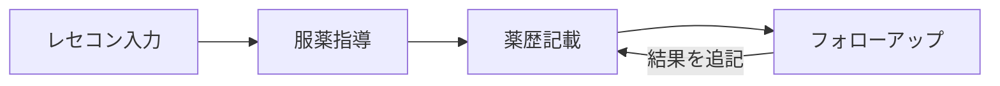

# 薬局全体のドメイン

状態: 相談用のモデル案。出発点は [domain-candidates.md](domain-candidates.md)。対象範囲の仮定は [相談記録](discussion-log.md) を参照。

レイヤーは組織・基盤、マスタ・外部参照、患者・臨床・ケア、算定・会計・請求、在庫・物販の5分類。在庫・物販は独立して整理する。

## 業務領域の候補

| 領域 | 主な責任 | 主な受け渡し |
| --- | --- | --- |
| 法人・組織 | 開設者、企業グループ、資本・契約上の関係 | 店舗の開設者 |
| 店舗 | 拠点、屋号、許可・指定・識別子とその履歴 | 業務を行う店舗と時点 |
| スタッフ | 資格、所属、配属、勤務、役割 | 実施者と責任者 |
| 運営・品質 | 施設基準、届出、実績、インシデント | 届出状況、改善事項 |
| 医薬品情報 | 医薬品の識別、製品情報、価格等の版 | 処方・調剤・在庫・算定の参照情報 |
| 外部関係者 | 医療機関、処方者、介護関係者等 | 照会・報告の相手 |
| 患者 | 患者の識別、基本情報、臨床情報、同意 | 患者に関する判断材料 |
| 保険・公費等 | 資格と適用期間、確認結果 | 費用負担に関する条件 |
| 処方箋 | 原記載、処方内容、受付、変更の経緯 | 調剤対象となる指示 |
| レセコン入力・連携 | 患者・資格・処方等の入力・確認・取込 | 各領域の確認済み情報と受付の対応 |
| 処方監査・疑義照会 | 処方の評価、照会、回答、変更提案 | 判断結果と処方変更の根拠 |
| 調剤・鑑査 | 調製、確認、実施記録 | 実際の薬剤と数量、実施者 |
| 服薬指導・交付 | 説明、理解の確認、薬剤の交付 | 指導・交付の実施結果 |
| 在宅 | 計画、訪問、指示、関係者との連携 | 訪問実績と報告 |
| 薬歴記載 | ケアの記録、評価、計画、確認・確定・訂正 | 次の対応に引き継ぐ情報 |
| フォローアップ | 予定、連絡、状況確認、評価、対応 | 実施結果と薬歴への追記、次回計画 |
| 算定 | 実績と条件に基づく費用計算 | 金額、内訳、算定根拠 |
| 会計・請求 | 支払、未収、請求、返戻・再請求 | 精算・請求の状態 |
| 調達・在庫 | 発注、入荷、保管、移動、払出、廃棄 | 利用可能数量と移動履歴 |
| 商品・物販 | OTC、衛生用品、健康食品、日用品等の商品情報・販売と必要な説明・記録 | 販売・取消実績、在庫・会計への連携 |

服薬指導・交付は原資料から補った候補。在宅と薬歴、会計と請求、施設基準と品質管理を同じ境界にするかは未決定。

## 代表的な業務のつながり

ユーザーが示した業務の順番を整理の軸とする。詳細は [業務フロー](03-clinical/workflow.md) を参照。処方監査・調剤・鑑査や会計等の位置づけ、並行処理、取消・やり直しは別途整理する。在宅やOTCも固有の流れを追加する。

## 領域を決めるときの観点

各領域について、開始と終了、担当者、判断、記録の正本、他領域へ渡す結果、訂正・取消を確認する。同じ患者や薬剤を参照していても、業務ごとの意味と責任を明記する。

組織変更、処方変更、資格変更、薬価等の変更に備え、「現在の情報」と「業務実施時点の情報」をどう保持するかを検討する。共通IDや値型の配置は、その意味と所有者が明らかになってから決める。
