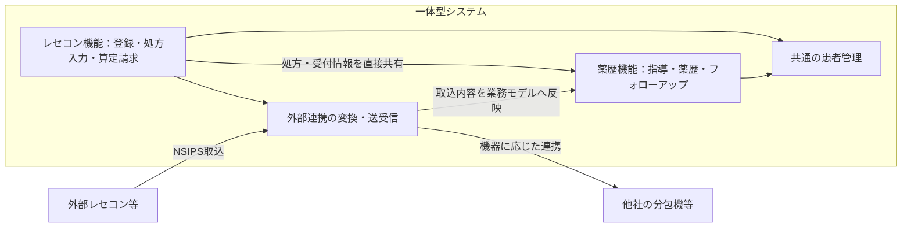

# 一体型内部と外部連携の境界

## 基本方針

- レセコン・電子薬歴の一体型クラウドシステムを前提とする。
- 一体型システム内部では患者・処方・受付等の情報を直接共有し、NSIPSを内部の受け渡し経路にはしない。
- NSIPSは外部レセコン等との連携用、および他社分包機・調剤機器等への連携用アダプタ境界で扱う。

## 業務モデルと外部連携アダプタの責務分担

| 対象 | ドメインモデルの責務 | 外部連携アダプタの責務 |
| --- | --- | --- |
| 患者 | テナント内共通の患者識別、基本情報、臨床プロファイル、マージ・分離 | 外部患者番号との対応づけ、文字コード・形式変換、反映結果の記録 |
| 処方・受付 | 処方内容、受付の識別、患者との関係、変更経緯の保持 | 外部受付番号との対応、受信データの構造化変換 |
| イベント・薬歴 | イベント先行作成、薬歴確定（イベント完了・不足事項注意喚起）、確定薬歴への追記・訂正 | 外部受信データの対象受付イベントへの紐づけ、受信履歴の保存 |
| 分包機等への連携 | 送信対象となる処方・調剤指示の識別と確定版の特定 | 機器仕様（NSIPS・専用フォーマット等）への変換・送信、再送・結果追跡 |

機器固有のコード・ファイル形式・通信プロトコルを患者や薬歴のドメインモデル自体には持ち込まず、腐敗防止層（ACL）で変換する。

## 外部NSIPS取込の仕様

- **受付番号によるイベント特定と自動更新**: NSIPSの受付番号を基に既存の受付イベントを特定し、同一受付の再受信時は処方・調剤取込データを最新値へ自動上書き更新する（更新前の差分承認操作は設けない）。
- **受信履歴と差分確認**: 上書き前のNSIPS受信データも版・受信日時とともに履歴保持し、追加・変更・削除の差分を比較確認できるようにする。
- **薬剤師記載の保護**: SOAP・病歴等の薬剤師による記載内容・確定情報・追記訂正履歴はNSIPS再受信で上書きせずそのまま保持する。
- **完了イベントに対する変更受信時の挙動**: 完了済みイベントに対して処方・調剤内容の変更を受信した場合の扱いは、開設者（法人/個人）設定に従い「未完了へ戻す（初期値）」または「完了を維持して変更を表示」のいずれかで制御する。詳細は [受付・相談・フォローアップのイベント](05-pharmaceutical-care/care-event.md) を参照。

## 分包機・調剤機器への連携仕様

- **送信単位と版管理**: 処方監査を経た処方・調剤指示の版を特定して送信し、処方変更・取消時の再送および重複実行防止を管理する。
- **機器処理と薬剤師鑑査の分離**: 分包機等への送信完了や機器側の処理完了通知と、保険薬剤師による調剤・最終鑑査の完了を明確に区別する。

関連: [ドメイン一覧](domain-candidates.md)、[業務フロー](workflow.md)、[相談・決定記録](discussion-log.md)。
