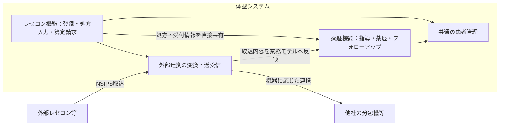

# 一体型内部と外部連携の境界

状態: 対象範囲と連携の位置づけは確認済み。具体的な製品・規格・項目・方式は未決定。

## 確認済みの方針

- レセコン・薬歴の一体型クラウドシステムを想定する。
- 一体型内部では患者・処方等の情報を直接共有し、NSIPSを必須の受け渡し経路にはしない。
- NSIPSは外部システムとの連携用に扱う。
- レセコン機能から他社の分包機などへ連携する。

責務を示す概念図であり、共有DB・API・メッセージ基盤等の実装方式を確定する図ではない。

## 業務モデルと連携の分担案

| 対象 | 業務上の責任 | 連携側の責任 |
| --- | --- | --- |
| 患者 | テナント内共通の患者、番号、基本情報、統合・分離 | 外部番号との対応、形式変換、反映結果 |
| 処方・受付 | 処方内容、受付の識別、患者との関係 | 外部受付番号の対応、受信内容の変換 |
| イベント・薬歴 | イベント先行作成、複数記載、確定・訂正・完了判定 | 外部受信を適切な受付へ関連づける |
| 分包機等への連携 | 送る対象となる処方・調剤指示の識別と版 | 製品仕様に合わせた変換・送信、結果の追跡 |

機器のコード・ファイル形式・通信方式を、患者や薬歴の業務ルールそのものにはしない。すべての機器がNSIPSで接続できるとは仮定せず、製品ごとに仕様を確認する。

## 外部NSIPS取込の確認済み要件

受付番号を基に既存イベントを特定し、同じ受付の再受信では取込内容を最新値へ更新する。過去の受信内容を保持し、差分を確認できるようにする。SOAP等の薬剤師記載は保持する。完了後の変更時の扱いは設定に従う。詳細は [イベント](03-clinical/care-event.md) を参照。

これらは外部連携用の要件として保持する。一体型内部の変更をNSIPSへ書き出して再取込することは要求しない。内部の処方変更が薬歴の完了状態へ与える影響を同じ設定で扱うかは未決定。

## 分包機等の連携で次に確認すること

- 最初の対象機器・製品と、送信する情報。
- 自動送信か、担当者による送信指示か。
- 機器側から受信する情報の有無と、その意味。
- 処方変更・取消時の再送、重複実行の防止、送信失敗時の扱い。
- 機器への送信・処理結果と、薬剤師による調剤・鑑査の完了の区別。

関連: [ドメイン候補一覧](domain-candidates.md)、[業務フロー](03-clinical/workflow.md)、[相談記録](discussion-log.md)。
