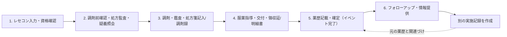

# レセコン入力からフォローアップまで（全体業務フロー）

レセコン・電子薬歴の一体型クラウドシステムにおける一連の業務フローと法定ゲートを定義する。「レセコン機能」「薬歴機能」は同一システム内の業務機能の区分を表し、内部では患者・受付・処方情報を直接共有する（NSIPSは外部連携時に用いる）。

業務の軸は「**1. レセコン入力・資格確認 → 2. 調剤前確認・処方監査・疑義照会 → 3. 調剤・鑑査・処方箋記入/調剤録 → 4. 服薬指導・交付・窓口会計 → 5. 薬歴記載・確定 → 6. フォローアップ・情報提供**」とする。出典: [保険調剤の理解のために（令和８年度）](../reference/保険調剤の理解のために%20（令和８年度）.pdf)。

## 各工程の責務と令和8年度制度上の必須ゲート

| 工程 | 実施内容（令和8年度『保険調剤の理解のために』準拠） | 次工程へ渡す情報・ゲート条件 |
| --- | --- | --- |
| **1. レセコン入力・資格確認** | ・患者特定・新規登録、オンライン資格確認等による受給資格確認（不正受給疑い時は保険者通知義務） ・保険医交付・偽造確認、FAX受領時は原本同一性確認、受入禁止処方箋（二枚処方箋・翌週交付予定・同意なき従業員持参・非保険医）のブロック ・使用期間確認（原則交付日含め4日以内、リフィル2回目以降は前回調剤日＋投薬期間経過日の前後7日以内） ・「患者希望」欄（長期収載品の選定療養）・「リフィル可」欄・「減数調剤指示」欄の入力・取込 | 対象患者（[患者](03-patient-coverage/patient.md)）、資格適用セット（[保険・公費等](03-patient-coverage/coverage.md)）、受付イベント、処方原記載（[受付](04-prescription-dispensing/reception-entry.md)・[処方箋](04-prescription-dispensing/prescription.md)） |
| **2. 調剤前確認・処方監査・疑義照会** | ・**薬を取りそろえる前の確認**（区分10の3、保険薬剤師専権）：①体質（アレルギー/副作用）・生活像・後発品意向、②疾患・既往・他科受診、③併用薬・OTC・健康食品・飲食物、④服薬・残薬状況、⑤体調変化・相談事項 ・形式監査・薬学的監査（薬価基準収載、承認内容、禁忌・過量・重複・電子処方箋重複投薬等チェック） ・**疑義照会ゲート（薬剤師法第24条）**：疑義がある場合は処方医へ照会し確かめた後でなければ調剤不可。変更調剤は医師同意必須（第23条第2項） | 監査合格状態、疑義照会結果・変更後確定指示（[処方監査・疑義照会](04-prescription-dispensing/prescription-review.md)） |
| **3. 調剤・鑑査・処方箋記入/調剤録** | ・保険薬剤師による調剤（無資格者調剤禁止：第19条）と最終鑑査（調製者と鑑査者を分離） ・一般名/後発品・バイオ後続品の選択（先発品選択時は合理的理由を摘要欄へ）、含量規格・類似別剤形変更の4要件確認、分割調剤・リフィル回数管理、手技（一包化・自家製剤・計量混合・無菌）、麻薬（有効期限内免許確認）、供給不安対応記録 ・**処方箋への記入（第26条）**：調剤済年月日（未済時は調剤日・調剤量）、薬局名・所在地、**調剤した保険薬剤師本人の記名押印/署名**（代筆・管理薬剤師代理押印不可）、変更・照会回答内容。分割/リフィル返却時は写しを保管 ・**調剤録作成（薬担規則第5・10条）**：保険調剤と自費等を分離して遅滞なく記録し、確定後は二本線抹消相当の追記型訂正履歴で管理 | 調剤実績、調剤録元データ（[調剤・鑑査](04-prescription-dispensing/dispensing.md)）、在庫払出連携（`08-inventory-retail`） |
| **4. 服薬指導・交付・窓口会計** | ・**薬剤情報提供文書**（RMP資材、後発品・バイオ後続品の有無と価格情報含む、無関係事項の記載禁止）を用いた説明 ・**お薬手帳**への経時的記載（当日持参忘れ時はシール交付・指導料2説明、不使用・複数冊非統合時は理由記録、JAHIS出力時は医薬品提供なしレコード出力禁止） ・対面 / オンライン（配送受領確認含む） / 施設 / 訪問での指導・薬剤交付 ・**窓口会計と領収証・明細書の無償交付**（薬担規則第4条の2：電子請求義務薬局は公費等で負担0円でも明細書無償交付） | 指導実施事実（実施日時・実施者・場所）、交付確認（[服薬指導・交付](05-pharmaceutical-care/medication-counseling.md)）、点数算定・窓口精算（[算定](07-reimbursement-billing/reimbursement.md)・[窓口会計](07-reimbursement-billing/payment.md)） |
| **5. 薬歴記載・確定（イベント完了）** | ・**指導後速やかに記載完了**（画一的な定型文を抑止し薬剤師が要点を判断して記載、特定加算の根拠・情報提供文書写しを記載/添付） ・SOAP・法定確認事項（残薬ゼロ時も「残薬なし」明記必須、併用薬該当なしの確認事実記録）の記録と、新規判明したアレルギー・副作用・検査値等の**患者頭書き（[患者](03-patient-coverage/patient.md)）への追記連動** ・**薬歴記載者が薬歴を確定するときにイベントも完了として扱う**（不足事項がある場合は注意を促す。複数者が記載する場合は確定した薬歴へ追記する） | 保険薬剤師確定済み薬歴（[薬歴記載](05-pharmaceutical-care/medication-history.md)）、レセプト請求確定ゲート解放（[保険請求](07-reimbursement-billing/billing-claim.md)）、次回申し送り・フォロー計画 |
| **6. フォローアップ・情報提供** | ・**調剤後の継続的服薬状況把握**（薬機法第9条の4第5項・薬剤師法第25条の2第2項）：電話や情報通信機器（一斉メールのみ不可、AI活用時は薬剤師確認・双方向介入必須、調剤後薬剤管理指導料は調剤翌日以降・同意必須）で状況確認し、**元の薬歴とは別の独立した実施記録として作成・元薬歴へ関連づけ** ・処方医・ケアマネ等への情報提供（減数調剤時の原則翌営業日までの報告、分割/リフィル2回目以降の報告、服薬情報等提供料） | フォローアップ実施記録、処方医等へのフィードバック文書（[フォローアップ](05-pharmaceutical-care/follow-up.md)） |

## 横断ルールと請求ゲート

- **請求の適正化と三者突合チェック**: 調剤報酬請求に当たっては、**処方箋・調剤録・調剤報酬明細書（レセプト）の三者突合チェック**を行い、無資格者調剤・薬歴未承認・架空請求・付増請求・振替請求をブロックする（薬担規則第2条の2・第10条の2、[保険等の請求](07-reimbursement-billing/billing-claim.md)）。
- **電磁的記録と保存期間**: 処方箋・調剤録・薬剤服用歴等の保存は原則として**完結の日／最終記入日から3年間**（生活保護法指定医療機関等は**5年間**、供給不安対応記録は**2年間**）。薬歴は最終記入日を起算点とするため直近3年分のみの切り捨て廃棄は禁止し、同一患者の全記録を直ちに参照できるよう保持する。電磁的保存では**真正性・見読性・保存性**を確保する。

## 患者を入口とするイベント構造と完了ルール

- **登録済み患者を必須入口とする**: レセコン機能で患者を登録・特定した上で、患者配下に処方箋受付・来局相談・電話相談・OTC相談・フォローアップ・在宅訪問のイベント（[イベント](05-pharmaceutical-care/care-event.md)）を先行作成し、後から薬歴記載を紐づける。患者未登録・匿名のイベントは作成しない。
- **共通患者管理とマージ・分離**: 患者情報はテナント内の全店舗で一元管理し、レセコン・薬歴の双方から基本情報を編集できる。M&A等で重複患者をマージする場合はレセコン機能から親・子を指定し、**最新の基本情報を正解として採用**しつつ臨床プロファイル（頭書き）を合算する。誤統合時は元の所属へ分離・復元できる。
- **薬歴の確定・複数者追記と店舗境界**: 薬歴は下書き中は編集でき、記録元店舗の確定権限を持つ保険薬剤師（記載者本人または別薬剤師）が確定する。複数者が記載することもあるが、確定した薬歴に追記（または訂正）という形にする。確定後は原記載・確定者を保持し、記録元店舗の操作権限を持つ薬剤師が追記・訂正を行い本人が確定する。同一テナント内の他店舗からは閲覧のみとし、フォローアップのみ他店舗へ引き継いで実施店舗の新記録を作成できる。
- **薬歴確定によるイベント完了と不足事項の注意喚起**: 薬歴記載者が薬歴を確定するときに、イベントも完了として扱う。開設者×イベント種別ごとの記載設定（イベント作成時の版を固定維持）に不足事項があった場合には、確定時に注意を促す。
- **外部NSIPS連携時の再受信・再完了**: 外部NSIPS受信時は受付番号でイベントを特定し、処方・受付取込データを自動上書きしつつ旧受信履歴と差分を保持する（薬剤師のSOAP記載は保持）。完了後のNSIPS変更受信時は開設者設定に従い「未完了へ戻す（初期値）」または「完了を維持」とし、未完了へ戻した場合は記録元店舗の操作権限を持つ薬剤師が差分確認（または確定薬歴への追記確定）を行うことで再完了できる。
